# Jetson PTZ Inspection

[](https://github.com/moonnnei/jetson-ptz-inspection/actions/workflows/ci.yml)
[](LICENSE)
[](https://github.com/moonnnei/jetson-ptz-inspection/releases/tag/v0.5.0-demo)

[中文](README.md) · [Documentation index](docs/README.md) · [Deployment](docs/DEPLOYMENT.md) · [Demo](docs/DEMO.md) · [Contributing](CONTRIBUTING.md)

An experimental visual inspection pipeline for a Jetson TX2 and a Hikvision DS-2DC2402IW-DE3 S6 PTZ camera. It combines RTSP acquisition, YOLO26n detection with NCNN, bounded scanning, position-based deduplication, visit planning, image-based centering, optical zoom and paired image capture.

The intended instrument workflow is to stop the platform, discover meters, plan a visit order, center and magnify each meter, then invoke a reading model and store the result. The TX2 handles acquisition, inference, scheduling and camera control. A computer provides browser access to the service.

Stationary people currently stand in for instruments in the **public implementation**. **Actual instrument detection, meter readings, full-scene coverage and real multi-target acceptance are pending.** The controller records `reading=null`; it does not generate demonstration readings. The bundled general object detector is not a meter detector or a meter-reading model.

## Start here

| Task | Guide |
| --- | --- |
| Understand the architecture | [Project plan](docs/项目方案.md), [source guide](src/README.md) |
| Check the project without hardware | Offline checks below |
| Deploy on a TX2 with a camera | [Deployment](docs/DEPLOYMENT.md), [inspection operation](docs/INSPECTION_DEMO.md) |
| Inspect the model contract | [Model guide](models/README.md) |
| Review demonstrated and pending work | Physical results below, [roadmap](docs/ROADMAP.md) |

Most detailed guides are currently in Chinese; filenames and source entry points are linked from each directory's README.

## Pipeline

```mermaid
flowchart LR
    A[Camera RTSP] --> B[Hardware decode / latest frame]
    B --> C[YOLO26n / NCNN CPU]
    C --> D[Bounded scan / deduplication]
    D --> E[Visit planning]
    E --> F[Absolute positioning]
    F --> G[Local P visual centering]
    G --> H[Optical zoom / recenter]
    H --> I[Paired image / result capture]
    I --> J[Next target / STOP]
```



The scan currently samples only −8°, 0° and +8° around the initial pan angle. A finite-state controller combines absolute positioning with a separately calibrated local visual mapping at each zoom level. The visual correction is proportional control, not PID. RTSP carries video, while ISAPI carries camera commands. Video, inference and browser display have separate latency budgets.

## What has been tested

One physical run on 2026-10-15 completed first-time calibration at 1.0× and 1.5×, a three-position scan, six sightings merged into one target, coarse positioning, centering, zooming and capture. It took **47.724 seconds**, excluding service/model loading. Final center errors were approximately −0.517% of image width and +0.279% of image height. The saved preview was 960×540. This is one successful experiment, not a reliability or accuracy benchmark. [Full report](docs/INSPECTION_DEMO_VALIDATION_2026-10-15.md).

Previous failures and the separate person-following experiment's noticeable lag remain documented. A position-based association is not identity recognition. A bounding box inside the image does not establish absence of occlusion.

## Runtime

| Component | Tested configuration |
| --- | --- |
| Board | Jetson TX2, Ubuntu16.04.7, L4T R28.3.1 |
| Service | Python3.5 standard library |
| Image crop helper | Existing Python2.7/OpenCV3.3.1 installation |
| Inference | NCNN CPU, FP32, 320×320, two threads in the current profile |
| Video | H.264 RTSP hardware decoding, 1280×720, 20fps output cap |
| Camera control | Hikvision ISAPI absolute positions and STOP |

Hardware video decoding and model GPU inference are different stages: this model does **not** use TensorRT, CUDA or Vulkan for inference. The bundled converted model can be used without installing modern PyTorch or Ultralytics on the TX2. Re-exporting is an optional, separate PC task.

## Offline checks

On a normal computer with Git and Python 3.11 or 3.12, without extra pip dependencies:

```bash
git clone https://github.com/moonnnei/jetson-ptz-inspection.git
cd jetson-ptz-inspection
python scripts/test_local.py
python scripts/check_release.py --verify-manifest
```

For an existing checkout, start with the two Python commands. These checks use the standard library, validate the included model hashes, and run fake-IO regressions. They do not connect to cameras or move hardware. [GitHub Actions](https://github.com/moonnnei/jetson-ptz-inspection/actions/workflows/ci.yml) runs them on Linux and Windows; the badge links to the actual workflow results. Windows may skip a symlink test when unprivileged symlink creation is unavailable. These checks do not establish ARM64 build compatibility or physical control performance.

## Run on TX2

Check the legacy compiler, OpenCV development libraries and GStreamer plugins first. Do not replace the system Python or install the PC export environment into it. Follow [deployment](docs/DEPLOYMENT.md) and [inspection instructions](docs/INSPECTION_DEMO.md).

```bash
python3 scripts/fetch_ncnn.py
bash scripts/build_tx2.sh
python3 scripts/test_local.py
cp config/inspection.example.json config/inspection.local.json
# Edit camera address, user, RTSP port, rotation, CPU affinity and local paths.
bash scripts/run_inspection_demo.sh --config config/inspection.local.json
```

The example's RTSP port 1554 and 180° rotation match the tested installation; check them for your setup. Enter the camera password interactively. Open `http://<TX2-IP>:8772/`. Startup observes and requests zero-speed STOP; starting inspection from the page causes physical movements. Use one controller per camera and keep the base and targets stationary. The currently supported camera limits are explicitly checked; similar model names do not establish compatibility. The package contains converted weights and source, not a full system image or prebuilt ARM64 executables.

## Capture outputs

For each captured target, the service saves a paired full preview and crop, together with the target number, timestamp, pose, zoom, detection score and center errors. JSON and CSV exports are available from the page. The current full preview is 960×540, not a separate high-resolution capture. Target IDs are local to one run, not persistent person identities or meter asset IDs. See the [interface contract](docs/INSPECTION_DEMO_INTERFACES.md) for fields and terminal states.

Zooming is followed by centering; active focus search is not implemented. Real instrument work still requires meter detection, image-quality acceptance, a reading model and unit/range metadata.

## Layout and documentation

- `src/inspection_demo/`: finite-state inspection controller, real adapter, evidence helper, page and tests.
- `src/person_tracker/`: shared acquisition/detector infrastructure and the separate following experiment.
- `models/yolo26n/`: converted model, source information, export contract and checksums.
- `tools/model_export/`: reproducible PC export and validation tools.
- `docs/`: architecture, interfaces, operations, validation and [roadmap](docs/ROADMAP.md).
- `.github/`: offline CI and issue/PR templates.

Directory guides: [source README](src/README.md), [models README](models/README.md), [documentation README](docs/README.md).

Use [contribution instructions](CONTRIBUTING.md) to refresh the explicit file manifest after a change. See [security guidance](SECURITY.md) before handling credentials or operating hardware. Public demo footage is optional and is not currently bundled; [recording guidance](docs/DEMO.md) explains the scope.

## License and attribution

Project-authored code and documentation are provided under [AGPL-3.0](LICENSE). Third-party components retain their own licenses. The converted YOLO model derives from Ultralytics weights and is not relicensed as MIT or BSD. Sources, versions and license copies are listed in [THIRD_PARTY_NOTICES.md](THIRD_PARTY_NOTICES.md).

No vendor SDK, firmware, private camera configuration, credentials, field photographs or raw device logs are included in the public release. Read [publishing instructions](docs/PUBLISHING.md) before making a fork or initial release public.
