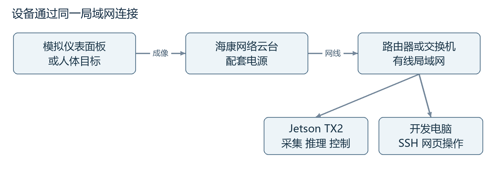
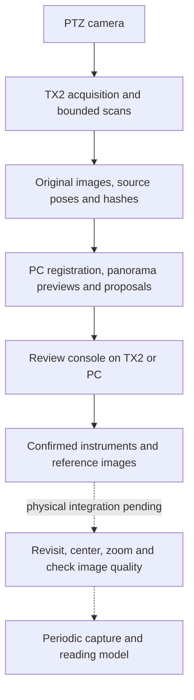

# Jetson PTZ Inspection

[](https://github.com/moonnnei/jetson-ptz-inspection/actions/workflows/ci.yml)
[](LICENSE)
[](https://github.com/moonnnei/jetson-ptz-inspection/releases/tag/v0.5.0-demo)

[中文](README.md) · [Documentation](docs/README.md) · [Hands-on tutorial (Chinese)](docs/TX2_YOLO_PTZ_TUTORIAL.md) · [Architecture](docs/ARCHITECTURE.md) · [Review console](docs/REVIEW_CONSOLE.md) · [Deployment](docs/DEPLOYMENT.md) · [Roadmap](docs/ROADMAP.md)

An experimental inspection system for a Jetson TX2 and a Hikvision DS-2DC2402IW-DE3 S6 PTZ camera. It combines RTSP acquisition, bounded camera motion, object detection, panorama previews, human review and persistent instrument records.

The intended workflow scans a stationary scene, asks an operator to confirm meters, teaches a capture pose for each meter, and periodically revisits those poses to center, magnify and capture each instrument before invoking a reading model.

**Main contains the scene-review development workflow. The v0.5.0-demo release uses stationary people as instrument proxies. Physical real-meter revisits, periodic capture and meter readings remain pending.** Records keep `reading=null`.

## Runnable paths

| Path | Current purpose | Requirements |
| --- | --- | --- |
| Scene review and instrument registry | Import originals and proposals; confirm/reject, draw/edit boxes, merge observations and save stable IDs | Python 3.5+ standard library on PC or TX2; no hardware control by default |
| Stationary-target inspection demo | Person-proxy scanning, deduplication, visit planning, positioning, visual centering, zoom and evidence capture | Tested TX2/camera environment and local configuration; physical motion |

Optional [PC scene tools](tools/scene_mapping/README.md) perform registration, panorama construction, proposal detection and reference rechecks. These tools are not all deployed on the TX2 and do not constitute an automatic startup pipeline.

## Start without hardware

Python 3.11 or 3.12 is recommended for PC checks. The standard-library tests and review service do not require OpenCV, PyTorch or a camera SDK.

```bash
git clone https://github.com/moonnnei/jetson-ptz-inspection.git
cd jetson-ptz-inspection
python scripts/test_local.py
python scripts/check_release.py --verify-manifest
python src/inspection_console/server.py --port 8775
```

Open `http://127.0.0.1:8775/`. A clean checkout has no field imagery. Prepare your own PNG/JPEG images and manifest as described in the [console guide](docs/REVIEW_CONSOLE.md), then import them:

```bash
python scripts/import_review.py var/private-import/manifest.json
```

The private SQLite database and images live under ignored `var/`. Human review and stable instrument IDs survive refreshes and service restarts. Physical periodic execution stays disabled.

## Data flow





The dashed steps remain development goals. A source image pose is not a validated centered capture pose. Panorama geometry is approximate and is not a camera/PTZ calibration. See the [architecture](docs/ARCHITECTURE.md).

## Evidence and limits

| Capability | Evidence and limit |
| --- | --- |
| RTSP, hardware decoding, latest-frame detection preview | Runs on TX2; inference uses NCNN CPU |
| Stationary person-proxy inspection | One successful complete run with initial calibration in 47.724 s; no repeated success-rate estimate |
| Bounded scans and original-resolution images | Three-view acquisition and one 19-view ring scan; originals are 2560×1440 |
| Panorama preview | 4096×600 angle-assisted projection; automatic spherical stitching failed and seams remain |
| Panorama-to-source proposals | Overlapping/cyclic tiles, estimated geometry and appearance checks for human review |
| Instrument registry | Human review, stable IDs and historical confirmation of two real meters |
| Reference rechecks | Four historical cross-view matches; incompatible current appearances rejected; no physical revisit validation |
| Real-meter positioning, image-quality acceptance, periodic hardware execution and reading | Pending integration or acceptance |

The latest panorama experiment produced three background false positives, all unconfirmed. Initial discovery used 24 PC forwards; correcting a source association added only three source rechecks. This does not establish real-meter recall or equal-accuracy performance gains. See the [panorama review record](docs/PANORAMA_REVIEW_2026-10-21.md).

## Run the motion demo on TX2

Follow the [deployment guide](docs/DEPLOYMENT.md) first. The tested system is Jetson TX2, Ubuntu 16.04.7 / L4T R28.3.1 and Python 3.5.

```bash
python3 scripts/fetch_ncnn.py
bash scripts/build_tx2.sh
cp config/inspection.example.json config/inspection.local.json
# Adjust device addresses, user, RTSP port, orientation and paths.
bash scripts/run_inspection_demo.sh --config config/inspection.local.json
```

Enter the camera password interactively and open `http://<TX2-IP>:8772/`. Starting inspection from the page causes movement. Startup observes and requests STOP; use one motion controller per camera. Camera limits and setup-specific defaults are explained in the [operation guide](docs/INSPECTION_DEMO.md).

The bundled general detector is converted YOLO26n, FP32, 320×320, using NCNN CPU. It does not run inference through TensorRT, CUDA or Vulkan. Hardware video decoding is separate from GPU inference. The older demo saves 960×540 previews; the newer scan workflow saves original-resolution images.

Do not replace the system Python. Keep modern PC export/mapping dependencies separate from the legacy TX2 installation. Similar camera names do not establish compatibility.

## Repository layout

- `src/inspection_console/`: review server, persistent registry, scan plans, references and tests.
- `src/inspection_demo/`: person-proxy inspection state machine, hardware adapter and page.
- `src/person_tracker/`: shared capture, C++ detector, ISAPI and separate following experiments.
- `tools/scene_mapping/`: optional PC registration, projections, proposals and reference matching.
- `tools/model_export/`: PC export and validation.
- `models/yolo26n/`: converted general detector, origin, contract and hashes.
- `scripts/`, `config/`, `docs/`: operations, credential-free examples and documentation.

See the [source guide](src/README.md), [model guide](models/README.md), [validation records](docs/README.md), [checks](CHECKS.md) and [roadmap](docs/ROADMAP.md). GitHub Actions runs standard-library checks, model hashes, source audits and model-free OpenCV scene tests on Linux/Windows; it does not control hardware or replace ARM64/physical acceptance. Scene tests can also run locally.

## License and contributions

Project-authored source and documents use [AGPL-3.0](LICENSE). Third-party components retain their respective licenses; see [THIRD_PARTY_NOTICES.md](THIRD_PARTY_NOTICES.md). The bundled converted model derives from Ultralytics weights.

Training datasets, locally trained meter checkpoints, field images/video, device databases/logs and credentials are excluded. Supply only trusted local meter weights with appropriate source rights. Contribution and file-list updates are documented in [CONTRIBUTING.md](CONTRIBUTING.md); see [security](SECURITY.md) and [publishing](docs/PUBLISHING.md) before operating hardware or uploading artifacts.
