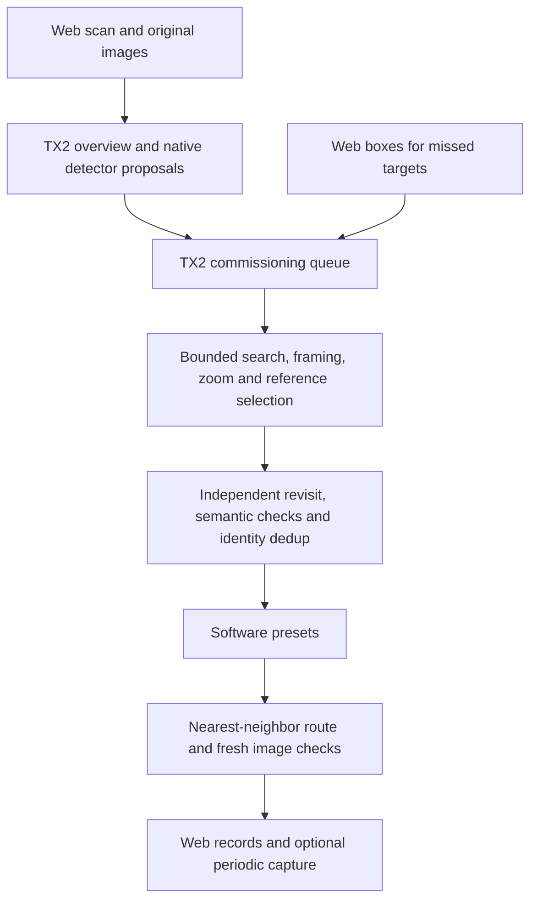

# Jetson PTZ Inspection

[](https://github.com/moonnnei/jetson-ptz-inspection/actions/workflows/ci.yml)
[](LICENSE)
[](https://github.com/moonnnei/jetson-ptz-inspection/releases/tag/v0.5.0-demo)

[中文](README.md) · [Documentation](docs/README.md) · [Deployment tutorial](docs/TX2_YOLO_PTZ_TUTORIAL.md) · [Automatic registration](docs/AUTOMATIC_REGISTRATION.md) · [Preset patrol](docs/SOFTWARE_PRESET_PATROL.md)

**Frozen snapshot: [`freeze-2026-10-24`](https://github.com/moonnnei/jetson-ptz-inspection/releases/tag/freeze-2026-10-24).** See the [baseline and reproduction guide](docs/FROZEN_BASELINE_2026-10-24.md). This snapshot covers fixed-site meter-image collection and its dashboard. Numerical reading and super-resolution remain outside the running pipeline; the four-meter results below describe earlier physical experiments, not a new publication-time trial or the current scene inventory.

[Bounded periodic batches](docs/BOUNDED_PERIODIC.md) add server-owned round limits, persistent progress and per-round capture/quality metrics. Reaching the limit stops the timer without an external control script.

An experimental fixed-site meter-image inspection system using Jetson TX2 and a Hikvision DS-2DC2402IW-DE3 S6 PTZ camera. It combines RTSP preview, original-resolution snapshots, ISAPI motion control, detection, persistent instrument records and a web console.

The [collection dashboard](docs/RESULT_GALLERY.md) separates daily image viewing from scene setup. Meter cards stay in registry order and update individually, with a native crop viewer, zoom/pan, timestamped downloads and comparison of up to four completed rounds. Missing historical captures remain empty; browsing does not move the camera.

The web console now runs scanning, native detection, overview construction and a finite commissioning queue locally on TX2. It takes fresh images at annotation-derived locations, searches a finite neighborhood, adjusts framing and zoom, selects a reference, and validates a software preset through an independent revisit. Operators add missed boxes. Numeric reading remains outside this stage; records keep `reading=null`.

## Development status — 2026-10-24

| Capability | Evidence and limits |
| --- | --- |
| Annotation-driven commissioning | Four fixed physical meters commissioned, each with departure and two fresh revisit checks; a blurred old template no longer gates the first new photograph |
| TX2 scene initialization | 19 fresh views, 227 native detector calls, 34 observations and 27 hypotheses; 12 attempted, 15 deferred, 6 uncertain |
| Automatic semantic checks and deduplication | A real cross-zoom duplicate was reconciled from commissioned references; four enabled meters retained, with evidence and uncertainty preserved |
| Earlier preset baseline | Five rounds: 20/20 meter visits and 40 fresh-image checks passed; retained as a separate experiment |
| Periodic adapter and bounded batches | Five server-owned rounds: 20/20 captures and 40 fresh identity/quality checks; six blurred frames rejected and recovered with bounded retries; automatic stop with no sixth round during a further 65 seconds |
| Super-resolution comparison | No additional correct detections on the small paired ROI set, with higher PC processing cost; not integrated |
| Console tests | 234 checks passed on TX2; PC standard-library suite 471 (470 passed, one platform skip), including bounded batches, STOP and restart pause; native C++ rebuild checked against saved images and nonempty ROI outputs |

This is one fixed four-meter scene. Three meters remain off-center at the mechanical tilt limit, and one has foreground occlusion. Identity checks do not establish numerical readability. Novel-scene discovery accuracy, cross-day reliability and long-running scheduled physical capture are not validated. Failed commissioning attempts and dated experiments remain available.

## Data flow



Panorama projection is approximate and has not established full scene coverage. Startup does not begin a scan or arm a schedule. Moving the installation or the meters requires rebuilding the scene. See the [initialization guide](docs/SCENE_INITIALIZATION.md) and [dated validation](docs/INITIALIZATION_VALIDATION_2026-10-24.md).

## Start on a PC

Python 3.11 or 3.12 is recommended. Offline control tests and the default review server require only the standard library.

```bash
git clone https://github.com/moonnnei/jetson-ptz-inspection.git
cd jetson-ptz-inspection
python scripts/test_local.py
python scripts/check_release.py --verify-manifest
python src/inspection_console/server.py --port 8775
```

Open `http://127.0.0.1:8775/`. The default adapter does not connect to hardware. A clean checkout contains no field imagery. Import your own originals and manifest according to the [console guide](docs/REVIEW_CONSOLE.md). Runtime images, SQLite data and logs live in ignored `var/`.

## TX2 deployment

The tested environment uses Ubuntu 16.04.7 / L4T R28.3.1, Python 3.5 control and Python 2.7 / OpenCV 3.3.1 image subprocesses. Keep the system Python unchanged. Modern export dependencies run separately on the PC.

The current meter detector is a locally trained single-class YOLO11n, fixed 640 input, NCNN CPU FP32. Hardware RTSP decoding is independent of model inference. This implementation does not use TensorRT, CUDA or Vulkan for inference. Preview uses the latest RTSP frame; patrol records use new 2560×1440 snapshot requests after settling.

Supply your own trusted meter checkpoint and converted model. See [preset patrol and deployment](docs/SOFTWARE_PRESET_PATROL.md), [C++ meter runtime](src/meter_runtime/) and [PC export](tools/model_export/export_meter.py). The standalone CMake entry was rebuilt on ARM64 TX2 and checked against the existing binary using saved images and nonempty ROIs. The new binary did not replace the live detector; no new model export was performed this round.

The historical `v0.5.0-demo` uses stationary people as instrument proxies with the bundled YOLO26n 320 NCNN model. Its [operation guide](docs/INSPECTION_DEMO.md) remains separate. Continuous person following is another experiment and still has visible lag.

## Source and evidence

- `src/inspection_console/`: registry, annotation queue, commissioning, deduplication, preset patrol and scheduler.
- `src/meter_runtime/`: native single-class meter detector and CMake entry.
- `src/inspection_demo/`, `src/person_tracker/`: historical demo and shared capture/ISAPI code.
- `tools/scene_mapping/`, `tools/model_export/`: scene tools and modern PC model tooling.
- `models/yolo26n/`: bundled general detector, origin, contract and hashes.

Read [automatic registration](docs/AUTOMATIC_REGISTRATION.md), [preset patrol](docs/SOFTWARE_PRESET_PATROL.md), [SR assessment](docs/SUPER_RESOLUTION_ASSESSMENT.md), [architecture](docs/ARCHITECTURE.md), [checks](CHECKS.md) and [roadmap](docs/ROADMAP.md). Dated reports preserve earlier failures. Offline CI does not control hardware or replace physical acceptance; web logic tests do not establish browser-rendering acceptance.

## License and data

Project-authored code and documents use [AGPL-3.0](LICENSE). Third-party components retain their licenses; see [THIRD_PARTY_NOTICES.md](THIRD_PARTY_NOTICES.md). Training data, local meter checkpoints, field images/video, device databases, logs and credentials are excluded. SR weights were used only in a private PC experiment and are not bundled. See [contributing](CONTRIBUTING.md) and [publishing](docs/PUBLISHING.md).
