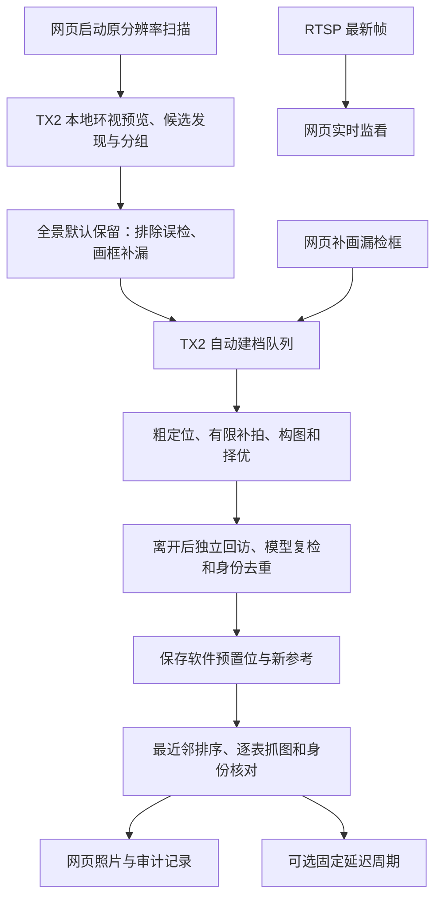

# Jetson PTZ Inspection

[](https://github.com/moonnnei/jetson-ptz-inspection/actions/workflows/ci.yml)
[](LICENSE)
[](https://github.com/moonnnei/jetson-ptz-inspection/releases/tag/v0.5.0-demo)

[English](README.en.md) · [文档](docs/README.md) · [部署实战](docs/TX2_YOLO_PTZ_TUTORIAL.md) · [场景初始化](docs/SCENE_INITIALIZATION.md) · [自动建档](docs/AUTOMATIC_REGISTRATION.md) · [软件预置位巡检](docs/SOFTWARE_PRESET_PATROL.md) · [路线图](docs/ROADMAP.md)

**冻结版本：[`freeze-2026-10-24`](https://github.com/moonnnei/jetson-ptz-inspection/releases/tag/freeze-2026-10-24)**。本版交付固定机位的仪表图像巡检与采集看板，读数和超分尚未接入。功能范围、复现入口、已有实验和恢复边界见[冻结说明](docs/FROZEN_BASELINE_2026-10-24.md)。

新增[有限轮次与执行统计](docs/BOUNDED_PERIODIC.md)：可设置运行 N 轮后由 TX2 自动停止，网页显示批次进度、单轮耗时、新拍图及质量拒绝数量。

新增[巡检工作台修订](docs/WORKBENCH_2026-10-24.md)：限定范围扫描、持续实时监看、最新手动指令优先、扫描进度与停止返回；全景接入 OpenSeadragon 与 Annotorious，候选后台归组，默认保留，只需排除误检和画框补漏。

新增[仪表采集看板](docs/RESULT_GALLERY.md)：固定位置的仪表图墙，当前轮次逐卡更新，旧图注明来源后补位；点击放大、缩放拖动、按轮浏览与四轮对比，支持带名称/时间的原像素裁剪图下载与仪表自命名。建图与云台控制在单独入口，超分不在当前流程中。

[场景档案](docs/SCENE_ARCHIVE.md)保留新建前的全景、仪表与采集记录，支持独立查看各场景历史，并记住刷新前选中的场景。

面向固定机位、分散仪表的 Jetson TX2 云台图像巡检工程。海康相机提供 RTSP 视频、高清抓图和 ISAPI 运动控制；TX2 运行模型、环视初始化、建档队列、逐表采集和网页服务，PC 用于训练、模型导出与独立实验。

当前目标是**自动建立采集位置并周期留图**。扫描后先显示全景和归组后的疑似仪表，默认保留；人工只需排除误检和补画漏检框。随后系统根据来源位置拍新图，在有限邻域内寻找、构图、放大、择优，离开后重新回访验证，保存软件预置位。不要求逐表选图或手工输入云台角度。数值读数不在本阶段，`reading` 保持 `null`。

## 冻结能力与此前实机结果

下表的四表数据来自此前固定现场实验，不是发布时重新采集的结果，也不代表当前所选场景始终有四块表。新看板与历史档案包含本日后续修订；发布冻结的离线检查另见[检查记录](CHECKS.md)。

| 项目 | 实际完成情况 |
| --- | --- |
| 标注驱动首次建档 | 固定四块真实表盘均建立新参考，完成离开后独立回访；旧模糊扫描模板不再阻挡拍摄第一张新图 |
| TX2 本地初始化 | 网页驱动 19 视点高清扫描、227 次检测；34 条观测归为 27 个假设组，有限安排 12 组，15 组延后 |
| 自动候选复检和去重 | 新场景输出的跨倍率重复经真实新参考复核后自动归并，启用清单为四表；6 个不确定项保留 |
| 历史预置位基线 | 首轮、连续三轮、去重后复验共五轮，20/20 次逐表采集、40 次新图身份检查通过，独立保留 |
| 周期调度与有限批次 | TX2 原生五轮上限：20/20 次采集、40 次新图身份与质量检查通过；6 张模糊图补拍恢复；到上限自动停止，65 秒无第六轮 |
| 超分对照 | 同 ROI 原图、双三次和 Real-ESRGAN 对照未增加正确检出，成本增加，未接入主流程 |
| 工程检查 | TX2 控制台 234 项通过；PC 标准库 471 项（470 通过、1 平台跳过），含有限批次、STOP 和重启暂停；C++ 运行时 ARM64 重编译与非空 ROI 输出核对通过 |

这些结果来自同一固定四表场景。三块表受俯仰下限影响仍偏离中心，其中一块有前景遮挡；身份检查通过不代表数值可读或精确居中。新环境发现率、跨天可靠性及长期实机周期运行尚未验收。初始化、去重修订和有限周期结果见[本轮复验](docs/INITIALIZATION_VALIDATION_2026-10-24.md)，此前成功与失败记录保留。

## 流程



环视图是带未标定假设的角度辅助预览，不能代替精确 PTZ 标定。新入口把扫描、检测和建档接到 TX2 网页；启动服务本身不自动扫描、不启用周期。安装或仪表位置改变后需重建场景；固定机位允许云台正常转动和变焦。操作与有限候选批次边界见[场景初始化](docs/SCENE_INITIALIZATION.md)。

## 普通电脑先运行

建议 Python 3.11 或 3.12；离线状态机检查和审核服务仅需要标准库：

```bash
git clone https://github.com/moonnnei/jetson-ptz-inspection.git
cd jetson-ptz-inspection
python scripts/test_local.py
python scripts/check_release.py --verify-manifest
python src/inspection_console/server.py --port 8775
```

访问 `http://127.0.0.1:8775/`。默认 `NoHardware`，不会连接相机。新仓库没有现场照片，按[审核控制台](docs/REVIEW_CONSOLE.md)准备自己的来源图和导入清单：

```bash
python scripts/import_review.py var/private-import/manifest.json
```

数据库、来源图、任务图像和日志保存在忽略的 `var/`。补框和图像来源使用修订号及哈希绑定，已开始的动作不能通过重放旧计划再次执行。

## TX2 部署

实测设备为 Jetson TX2、Ubuntu 16.04.7 / L4T R28.3.1、Python 3.5 与海康 DS-2DC2402IW-DE3 S6。控制端使用 Python 3.5 标准库，图像子进程使用板端 Python 2.7 / OpenCV 3.3.1。不要替换系统 Python。

本轮仪表模型为自行训练的单类 YOLO11n，固定 640 输入、NCNN CPU FP32。RTSP 硬件解码与模型推理是两个环节，本工程没有将模型配置为 TensorRT、CUDA 或 Vulkan 推理。实时监看取 RTSP 最新帧；正式巡检在停稳后调用高清抓图接口，保存新的 2560×1440 图像。

仪表权重由使用者提供，C++ 推理源码、PC 导出工具和当前控制适配器见[软件预置位部署说明](docs/SOFTWARE_PRESET_PATROL.md)。显式启用硬件后，网页单轮入口或已启用的周期会转动相机；同一相机通过共享运动锁串行使用。

历史 `v0.5.0-demo` 保留人体替代仪表的运动演示，使用仓库随附 YOLO26n 320 NCNN 模型，其入口见[旧 Demo 手册](docs/INSPECTION_DEMO.md)。它与当前真实仪表建档流程分别记录，独立人员跟随仍有明显滞后。

## 工程目录

| 目录 | 内容 |
| --- | --- |
| `src/inspection_console/` | 场景档案、自动建档、去重、软件预置位巡检、调度器及测试 |
| `src/meter_runtime/` | 单类 YOLO11n NCNN C++ 推理程序与独立 CMake 入口 |
| `src/inspection_demo/` | 历史人体替代仪表的巡检演示 |
| `src/person_tracker/` | 共享 RTSP、ISAPI、通用检测与独立跟随实验 |
| `tools/scene_mapping/` | 配准、环视投影、候选发现和来源/新图匹配；板端兼容图像子进程 |
| `tools/model_export/` | 可信本地权重加载、PC 导出与一致性检查 |
| `models/yolo26n/` | 历史通用转换模型、来源、契约和哈希 |
| `scripts/`, `config/`, `docs/` | 构建/检查/导入、无密码示例、操作与实验记录 |

## 文档与实验

- [标注驱动建档：控制、自动复检、去重和实机结果](docs/AUTOMATIC_REGISTRATION.md)
- [TX2 网页初始化、单命令启动与基本图像质量检查](docs/SCENE_INITIALIZATION.md)
- [软件预置位：逐表采集、周期与迁移回退](docs/SOFTWARE_PRESET_PATROL.md)
- [超分实验：原图/普通放大/超分的成对比较](docs/SUPER_RESOLUTION_ASSESSMENT.md)
- [架构与数据约定](docs/ARCHITECTURE.md)、[大图补框](docs/OVERVIEW_REVIEW.md)、[实时监看](docs/LIVE_PREVIEW.md)
- [19 视点扫描及拼接失败记录](docs/RING_SCAN_2026-10-21.md)、[较早首次采图失败](docs/FIRST_CAPTURE.md)、[较早局部回访修订](docs/FIXED_POSE_REVISIT.md)
- [检查记录](CHECKS.md)、[变更记录](CHANGELOG.md)、[开发路线与限制](docs/ROADMAP.md)

GitHub Actions 的离线检查不连接相机，不替代 ARM64 编译或现场验收。网页逻辑检查也不等同于浏览器渲染验收。新的仪表 CMake 入口已在 TX2 上完成独立构建，原运行二进制保留；仪表导出工具已验证本地检查点前向，本轮未重新导出模型。

贡献及公开清单维护见[贡献说明](CONTRIBUTING.md)，上传流程见[发布步骤](docs/PUBLISHING.md)。

## 许可证与数据

原创代码和文档使用 [AGPL-3.0](LICENSE)；第三方来源及各自许可见 [THIRD_PARTY_NOTICES.md](THIRD_PARTY_NOTICES.md)。不声明拥有 YOLO、NCNN 或 OpenCV 的原创权。

仪表训练集、本地 `best.pt`、现场照片/视频、数据库、日志和真实凭据不随公开仓库提供。超分权重仅用于独立 PC 实验，未打包进主流程。模型来源与接口见[模型说明](models/README.md)。
