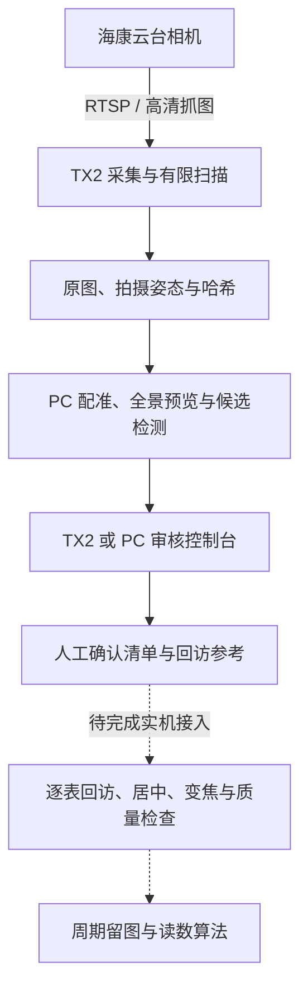

# Jetson PTZ Inspection

[](https://github.com/moonnnei/jetson-ptz-inspection/actions/workflows/ci.yml)
[](LICENSE)
[](https://github.com/moonnnei/jetson-ptz-inspection/releases/tag/v0.5.0-demo)

[English](README.en.md) · [文档](docs/README.md) · [部署实战文章](docs/TX2_YOLO_PTZ_TUTORIAL.md) · [系统架构](docs/ARCHITECTURE.md) · [审核控制台](docs/REVIEW_CONSOLE.md) · [部署](docs/DEPLOYMENT.md) · [路线图](docs/ROADMAP.md)

面向分散仪表的 Jetson TX2 云台视觉巡检实验工程。相机提供 RTSP 视频和 ISAPI 云台控制，系统组合目标检测、扫描采集、全景总览、人工复审、仪表建档及视觉居中等模块。

最终流程是：平台停稳后扫描场景，在网页确认需要采集的仪表，为每块表建立采集位置，再按周期依次回访、居中放大、保存图像，并对接读数算法。安装位置固定时复用采集位置；安装或场景发生变化时重新定位或建图。

**当前 main 是场景审核开发版；v0.5.0-demo 保留人体替代仪表的运动演示。真实仪表的自动回访、周期采集和读数尚未完成。** 工程不生成示例假读数，`reading` 保持 `null`。

## 两条可运行的路径

| 路径 | 当前用途 | 运行条件 |
| --- | --- | --- |
| 场景审核与仪表建档 | 导入高清原图、全景和检测候选，人工确认/排除/补框/合并，保存仪表编号和回访参考 | Python 3.5+ 标准库；PC 或 TX2；默认不控制相机 |
| 固定目标巡检 Demo | 人体作为固定目标，验证扫描、去重、规划、粗定位、P 视觉居中、变焦和留图 | TX2、匹配相机及本地配置；会产生真实运动 |

可选的 [PC 场景工具](tools/scene_mapping/README.md)负责图像配准、环视预览、候选发现和参考图复核。它们尚未全部迁移到 TX2，也不是开机自动执行流程。

## 快速开始：普通电脑

建议 Python 3.11 或 3.12。离线回归与审核服务不需要安装 PyTorch、OpenCV 或相机 SDK。

```bash
git clone https://github.com/moonnnei/jetson-ptz-inspection.git
cd jetson-ptz-inspection
python scripts/test_local.py
python scripts/check_release.py --verify-manifest
python src/inspection_console/server.py --port 8775
```

浏览器访问 `http://127.0.0.1:8775/`。首次运行没有现场数据，页面会提示导入。按[审核控制台说明](docs/REVIEW_CONSOLE.md)准备自己的 PNG/JPEG 和 JSON 清单：

```bash
python scripts/import_review.py var/private-import/manifest.json
```

数据库、原图和日志保存在被 Git 忽略的 `var/` 中。审核页面可确认、排除、恢复、补框、修正框及合并重复观测；仪表编号与操作记录在刷新和服务重启后保留。默认不启用物理周期巡检。

## 系统分工




图中的后续实机流程是开发目标。已有运动控制代码和人体演示结果可作为基础，不能直接当作真实仪表闭环的验收依据。详细数据流与坐标约定见[系统架构](docs/ARCHITECTURE.md)。

## 当前能力与验证边界

| 能力 | 已有依据与限制 |
| --- | --- |
| RTSP 采集、硬解、最新帧及同帧检测预览 | 已在 TX2 运行；模型后端为 NCNN CPU |
| 人体替代仪表的固定目标巡检 | 一轮首次标定与完整采集成功，47.724 秒；未统计重复成功率 |
| 有限扫描与原分辨率留图 | 已完成三视点和一次 19 视点环视实拍，来源图为 2560×1440 |
| 环视预览 | 4096×600 角度辅助投影；自动球面拼接失败，仍有接缝，未验证完整无缝覆盖 |
| 全景候选与高清来源关联 | 重叠分块、跨接缝框、近似几何和外观核对；供人工复审，不是 PTZ 几何标定 |
| 人工审核与稳定仪表编号 | 已实现并持久化；历史两块真实仪表已经确认 |
| 回访参考检查 | 保存图上两表共 4 次定位通过；当前外观不符时拒绝匹配；不等于实机回访 |
| 真实仪表逐表回访、清晰度验收、物理周期执行和读数 | 待接入或待实机验证 |

最近的全景实验得到 3 条背景误检，没有自动加入正式仪表清单。首次 24 次 PC 前向之后，来源关联修正仅追加 3 次来源复检；错误结果及修正过程见[全景复审记录](docs/PANORAMA_REVIEW_2026-10-21.md)。人工复审能排除误检，漏检仍需补框或改进模型与成像。

## 在 TX2 上运行运动 Demo

先按[部署手册](docs/DEPLOYMENT.md)准备依赖。已验证设备为 Jetson TX2、Ubuntu 16.04.7 / L4T R28.3.1、Python 3.5 与海康 DS-2DC2402IW-DE3 S6。

```bash
python3 scripts/fetch_ncnn.py
bash scripts/build_tx2.sh
cp config/inspection.example.json config/inspection.local.json
# 按设备修改相机地址、用户名、RTSP端口、图像方向与路径
bash scripts/run_inspection_demo.sh --config config/inspection.local.json
```

相机密码在终端交互输入，浏览器访问 `http://TX2的IP:8772/`。页面主动开始巡检后会转动相机，启动默认观察并请求 STOP；具体动作范围见[操作手册](docs/INSPECTION_DEMO.md)。同一相机只运行一个运动控制服务。

Demo 使用随仓库提供的 YOLO26n 转换模型、FP32、320×320、NCNN CPU 推理，没有使用 TensorRT/CUDA/Vulkan 执行该模型。视频硬解与模型 GPU 推理属于不同环节。当前 Demo 留存 960×540 预览，和新扫描模块的高清原图分别记录。

公开配置中的端口、旋转方向和 CPU 绑定来自实验设备，其他设备需核对。不要替换系统 Python；电脑侧导出或建图环境与旧 TX2 环境分开安装。

## 工程目录

```text
src/inspection_console/ 场景审核、仪表档案、扫描规划、回访参考与测试
src/inspection_demo/    人体替代仪表的巡检控制、实机适配及网页
src/person_tracker/     共享采集/检测/ISAPI，以及独立人员跟随实验
src/image_infer/        C++ 通用物体单图推理
tools/scene_mapping/    PC 配准、环视投影、候选发现与来源复核
tools/model_export/    PC 模型导出及一致性检查
models/yolo26n/         通用转换模型、来源、契约及哈希
scripts/               构建、导入、运行、测试及发布检查
config/                无密码配置示例
docs/                  架构、操作、接口、实验和开发路线
third_party/licenses/  第三方许可证
legacy/                历史 CSI / YOLOv3-tiny 脚本
```

## 实验与贡献

- [固定目标运动实机复验](docs/INSPECTION_DEMO_VALIDATION_2026-10-15.md)
- [三视点仪表建图](docs/SCENE_MAPPING_VALIDATION_2026-10-20.md)
- [19 视点环视采集与拼接失败记录](docs/RING_SCAN_2026-10-21.md)
- [全景候选、误关联修正与网页复审](docs/PANORAMA_REVIEW_2026-10-21.md)
- [回访参考及失败拒绝](docs/REVISIT_REFERENCE.md)
- [检查记录](CHECKS.md)、[变更记录](CHANGELOG.md)、[待完成与验收标准](docs/ROADMAP.md)

GitHub Actions 在 Linux/Windows 运行标准库回归、模型哈希、公开清单审计和无需模型下载的 OpenCV 场景检查，不访问相机，也不替代 ARM64 编译和机械验收。本地场景检查按[工具说明](tools/scene_mapping/README.md)运行。

贡献方式与公开文件登记见 [CONTRIBUTING.md](CONTRIBUTING.md)，设备和凭据处理见 [SECURITY.md](SECURITY.md)，更新上传见[发布说明](docs/PUBLISHING.md)。

## 许可证与模型

原创代码和文档采用 [AGPL-3.0](LICENSE)，第三方组件保留各自许可与来源，见 [THIRD_PARTY_NOTICES.md](THIRD_PARTY_NOTICES.md)。通用转换模型派生自 Ultralytics 权重；本工程不宣称原模型架构的原创权。

表盘训练集、训练得到的 `best.pt`、现场图片/视频、数据库、设备日志和真实凭据不包含在公开仓库中。接入自己的仪表模型时，请使用可信本地权重并遵守其来源许可；模型接口见[模型说明](models/README.md)。
