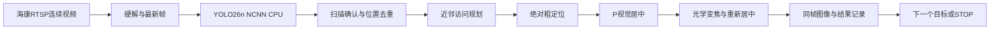

# Jetson PTZ Inspection

[](https://github.com/moonnnei/jetson-ptz-inspection/actions/workflows/ci.yml)
[](LICENSE)
[](https://github.com/moonnnei/jetson-ptz-inspection/releases/tag/v0.5.0-demo)

[English](README.en.md) · [文档导航](docs/README.md) · [演示说明](docs/DEMO.md) · [部署](docs/DEPLOYMENT.md) · [接口](docs/INSPECTION_DEMO_INTERFACES.md) · [贡献](CONTRIBUTING.md)

基于Jetson TX2、YOLO26n NCNN与海康DS-2DC2402IW-DE3 S6的视觉巡检实验工程，将持续视频、目标发现、云台定位、视觉居中、光学变焦和图像记录串成可复现的链路。

最终目标是：平台暂停后自动发现面板上的仪表，规划访问顺序，依次将每个仪表移到画面中央、放大成像，再调用读数算法并保存结果。TX2负责图像处理、推理、任务调度和云台控制；电脑通过网页操作和查看结果。

**当前公开主线使用位置固定的人体代替仪表。真实仪表检测与读数、完整场景覆盖和真实多目标验收尚未完成。** 不生成假仪表读数，采集记录中的`reading`保持`null`。随仓库提供的是通用物体检测模型，不能直接当作仪表识别或读数模型。

## 从这里开始

| 想了解什么 | 入口 |
| --- | --- |
| 项目整体方案与技术分工 | [项目方案](docs/项目方案.md)、[源码导航](src/README.md) |
| 没有TX2，先查看工程能否通过离线检查 | 下方“普通电脑先运行检查” |
| 有TX2和相机，准备实机运行 | [部署手册](docs/DEPLOYMENT.md)、[巡检操作](docs/INSPECTION_DEMO.md) |
| 查看模型来源、输入输出和替换注意事项 | [模型目录说明](models/README.md) |
| 核对演示效果与尚未完成的功能 | 下方“实机证据”、[路线图](docs/ROADMAP.md) |


相机通过RTSP提供视频，通过ISAPI接收云台命令；TX2运行检测和巡检服务。浏览器显示的是服务生成的检测预览，采集视频、模型检测和浏览器显示各自有独立耗时。

## 能做什么

| 功能 | 当前状态 |
| --- | --- |
| RTSP持续采集、硬解、最新帧与同帧检测预览 | 已实现并在TX2运行 |
| 三点扫描、重复观测确认、角位置去重、近邻访问规划 | 已实现；当前仅起始方向水平−8°、0°、+8° |
| 绝对位置粗定位、局部P视觉微调、变焦后再居中 | 已实现；本型号有界配置 |
| 保存图像、裁图、时间、位置、分数及JSON/CSV | 已实现，保存960×540检测预览 |
| 新修订的固定单目标实机演示 | 2026-10-15一轮成功1/1，含首次标定47.724秒 |
| 人员移动跟随 | 保留独立实验入口，仍有明显滞后 |
| 真实仪表、高分辨率、主动调焦、读数和业务上传 | 待接入或待验证 |

本项目的工程工作集中于旧设备部署、采集与推理衔接、模型输出到相机动作的控制和可核对的实验记录；没有训练新检测模型，也未将现有部署宣称为新的识别算法。

## 工作流程



巡检控制采用有限状态机、按倍率局部标定和离散P视觉伺服，未实现PID。人物位置关联不识别人员身份；框未跨画面边界不等于目标无遮挡。新倍率分别标定，场景或安装变化后应重新标定。

## 实机证据

2026-10-15新修订在一次真实实验中，完成1.0倍和1.5倍首次标定、三点扫描、六次发现去重为一个目标、粗定位、居中、放大和留图。成功1/1，整轮47.724秒，不含服务与模型加载；最终框中心偏差约−0.517%画面宽、+0.279%画面高。

这是一轮成功复验，不是重复成功率、COCO精度或端到端视频延迟测试。此前弱标定0/1、重复位置候选0/3和旧人员跟随明显滞后均保留记录。旧缓存标定成功的20.399秒与新首次标定47.724秒条件不同，不能作提速对照。

- [10月15日新修订复验](docs/INSPECTION_DEMO_VALIDATION_2026-10-15.md)
- [10月14日成功与失败记录](docs/INSPECTION_DEMO_VALIDATION_2026-10-14.md)
- [当前检查与历史修复](CHECKS.md)、[版本变更](CHANGELOG.md)

公开包不附现场人物照片和原始日志；[演示说明](docs/DEMO.md)给出复现顺序及可选视频录制方式。

## 已验证环境

| 项目 | 配置 |
| --- | --- |
| 板卡／系统 | Jetson TX2，Ubuntu16.04.7，L4T R28.3.1 |
| 主服务 | Python3.5标准库 |
| 图像裁剪辅助 | 原设备Python2.7、OpenCV3.3.1、NumPy |
| 编译工具 | GCC5.4、CMake3.5.1、OpenCV开发库、OpenMP/pthread |
| 模型 | YOLO26n转换模型，FP32，320×320，当前示例两线程 |
| 推理 | NCNN CPU；没有使用TensorRT、CUDA或Vulkan执行该模型 |
| 视频 | H.264 RTSP硬解、1280×720、20fps输出上限；不代表检测帧率 |
| 相机 | DS-2DC2402IW-DE3 S6，ISAPI绝对位置与STOP |

视频硬件解码与模型GPU推理是不同环节。已附转换模型，板端推理不需要安装现代PyTorch或Ultralytics；重新导出是电脑侧可选流程。尚未测试的JetPack、板卡及近似相机型号不直接视为兼容。

## 普通电脑先运行检查

电脑建议使用Git和Python3.11或3.12，不需要额外pip依赖。在终端中运行：

```bash
git clone https://github.com/moonnnei/jetson-ptz-inspection.git
cd jetson-ptz-inspection
python scripts/test_local.py
python scripts/check_release.py --verify-manifest
```

已克隆的工程可从两条Python命令开始。检查包含Python3.5语法、模型哈希、原跟随与巡检逻辑测试、发布守卫测试和公开文件审计，不连接相机。Windows无符号链接权限时可能跳过相应测试。[GitHub Actions](https://github.com/moonnnei/jetson-ptz-inspection/actions/workflows/ci.yml)提供Linux和Windows离线工作流，顶部徽章链接至实际运行记录；工作流不负责ARM64编译或机械验收。

## 在TX2运行巡检Demo

先按[部署手册](docs/DEPLOYMENT.md)核对系统、编译依赖、GStreamer插件及相机接口。不要直接替换系统Python，或把电脑导出环境装进旧系统。

```bash
python3 scripts/fetch_ncnn.py
bash scripts/build_tx2.sh
python3 scripts/test_local.py
cp config/inspection.example.json config/inspection.local.json
# 编辑本地配置中的相机地址、账号、RTSP端口、旋转方向、CPU编号和路径
bash scripts/run_inspection_demo.sh --config config/inspection.local.json
```

已有相同固定版本的NCNN构建时，可用`bash scripts/build_tx2.sh --ncnn-root ~/tx2-yolo26-ncnn`复用。本包不包含完整系统镜像或ARM64可执行文件；新环境的依赖准备不能由上述命令自动代替。

终端交互输入相机密码，浏览器打开`http://TX2的IP:8772/`。启动只观察并请求零速度STOP；页面开始巡检后会真实转动相机。相机和目标保持位置固定，同一相机只运行一个控制服务，操作完确认停止。

示例的RTSP端口1554、180°旋转、CPU0/3检测与CPU4/5采集均来自原实验设备。其他设备须先核对，不能直接照搬；本型号范围或单位不匹配时适配器拒绝运行。[详细巡检操作与控制原理](docs/INSPECTION_DEMO.md)。

历史人物跟随入口使用`config/tracker.follow.example.json`及`scripts/run_tracker.sh`，默认示例端口8771；其脉冲标定和控制参数与巡检入口分开，见[跟随复验](docs/FOLLOW_2026-10-14.md)。不同时运行两套运动控制服务。

## 工程目录

```text
src/inspection_demo/    巡检状态机、实机适配器、留图、网页与测试
src/person_tracker/     共享采集与检测器、独立人物跟随实验
src/image_infer/        通用物体单图推理
models/yolo26n/         固定转换模型、来源、契约及哈希
tools/model_export/    电脑侧导出和一致性核对
scripts/               构建、运行、离线测试与发布检查
config/                无密码配置示例
docs/                  方案、部署、接口与验证报告
third_party/licenses/  第三方许可
.github/               CI、Issue和PR模板
legacy/                历史CSI与YOLOv3-tiny脚本，非主线
```

`build/`、`var/`、本地配置、缓存及私有实验资料在运行时生成，不属于公开源码。

目录内也有独立的[源码README](src/README.md)、[模型README](models/README.md)和[文档README](docs/README.md)，可从对应目录继续阅读。

## 一轮巡检会留下什么

成功采集目标后，服务保存配对的整帧图像与目标裁图，并记录目标编号、时间、云台位置、倍率、检测分数和中心误差。网页提供JSON和CSV导出；具体字段、终态和错误含义见[巡检接口](docs/INSPECTION_DEMO_INTERFACES.md)。目标编号仅在当前一轮有效，不代表跨轮次的人员身份或仪表资产编号。

当前保存的是960×540检测预览，尚未接入独立高分辨率仪表成像。放大后会再次居中，但未实现主动调焦搜索；读数接口保留为空。完整的仪表应用还需要仪表检测、清晰度验收、读数模型及单位和量程等业务信息。

## 文档与后续工作

- [项目方案](docs/项目方案.md)、[算法与接口契约](docs/INTERFACES.md)
- [模型说明](models/yolo26n/MODEL_CARD.md)、[性能历史](docs/OPTIMIZATION_2026-10-13.md)
- [开发路线](docs/ROADMAP.md)、[贡献说明](CONTRIBUTING.md)、[安全与隐私](SECURITY.md)
- [GitHub发布步骤](docs/PUBLISHING.md)、[首版发布说明](docs/RELEASE_NOTES_v0.5.0-demo.md)

近期优先重复单目标实验、统计失败原因与耗时，再验证两个固定目标依次采集；之后接入实际仪表模型、高分辨率成像和读数接口。当前未验收完整场景覆盖、主动调焦、移动平台通用标定及断网后的物理停止。

## 许可证与来源

项目原创代码和文档采用[AGPL-3.0](LICENSE)，贡献者署名可通过各自提交记录维护。第三方内容保留其原许可，见[来源与声明](THIRD_PARTY_NOTICES.md)。转换模型派生自Ultralytics官方权重，不重新声明为MIT或BSD。

公开工程不分发厂家SDK、固件、真实凭据、设备私有配置或现场人物图像。发布者仍需确认自己对原创代码及学校、合作项目资料的公开权利。项目不代表NVIDIA、海康或Ultralytics官方产品或背书。
