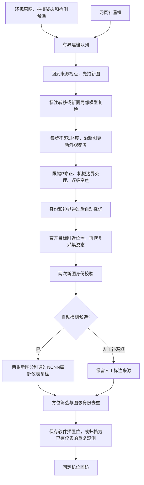

# 标注驱动的自动建档

本版本从带拍摄姿态的高清来源图出发，为仪表自动建立软件预置位。旧扫描图的相关性分数不再作为拍摄第一张新图的前置条件。当前固定四表已经完成新参考建立和独立回访，另有一个自动检测候选完成模型复检后被归入已有仪表。

## 数据与流程

环视大图用于导航，处理使用对应的 2560×1440 来源图。现有环视图是角度辅助投影，包含未标定假设；不是精确的 PTZ 标定图，也不保证无缝覆盖。

来源位置、估计目标方向和最终采集位置分别保存。相机安装位置固定时，云台仍会转动、变焦。安装或目标位置改变后，需要重新建立场景。

## 控制与成像

初始方向根据来源框中心、来源姿态和估计焦距计算，再通过新图修正。使用限幅的离散 P 修正，没有积分项和微分项，不称为 PID。

当前配置：

| 参数 | 值或含义 |
| --- | --- |
| 大范围移动分段 | 单轴每次不超过 20° |
| 建档中的外观跟踪步长 | 单轴不超过 4°，每步完成后拍摄并核对 |
| 局部 P 增益 | 0.7；每次修正不超过 4°，最多三次 |
| 初始邻域 | 估计位置及有限的水平、俯仰邻点，最多五个 |
| 变焦 | 1～2 倍，单次增加不超过 0.3 倍 |
| 边界余量 | 检测框距离画面边界至少 2% |
| 单个建档尝试 | 最长 180 秒、最多 40 次抓图 |
| 独立回访 | 离开至少 2° 后恢复保存位置，核对两张新图 |

这些值是当前相机与场景的实验配置。估计焦距没有被声明为通用内参。机械俯仰到下限时保留可达位置和中心残差；倍率由边缘余量限制。框在图内不等于盘面没有遮挡。

自动择优先要求目标身份与画面边界通过，再综合目标像素面积、拉普拉斯清晰度、过曝/欠曝比例和中心偏差排序。它是候选之间的相对排序，尚不是经过标定的读数质量判定。

## 补漏与自动候选的来源

网页补漏框先进入持久队列。若正在巡检，当前来源绑定保持不变，补框在安全的空闲阶段才转为新目标。保存补框后不再要求逐表点击确认、挑图或输入云台角度。

| 状态 | 证据含义 |
| --- | --- |
| `human_labeled` | 来源是操作者补漏框，仍需自动建立回访位置 |
| `automatic_proposal` | 模型提出的候选，语义与采集位置尚未验收 |
| `auto_verified` | 自动候选完成新图模型复检与独立回访 |
| `auto_uncertain` | 本次未通过，保留原因与证据，不作为已确认目标 |
| `auto_duplicate` | 通过方位与图像证据归入已有仪表，原编号及图像保留 |

原有人工确认记录保持原来源。自动成功不会被写成“人工已确认”。给清单增加新表时，仅对来源图和标注未变化的旧预置位重绑清单索引，不伪造一次新的实机回访。

自动候选的局部复检复用 YOLO11n 单类 NCNN 模型，输入 640，置信度阈值 0.25，NMS IoU 0.45。两张独立回访新图分别复检。图像方向在抓图归一化时处理，ROI 推理不再次旋转。

## 自动去重

同一来源图中，与已有已验证目标显著重叠的补框可直接复用已有编号。不同视点的目标先按估计方位筛选，再比较新参考图中的局部外观；匹配区域与新目标框的 IoU 至少为 0.5，且不能出现多个竞争身份。

方位接近、连续帧稳定或模型分数高，单独都不能证明同一身份。当前采用模型复检、图像身份和位置约束的组合。外观相同且相邻的仪表仍需独立场景测试；出现歧义时保留不确定结果。

## 2026-10-23 实机结果

固定四表自动建立新参考，均完成离开后回访和两张新图核对：

| 仪表 | 最终水平 / 俯仰 / 倍率 | 建档用时约 | 新图数 | 构图结果 |
| --- | --- | ---: | ---: | --- |
| M0006，A 0～30 | 254.3° / 0° / 1.9× | 118 秒 | 18 | 中心检查通过 |
| M0007，V 0～450 | 208.8° / 0° / 2× | 139 秒 | 18 | 机械下限，保留偏心 |
| M0008，V 0～500 | 190.3° / 0° / 2× | 117 秒 | 19 | 机械下限，保留偏心；存在前景遮挡 |
| M0009，A 0～50 | 176.1° / 0° / 2× | 125 秒 | 20 | 机械下限，保留偏心 |

此前两个尝试分别因大角度端点外观失配、150 秒建档预算耗尽而停止。改为每 4° 更新参考、逐级变焦和附近离开验证后完成。原失败记录保留，没有降低旧匹配阈值来改写结果。

另选已有仪表的一个待处理次视点候选验证完整自动分支：采集 10 张新图、约 96 秒，独立回访的两次 NCNN 复检均通过；系统将其归档为 M0006 的重复观测，正式清单仍为四表。该案例验证流程和去重，不代表陌生场景发现率。

## 运行入口与限制

- 服务端：`server.py --software-patrol --auto-annotations`，明确配置相机、工程、控制台及单类模型运行目录。
- 单表 CLI：`scripts/capture_annotated_meter.py`，先生成新计划，再执行一次；使用过的计划不能重放。
- `POST /api/candidates/add`：启用自动建档时保存为补漏队列；审核模式仍保留旧接口行为。
- `POST /api/annotations/from-overview`：根据大图框自动选择高清来源并排队，不弹出逐来源确认框。
- `POST /api/annotations/discover`：将本场景待处理模型候选加入有限队列。
- `POST /api/annotations/resume`：恢复被操作者暂停的队列。
- 全局停止同时暂停巡检和建档队列；重启时不重放已开始的尝试。

默认没有硬件，只有显式连接的固定现场服务执行这些动作。原型当前每批最多 40 个候选、正式巡检最多 12 个目标。尚未完成新环境的大样本漏检/误检统计、跨天可靠性和读数验收。

见[软件预置位巡检](SOFTWARE_PRESET_PATROL.md)与[超分对照](SUPER_RESOLUTION_ASSESSMENT.md)。
