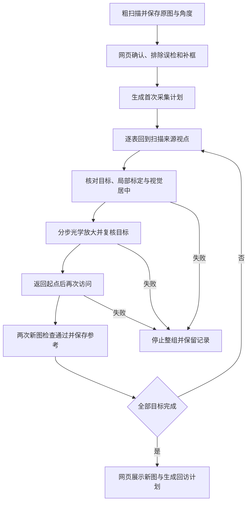

# 人工确认后的首次逐表采集

本阶段的交付目标是仪表图像采集，不包含数值读取。首次进入一个场景时，即使人工已经确认表盘框，也没有可直接回访的近景照片和拍摄位置。本模块负责从扫描原图出发，逐表建立这些资料，再交给已有的有限回访程序。



## 与原回访程序的区别

原单轮回访从已有的近景照片和位置开始。首次采集只要求人工确认的扫描来源，不读取旧任务中的近景照片：程序到达来源视点、核对外观、完成局部标定，用离散 P 控制逐步居中，再尝试光学放大。

网页和 CLI 默认采用自适应模式。无法调整安装位置时，允许保留机械边界附近的偏心，但不越过计划范围。程序根据表盘框相对画面中心的位置估计最大可用倍率，再用新图检查；不强制达到 2 倍。放大后出现边缘风险或外观不确定，只允许一次返回上次已确认的位置，并用新图重新核对。通信、取消、停止故障不能触发这种回退。

居中成像与偏心成像分开记录。包围框位于图像内部且留有边距，只证明图像几何检查通过，不能保证原本被遮挡或未入画的部分已经完整。即使一倍视野也无法容纳目标时停止并留存诊断，不把它保存成可用的采集参考。`--mode strict` 保留严格居中、2 倍建档的独立策略。

初次寻找与变焦过程沿用跨视点匹配；建立位置后，离开再返回的两张新图使用 `saved_pose_roi_v1` 局部匹配。全过程成功后保存照片和采集位置。新资料可直接用于有限回访，不需要人工录入角度或修改数据库。

当前保存为“采集参考已建立，成像质量待复核”，同时记录实际倍率、中心偏差与受限状态，不自动升级正式机位验收或启用周期任务。外观与画面边界检查仍不能替代完整盘面、遮挡、反光和清晰度的人工检查。

## 使用前提

- 相机底座固定，仪表在执行期间保持静止；移动底座后重新扫描，不沿用旧场景的角度。
- 清单只包含人工确认、启用并绑定高清来源框的目标。
- 当前 S6 配置使用 2560×1440、一倍扫描、`rotate180_from_raw` 方向；其他配置会被列为阻塞项。
- 每批最多 12 块表。每块最多 360 秒，整组预算按目标数累计，计划明确列出范围和最长时间。
- 每个成功目标返回共同起点；任何目标失败、取消、版本改变或停止未确认，结束整组。

三块旧测试仪表曾位于俯仰机械下限附近，无法严格居中。用户明确要求保持安装位置，后续采用自适应成像。旧场景重复回访成功不能替代新首次建档试验；也不能把自适应偏心留图计作严格居中通过。

## 网页操作

“仪表清单”页增加“首次逐表采集”：

1. 确认或补全仪表清单，点击“生成首次采集计划”。
2. 检查目标顺序、水平／俯仰范围和最长时间。接入执行端时，起点来自相机的只读查询。
3. 现场准备好后勾选确认，再点击“开始逐表采集”。页面显示当前目标和已完成数量，可以请求停止。
4. 完成后到记录页查看新照片。已有参考的目标可在“检查回访路线”中生成有限回访路线；缺少参考的目标继续显示为阻塞。

默认启动仍不接入硬件，只能预览计划。可选执行端通过服务启动参数显式配置，密码只从标准输入交给服务并保留在内存，不发给浏览器、不放入命令参数。页面上的计划预览不会触发云台运动，不能根据网页自动刷新重复执行任务。

## TX2 命令行

先只读生成计划；密码交互输入：

```bash
python3 scripts/first_capture_meters.py \
  --console-root /path/to/console --camera http://CAMERA_IP \
  --user YOUR_CAMERA_USER --map YOUR_MAP_ID \
  --plan-out var/first-capture-plan.json
```

核对计划与现场后，使用新输出目录执行：

```bash
python3 scripts/first_capture_meters.py \
  --console-root /path/to/console --camera http://CAMERA_IP \
  --user YOUR_CAMERA_USER --map YOUR_MAP_ID \
  --execute --plan var/first-capture-plan.json \
  --acknowledge-plan SAVED_FINGERPRINT --output var/first-capture-new
```

命令同时保存原始批次和单表记录，并将实际结果一次性导入审核数据库，输出新的回访计划。导入保留候选、仪表和旧任务；失败表不会成为可用参考，未执行的目标会明确标记。清单版本冲突时拒绝导入，原始图像和记录仍在输出目录，不覆盖当前审核结果。

可选网页执行配置为 `server.py` 的 `--first-capture-camera`、`--first-capture-user`、`--first-capture-console-root`、`--first-capture-project-root` 与 `--first-capture-password-stdin`。四项路径／设备配置及输入协议须同时满足；最后一项从 stdin 读取一个 `{"password":"…"}` 对象。部署程序应通过管道交付该对象并关闭管道，不把它写入临时文件、命令行或环境变量。该配置只开启有限首次采集，周期适配器仍关闭。

## 记录与验证边界

`batch.json` 绑定清单版本、扫描引用、具体子计划和每个单表记录的哈希。成功导入要求离开后两次新图、时序递增、外观通过、符合所选成像策略的姿态和边界、正常返回与停止确认；导入重新检查图像哈希与尺寸。未完成的表留存失败原因和诊断图，不把诊断图当作已接受的参考。

PC 与 TX2 Python 3.5.2 控制台各 165 项检查通过。其中首次建档 14 项覆盖无旧近景的新场景、参考交接、错误来源、双轴分段移动、取消、审核变化、停止失败、伪造完成、时序和坐标错误、默认网页禁止硬件、单次执行绑定，以及已知机位的图像入口；自适应 6 项覆盖受限偏心、可变倍率回访、变焦失配回退、通信错误传播、画面边缘拒绝与计划绑定。新增网页检查 6 组通过；原实时预览 8 组、大图审核 6 组保持通过。

这些检查使用模拟 IO 验证编排和证据约束，不能证明陌生场景的检测、视觉控制或成像已通过实机验收。此前固定场景三轮回访数据继续单独保留。

## 首次自适应实机试采：未完成（2026-10-23）

已部署可选有限执行端，现场确认后只启动一次四表计划。整组在 **11.705 秒**后因首表来源核对未通过而结束，保存一张新的 2560×1440 诊断图并确认停止。首表没有建立可用参考，另外三表未执行；没有进入标定、居中或变焦，所以本次结果不能用于评价自适应控制效果。

首表的历史扫描参考明显失焦，当前诊断图更清楚。板端 Python 2.7 / OpenCV 3.3.1 用保存的同一对图像离线回放，复现全图配准通过、局部外观分数 0.7086 低于 0.72 而拒绝；内区分数为 0.6047。直接切换局部回访匹配也被拒绝，因为互相匹配的特征点只有 8 个，低于原来的 20 个要求。没有降低阈值或用电脑结果覆盖失败记录。

电脑 OpenCV 4.12 对同一对图像给出 0.7406 并通过，因此需将运行时版本和图像本身一起纳入复现实验。失焦是观察到的差异，不能只凭这一对样本证明它是唯一原因。离线平移、局部上下文和仿射配准试探也未形成板端通过且经过反例检验的替代方案，未接入执行端。

下一步应先保证扫描参考的清晰度和一致性，例如停稳后有限采样并保留清楚的一帧，再经过来源审核进入首次建档。清晰度指标目前只有记录作用，没有已验证的通用阈值；不能以全图锐度高来保证远处的盘面清楚。此项需要独立实现与验证，不能将当前系统描述成已在陌生场景完成全自动首次采集。安装高度保持原样，后续仍采用自适应偏心与倍率策略。
