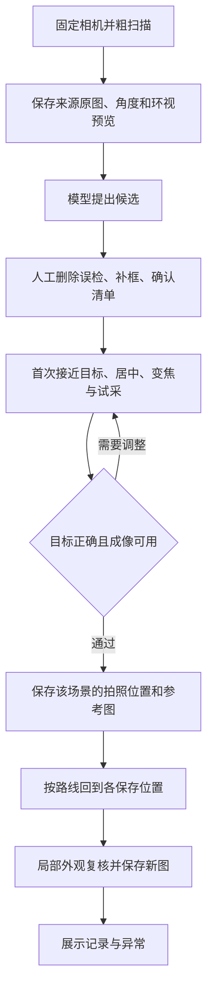

# 粗扫描、人工纠正与固定机位回访

系统允许首次扫描存在漏检和误检。粗扫描提供原图、拍摄角度和环视预览；模型提出候选，人工在大图中删除误检、补充漏检、合并重复观测并确认仪表。确认后的目标还需要一次合格的近景试采，建立该场景的参考图和拍摄位置，然后才能重复回访。

粗扫描阶段不要求模型发现所有表盘，但原图必须足够清楚，让人能定位漏检目标。网页补框与来源核对已经具备。[首次逐表试采编排](FIRST_CAPTURE.md)已实现，PC／TX2 各 165 项检查通过；首轮自适应实机在来源核对失败后停止，尚未建立可用新参考。首次建档、机位质量验收及周期适配仍待验证或接入，不能把确认一个候选框等同于已完成近景建档。

## 这次修订解决的环节

2026-10-22 的有限三轮试验在第一轮结束后停止：M0007 已按保存角度拍到完整表盘，但全图 ORB/RANSAC 配准只有 17 个有效匹配点，先于局部盘面核对被拒绝。这与首次扫描时 YOLO 漏检是两个问题。原失败结果和后两轮未执行的记录保持不变。

2026-10-23 增加 `saved_pose_roi_v1`。它只用于已经恢复上次拍摄位置的单轮和有限多轮回访，不承担陌生场景发现，不取代首次示教的跨视点匹配，也不自动标记机位已验收。

## 匹配步骤

1. 要求参考图与新图尺寸、方向一致，包含明确的参考拍摄姿态和本次实测姿态。水平、俯仰报告值之差分别不得超过 0.3°，倍率差不得超过 0.05。这是执行前置条件，不是编码器物理精度证明。
2. 围绕参考框扩展其长边的 25%，在两张图的相同区域计算 ORB/RANSAC，减少远处背景与全图缩放对特征的影响。原有效匹配点数量和几何质量阈值保持不变。
3. 沿用原局部模板和盘面内区核对：相关分数至少 0.72、内区至少 0.60，并检查图像支持范围。分数是外观相关值，不是正确概率。
4. 将结果投回完整原图，限制表盘投影面积比在 0.8～1.25，最大角点位移不超过盘面相应宽高的 25%。错误倍率、显著位移和异常投影不能仅因附近有相似目标而通过。
5. 在更大的校正邻域检查另一处相似表盘。局部小窗口可能没有独立的次峰，因此不能只看其 `peak_gap`。新 `competition` 结果独立比较另一处位置的完整盘面及内区外观；强竞争匹配导致拒绝。搜索区域超过预算也拒绝。

失败时保留原因和诊断图，既有停止、看门狗、清单版本检查和单轮不确定目标处理规则继续生效。不放宽原外观阈值，也不在匹配失败后自动跨机位搜索。

仅凭外观仍无法保证区分外观完全相同、被置换到相同位置的仪表。相机底座或仪表布局改变时，要重新建立位置与参考图；这套局部方法不用于任意场景变化后的全局重定位。

## 保存图片回放验证

在 TX2 Python 2.7 / OpenCV 3.3.1 上，使用上次试验的原始参考和 7 张保存的新图复测，实际涉及同一场景的 4 块表。

| 目标 | 图片数 | 原全图方法通过 | 新方法通过 |
| --- | ---: | ---: | ---: |
| M0006 | 2 | 2 | 2 |
| M0007 | 1 | 0 | 1 |
| M0008 | 2 | 2 | 2 |
| M0009 | 2 | 2 | 2 |

M0007 新方法得到 50 个有效匹配点，完整盘面相关分数 0.819、盘面内区分数 0.819。另构造盘面擦除、替换成错误区域、错误角度、错误倍率和附近重复盘面 5 个反例，均被拒绝。合成检查另覆盖局部平移、背景替换、盘面内区消失、越界和附近强竞争匹配。

PC 控制台 145 项与图像工具 50 项检查通过；TX2 控制台 145 项、固定机位匹配 11 项及原匹配器 11 项检查通过。新执行代码已部署，审核页计划生成器与 CLI 的只读计划相同，原清单、历史照片和实时预览保留。

上述 7 张图来自同一轮历史采集，5 个反例为人为构造，不能计作新实机成功次数，也不能证明陌生环境泛化或长期可靠性达标。原 M0007 失败记录保留。下面的新实机试验使用单独的计划、目录与记录。

## 修订后的三轮实测

2026-10-23，在相机底座和四块表盘保持不动的条件下，新计划沿 M0006 → M0007 → M0008 → M0009 执行三轮。每轮从同一起点出发，复用先前保存的参考照片；本组三轮没有重新训练 YOLO、重新扫描场景或用新照片更新参考。

| 轮次 | 实际用时 | 通过的逐表回访 | 新图请求／通过检查 | 返回与停止 |
| --- | ---: | ---: | ---: | --- |
| 1 | 93.492 秒 | 4/4 | 8/8 | 已确认 |
| 2 | 94.094 秒 | 4/4 | 8/8 | 已确认 |
| 3 | 93.815 秒 | 4/4 | 8/8 | 已确认 |

整组 **287.638 秒**，包括轮间等待和收尾；平均每轮 **93.800 秒**。24 次请求的接收时间严格递增，24 个图像哈希不同；每表每轮以两次新的外观检查通过后保存采集结果。12 张新结果图在网页上核对哈希及 2560×1440 尺寸，三轮任务一次性导入，原清单、历史任务和首次失败均保留。实时预览继续可用。

检查保存的 12 张表盘裁剪及最后一轮四张全幅标注，目标分别为 A 0～30、V 0～450、V 0～500、A 0～50，与清单一致。M0007 三轮均通过。本轮完整盘面相关分数最低为 0.776，内区分数最低为 0.746；这些数值仅描述本组已采样图片，不代表一般检测准确率。

### 重复位置与居中偏差

以下盘心偏差以完整图像宽、高的百分比表示，向右、向下为正；标准差为每表三次回访的总体标准差。

| 目标 | 平均水平偏心 | 平均垂直偏心 | 水平／垂直位置标准差 | 严格居中次数 |
| --- | ---: | ---: | ---: | ---: |
| M0006 | +27.172% | +3.619% | 0.081% / 0.019% | 0/3 |
| M0007 | +4.283% | +20.958% | 0.034% / 0.024% | 0/3 |
| M0008 | −3.797% | +19.368% | 0.027% / 0.070% | 0/3 |
| M0009 | +6.153% | +25.054% | 0.022% / 0.036% | 0/3 |

严格居中沿用水平绝对偏差不超过 3.5%、垂直不超过 4% 的检查条件。本组 **0/12** 次满足；低位置波动说明重复拍到近似位置，并不说明该位置合适。三块表的参考俯仰位于机械下限，M0008 下缘局部遮挡，尚未进行读数图像质量验收。后续应先调整安装高度或仪表布局，重新建立可居中、完整且足够清楚的参考画面。

本组只覆盖一个固定场景、四块仪表和三轮连续回访。它证明修订后本组采集成功，不能证明长期可靠性、相同外观仪表置换后的身份判别或陌生场景自动建档。正式机位仍未自动升级，`reading=null`，周期保持关闭。

## 代码与运行边界

- `tools/scene_mapping/fixed_revisit.py`：固定拍摄姿态下的局部配准、几何和竞争匹配检查。
- `tools/scene_mapping/revisit_worker.py`：新增 `locate_saved_pose` 图像入口；原 `locate` 和运动测量入口保留。
- `src/inspection_console/capture_round_io.py`：只在有限回访中传递参考及本次姿态，并核对方向。
- `src/inspection_console/capture_round.py`：计划绑定 `appearance_strategy`，旧计划不能被直接拿来执行新匹配策略。

运行方式见[有限重复回访](REPEATABILITY.md)。更新代码后重新生成计划，核对当前姿态与清单，再安排有限实测。页面周期适配器仍为 `NoHardware`，不因保存图回放通过而自动启用。
