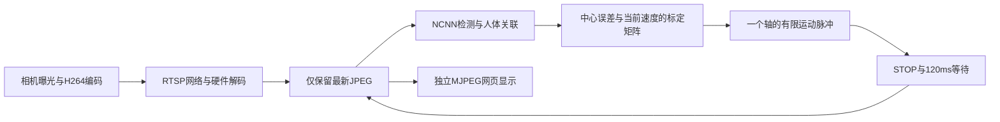

# 2026-10-14 云台跟随复验与工程修订

本次版本v0.4.1，设备为Jetson TX2与海康DS-2DC2402IW-DE3 S6，网页端口8771。真实人员左右移动和云台动作已执行，所有测试结束后确认停止。**功能可运行，但用户明确反馈“左右都走了，但镜头仍有明显滞后”，本次不判定运动跟随体验验收完成。**

## 最终配置

NCNN CPU FP32／320×320，两线程；检测CPU0、3，RTSP工作进程CPU4、5；OpenCV单线程；RTSP硬解1280×720、20fps上限；latest取帧、adaptive脉冲、responsive单动作线程；速度参数30、单次脉冲上限500ms。模型权重与精度未改动，没有新增PID或运动预测。启动文件为`config/tracker.follow.example.json`，密码仅交互输入。当前板端配置已持久化为相同值。

## 标定修复与实测范围

早期逐帧光流中位数累加、再除以尝试次数的方式未能稳定通过俯仰校验。新增IPC bit29持有光流参考，每个脉冲单独建立动作前图像，六次动作后图像直接比较；图像位移小于0.005的尝试不计入有效响应平均。记录每次位置反馈、图像位移和一致性，保留失败状态；每轴最多三次正向500ms动作及相同次数反向动作。

速度20与30分别通过新标定。速度40的水平位移约0.082，特征一致性约0.29..0.32，低于0.6，停止并弃用该标定。不得把某次图像位移接近零解释为电机必然没有转动，位置反馈显示它仍可能发生变化。列长度0.005、行列式0.000025和采样一致性0.6的校验没有降低。速度更改会强制废弃矩阵，重新标定之前拒绝追踪。

## 实测结果

中央区域按人体框中心定义：水平距中心不超过画面宽度8%，垂直不超过画面高度10%。比例仅来自按已处理帧去重的API采样；未轮询到的帧不参与统计。

| 试验 | 活动采样数 | 锁定后目标可用率 | 有目标采样中央占比 | 首次进入中央/秒 | 非零动作数 |
| --- | ---: | ---: | ---: | ---: | ---: |
| 速度20／上限200ms静止回中 | 98 | 100.0% | 18.6% | 28.97 | 29 |
| 速度20中央停稳 | 42 | 100.0% | 100.0% | 0.70 | 0 |
| 速度20／上限500ms回中 | 88 | 100.0% | 88.6% | 3.72 | 6 |
| 速度20首次走动 | 126 | 99.2% | 44.4% | 4.03 | 25 |
| 速度30／A57静止回中 | 94 | 98.9% | 76.3% | 6.20 | 12 |
| 速度30动态试跑15秒 | 57 | 98.2% | 20.0% | 6.09 | 16 |
| 速度30／A57正式走动40秒 | 157 | 99.4% | 78.7% | 0.70 | 12 |

速度30静止回中确认持续进入中央的时间为7.34秒；各试验起始位置和姿态不同，不能把这些时间当作严格同起点提速对照。标为“动态试跑15秒”的阶段原准备测停稳，但现场人员已经走动，已更正分类；它不能作为静止停稳通过证据。速度30配置的独立15秒停稳复验仍待补做，静止回中阶段包含其中央区域尾段。

最后40秒试验锁定后可用率为99.4%，有目标采样中央占比78.7%；最长采样丢失区间0.23秒。检测结果完成到动作请求开始中位数3.50ms，设备HTTP请求耗时中位数30.15ms。运动阶段仍采样到18次检测。指令方向为`{"pan:-30": 7, "tilt:-30": 1, "pan:30": 4}`。用户已确认向左右两个方向走动，并反馈仍有明显滞后；该反馈优先于仅凭统计比例的通过判断。

## 当前状态下的CPU核心对照

同一观察服务、同一模型、同一现场，各阶段预热2秒、采样约8秒，结束后原线程亲和性恢复。没有修改系统功耗模式、时钟或模型。试验期间没有发送非零云台命令。

| 条件 | 完成检测/秒 | 网络中位数/ms | 处理链中位数/ms |
| --- | ---: | ---: | ---: |
| denver-pair | 3.50 | 246.09 | 263.00 |
| a57-separated | 5.86 | 128.73 | 149.10 |
| denver-single | 3.48 | 243.49 | 261.10 |
| denver-restored | 3.60 | 239.42 | 256.30 |

当前A57分核结果较快，因此用于本次跟随；2026-10-13 Denver配置约66ms的历史测量仍保留，两次状态的差异尚未完全解释，不能据此认定Denver硬件普遍更慢。当前CPU温度约50℃，查询显示MAXN；这些读数不能单独排除所有调度和内存带宽因素。

## 影响跟随速度的环节

1. **运动控制策略。** 当前采用单轴、有限脉冲、STOP、120ms等待的循环；500ms动作还包含约50ms软件等待余量。检测继续运行，但下一次动作需等待旧动作结束及新帧屏障，镜头运动仍有间歇。转向或换轴会取消旧动作并重新停稳。
2. **速度与持续时间。** 固定速度参数30，误差较小时缩短脉冲；参数不是角速度。机械启动、加减速及方向反转需要时间，短动作未必产生与时长成比例的位移。
3. **检测反馈。** 最新40秒的网络推理中位数125.57ms，处理链中位数146.20ms。本地收齐JPEG至处理结束中位数171.50ms。目标仍在运动时，反馈所描述的位置已落后于当前位置。
4. **控制器与目标关联。** 当前依据当前位置误差调节，没有目标速度预测、积分或微分项。中央死区减少抖动，也允许小偏差暂不纠正；低置信度、遮挡或相邻帧框中心变化过大会暂停动作。水平与俯仰不同时驱动。
5. **画面播放。** 相机编码、网络、解码和浏览器播放均可能增加观看延迟。当前MJPEG显示已与检测分开，但没有测量曝光到屏幕的端到端延迟，不能把本地收帧年龄当作该指标。
6. **场景几何。** 距离越近，人员同样移动速度对应的视线角速度越大；变焦越大，对偏差越敏感。安装、距离、变焦变化后需重新验证标定和跟随效果。

后续优先研究受限时长的连续更新速度控制，减少逐次STOP的空档；保留失目标、失心跳、旧帧及命令异常时停止。再评估双轴驱动、目标速度预测及PD/PID。新增方式必须独立完成机械复验，不能直接沿用本次结论。

## 验证与交付

PC与TX2的159项标准库测试通过，板端C++编译通过；真实模型协议检查覆盖固定参考重复比较、正常请求推进、无光流清除、预览标志和同图人体输出一致性。此处检查输出一致性，不代表数据集精度测评。

公开工程包含源码、无密码示例、模型哈希及本报告；不包含密码、控制令牌、现场人物照片、原始日志、设备私有配置或编译产物。原始结果、日志、用户反馈和分析脚本保存在本地`runs/follow-20261013`，失败记录保留。服务最终为观察模式、已校准速度30，enabled=false、motion_busy=false。曝光到显示延迟、断网机械停止和仪表扫描读数不属于本次已通过项目。
