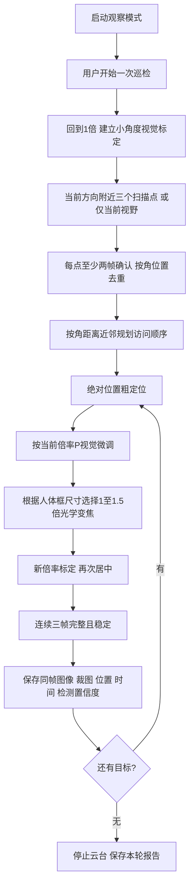

# 人体代替仪表的实机巡检 Demo

版本：**v0.5.0-demo，工程验证中，尚未最终验收**。本Demo复用TX2已部署的YOLO26n人体检测、RTSP硬解和海康DS-2DC2402IW-DE3 S6，以固定位置的人作为待采集目标。代码已实现目标列表、访问调度、视觉居中、光学变焦与留图接口；**实际证据目前包含一轮单目标采集成功和两轮不同原因的失败，尚未证明完整流程可稳定复现，也不代表多目标或真实仪表已经通过验收**。仪表检测和仪表读数算法尚未接入，所有 `reading` 均为 `null`；位置关联不做人脸或人员身份识别。

2026-10-14一轮后续运行完成三点扫描、六次发现去重、1.4倍放大和图像保存，成功1/1，用时20.399秒。该轮复用进程内已有标定缓存，不能称为冷启动性能。首次1.5倍标定过弱、0/1采集的失败结果也保留。19:58在修订后的服务中从冷标定开始扫描，形成三个位置候选，但回访均失败，采集0/3、终态 `completed_with_errors`、STOP已确认；按运行开始与结束时间计算为36.554秒。三个位置候选不能直接解释为三名真实人物。具体证据见 [巡检验证报告](INSPECTION_DEMO_VALIDATION_2026-10-14.md)。

## 已实现的流程



当前扫描仅为起始方向的水平 −8°、0°、+8°，俯仰保持起始角度；它不是完整场景覆盖算法。只在这些视野内寻找完整入画的人。人物必须保持原位，否则同一个人可能成为不同位置候选，或在回访时失败。发现数量不能直接视为现场真实人数。

## 控制方法

相机返回的 `azimuth`、`elevation`、`absoluteZoom` 在本机配置中按十分之一度、十分之一倍率换算。能力查询还会核对原始范围 pan 0..3500、tilt 0..900、zoom 10..20；不匹配则拒绝直接套用。

粗定位通过ISAPI绝对位置命令执行，并读取位置确认到位。细定位使用局部图像雅可比 `J(z)`：当前修订每轴先回到标定起点，再同向预移动3°，获取新参考图，继续同向移动1.5°；比较固定参考下的背景光流，除以相机报告的角度变化。质量不足时，仅允许回起点、重新预移动和取参考后改测3°一次。两轴在运动前共同核对最大6.3°余量，保留原标定质量门限、取消及STOP检查。

此前小角度位置回报与图像位移不一致，导致一个人被投影成三个位置。预移动旨在减少反向动作对测量的影响；没有确认唯一机械原因。10月15日修订实机复验完成两套首次标定、三点去重为一个目标、1.5倍放大和同帧留图，用时47.724秒；这是一次成功复验，仍需重复及多目标实验评估可靠性。详情见验证报告。

下一轴测量前及最终标定完成后返回原标定位置。新倍率首次使用时独立标定；同一服务进程、安装和场景不变时可复用该倍率缓存。重启服务或安装、画面方向、视频源、场景几何发生变化后，应重新标定。不会把旧跟随程序的500ms脉冲矩阵当作角度标定，也不将局部矩阵视作整个场景通用的云台模型。

微调采用 `Δq = -0.65 J(z)^(-1)e`，单次最大轴增量限制2°；水平中心容差为画面宽度3.5%，垂直为高度5%。三帧满足中心条件后，按人体框高度约65%的目标选择倍率，最高1.5倍，并保留完整性边界。访问规划是角距离近邻启发式，没有声称获得全局最短巡检时间。

绝对定位命令返回并不代表物理到位。适配器要求位置连续三次接近目标，并发送STOP、等待，再取新图。标定和采集必须使用新的检测帧；本地接收时间门限仍不能证明相机曝光时刻晚于运动结束，需要实机观察补充验证。

## 数据与图像

每轮运行生成 `var/inspection-demo/captures/<run_id>/run.json`。成功目标包含：

| 字段 | 含义 |
| --- | --- |
| target_id | 本轮基于位置生成的编号 |
| captured_at | 采集记录时间 |
| pose | 相机水平角、俯仰角、倍率 |
| bbox / confidence | 同帧人体框及模型置信度 |
| image / crop | 无框检测预览整图与由该图产生的目标裁图 |
| source_sequence | 图像与检测对应的序号 |
| sharpness | 裁图拉普拉斯方差，记录参考值 |
| reading | 固定为null，未接入仪表读数 |
| reading_status | not_applicable_person_proxy |
| capture_kind | same_frame_detection_preview，明确图像来自检测预览 |
| instrument_resolution_validated | false，尚未进行仪表分辨率验收 |

当前成功证据整图为960×540的检测预览，目标裁图220×279；不能把它称作相机原分辨率图像。图像、框、序号从同一帧绑定取出，保存后核对序号，裁图直接来自保存的整图。后续仪表版需独立接入高分辨率采集路径并验证读数精度。

程序中的“完整入画”只检查检测框没有越过画面边界，不判断目标是否被桌子或其他物体遮挡。成功人体照片不能替代仪表面板无遮挡和刻度可辨识的验收。

时间记录带UTC时区偏移，网页可按浏览器当地时区显示。每个目标记录自己的采集时刻，不声称逐个采集的目标数值来自同一瞬间。`run.json`以临时文件加替换的方式保存，JSON/CSV导出用于复核结果；公开工程包不包含实际人物照片和私有运行日志。

本次相机查询到的聚焦模式为 `SEMIAUTOMATIC`。Demo保留现有模式，在转动和变焦后等待稳定、记录清晰度指标，不假定一次等待即保证刻度清晰；尚未实现主动调焦搜索及仪表清晰度阈值验收。成功图的拉普拉斯方差1143.43只是这张裁图的测量值，不是通用清晰度合格线。若相机聚焦状态未知会明确保留unknown。图像保存使用板上已有Python2 OpenCV3.3.1，通过短生命周期子进程执行；主服务仍为Python3.5，未更换系统Python。

## 运行

先按原工程说明构建NCNN检测器并确认RTSP可用。停止原人物追踪服务，同一台相机只运行一个运动控制服务。旧版人物跟随仍保留，Demo不需要修改模型权重。

```bash
cp config/inspection.example.json config/inspection.local.json
# 填写真实用户名、当前IP、RTSP端口、安装旋转方向以及模型/可执行文件路径。
bash scripts/run_inspection_demo.sh --config config/inspection.local.json
```

密码在本地终端交互输入，不写进配置、源码或命令行。服务启动只检测，不开始扫描。页面默认端口8772，可选择“扫描并巡检”或“仅当前视野”。开始前让目标站定、保持身体完整入画，结束后可下载JSON/CSV，点击结果查看真实图像。代码无需重新训练人体模型。

程序另有面向部署脚本的 `--password-stdin`，仅接收一次标准输入JSON；不要把密码写入示例配置。部署到独立目录时可以把 `model_dir` 和 `detector` 配置为原工程的绝对路径，以复用已验证的模型和ARM64二进制。

## 运行边界与验证

- 初版只允许相对服务启动位置水平±25°、俯仰±15°，变焦1～1.5倍，单次绝对位置等待上限7秒；3点扫描并非360°扫描。
- 每目标居中阶段上限20秒，整轮上限180秒，最多20个候选目标。
- 页面每800ms续租，3秒未收到心跳则取消并请求STOP；停止未确认时保留错误、阻止新动作。后台STOP成功不等于已经验证所有断网机械停止情境。
- 不积累未来运动队列。停止先设置取消标志，硬件发送前再次检查；中止后不会自动转回起点。
- 人体缺失、截断、多个相近候选关联不明确、旧帧、标定不一致或保存失败，均记录失败，不伪造成功结果。
- RTSP重连后不复用标定，应重启观察服务并重新标定。

完整遍历目标列表只意味着流程已经结束。修订后的结果展示分别报告成功数和失败数：全部采集成功为 `completed`，包含目标失败为 `completed_with_errors`；用户取消为 `stopped`，整轮异常或STOP失败为 `error`。成功保存图像后若最终STOP失败，保留真实图像及成功采集记录，同时明确整轮运行失败。历史首轮原始记录中的 `completed` 按当时程序保留，其0/1结果必须解读为采集失败。

人物跟随和定点巡检的验收分开：旧跟随实验仍有用户反馈的明显滞后，当前定点巡检成功不表示已经修复动态跟随体验。

无硬件测试：

```bash
python3 -m unittest discover -s src/inspection_demo -p 'test_*.py' -v
```

本次修订在PC运行Demo68项，67项通过、1项因Windows不允许非特权符号链接而跳过；TX2上68项全部通过。同一PC完整工程检查还通过原人物跟随159项测试及三个模型文件的SHA-256核对。离线测试中的FakeIO只用于验证控制逻辑，不作为实机效果证据；早期Demo板端56项属于先前版本。实机结果见 [2026-10-14巡检验证](INSPECTION_DEMO_VALIDATION_2026-10-14.md)。冷标定后稳定完成采集、跨视角位置关联与去重、真实多人多目标、仪表识别与读数、全场景覆盖、主动调焦和变焦标定重试仍待验证。
