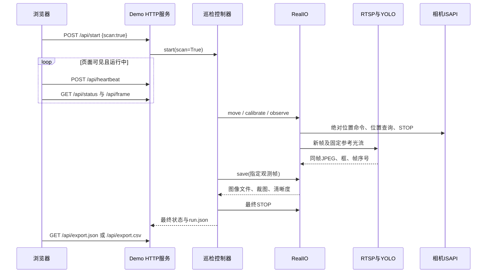

# 巡检 Demo 接口与坐标约定

适用于 `src/inspection_demo`。这是人体替代仪表的实验接口；现有连续人员跟随服务位于 `src/person_tracker`，两者共用检测器但运行入口不同。

## 调用关系

## HTTP

| 方法与路径 | 用途 |
| --- | --- |
| GET `/` | 操作页，包含当前进程的控制令牌 |
| GET `/api/status` | 控制器快照、相机最近位置、检测器状态与帧年龄 |
| GET `/api/frame` | 配对的JPEG、人体检测框与帧序号 |
| POST `/api/start` | 请求体仅允许 `{"scan":true}` 或 `{"scan":false}`，分别为三点扫描与当前视野 |
| POST `/api/heartbeat` | 空JSON对象，运行时续租 |
| POST `/api/stop` | 空JSON对象，请求取消并STOP |
| GET `/api/export.json` | 当前一轮的完整快照 |
| GET `/api/export.csv` | 当前一轮的逐目标记录，包含时间、位置和空读数 |
| GET `/captures/<run_id>/<filename>` | 读取已保存的JPEG或JSON；拒绝越界路径及越界符号链接 |

POST需要页面提供的 `X-Control-Token`，并检查请求来源与JSON格式。请求错误、重复开始、图像过期或STOP未确认会返回非成功状态；调用方必须检查HTTP状态和响应。令牌方案用于可信局域网实验，不是具备用户鉴权和TLS的生产平台。

## 状态与结果

`phase` 描述整轮状态：`idle`、`starting`、`calibrating`、`scanning`、`planning`、`positioning`、`centering`、`zooming`、`settling`、`capturing`，以及以下终态。

| 终态 | 含义 |
| --- | --- |
| `completed` | 本轮全部目标保存成功，最终STOP未出现失败 |
| `completed_with_errors` | 已遍历目标列表，至少一个目标处理失败；可能一个也未保存 |
| `stopped` | 用户、心跳或运行期限等取消了任务 |
| `error` | 整轮故障；STOP失败优先保留为本轮错误 |

`active=false` 只说明控制器工作线程已结束。应同时查看 `phase`、`results`、`error`、`stop_error`。STOP接口确认也不能代替断网情境的物理停止验收。已保存的图像不会因最终STOP失败而删除，但整轮不能标成通过。

目标编号只在当前一轮有效；`hits` 是重复观测次数，不是人数。目标处理状态与整轮状态分开记录。人物移动、截断、歧义、回访不匹配、弱标定和保存异常均可产生目标失败。

## 控制器与IO适配层

控制器只依赖注入的IO对象，离线测试使用FakeIO，实机使用RealIO：

| 方法 | 约定 |
| --- | --- |
| `position()` | 返回 `pan`、`tilt`、`zoom`；角度为度，倍率为本机定义的光学倍率 |
| `move(pan, tilt, zoom, cancel)` | 有界绝对运动；检查取消与图像源，查询到位并STOP；异常向上抛出 |
| `calibrate(zoom, cancel)` | 返回2×2局部图像位移/度矩阵；质量不满足时抛出异常，不返回猜测矩阵 |
| `observe(after=None, timeout=3)` | 返回新鲜且配对的 `sequence`、`received_at`、`persons` 和 `jpeg` |
| `save(observation, record, run_dir)` | 保存指定观测帧并从它裁图，返回文件名、清晰度及同帧序号 |
| `stop()` | STOP未确认必须抛出异常，不能悄悄当作成功 |

`cancel` 是线程事件；硬件发送前必须再次检查。任何实现都不应在取消后自动回位。传输或图像源错误不应进入标定质量重试分支。

## 坐标、时间与质量

- `bbox=[x1,y1,x2,y2]` 按经过安装方向旋转后的图像宽高归一化，左上为原点，x向右、y向下。网页中心框与控制器容差一致。
- `J(z)` 两列分别对应水平角与俯仰角变化，两行对应归一化图像x、y位移。单位是画面比例/度；不能代入旧人物跟随的“每脉冲位移”矩阵。
- 当前相机配置将ISAPI位置原始值除以10转换为度或倍率，并严格核对本型号能力范围。不要将此换算直接套到其他型号。
- `received_at`、运动屏障和内部期限采用本机 `time.monotonic()`；持久化时间采用带时区的UTC ISO格式。本地接收时刻不是相机曝光时间。
- 当前保存的是960×540检测预览及其裁图。`sharpness` 为参考指标；尚无经过验收的仪表读数清晰度阈值。

后续接入仪表模型时，应保留同帧契约、错误状态与原始证据，将人体检测换成仪表检测，并新增真实读数、单位、读数置信度及失败原因。当前 `reading=null` 和 `reading_status=not_applicable_person_proxy` 不应被填成演示数值。
