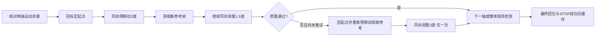

# 同向预移动标定与单目标巡检复验

日期：2026-10-15。工程：v0.5.0-demo。设备：Jetson TX2与海康DS-2DC2402IW-DE3 S6。

**新修订完成一次包含首次双倍率标定的单目标实机巡检，采集1/1成功，整轮47.724秒。** 本轮使用RTSP、真实YOLO人体检测和真实相机运动。用户在测试前确认方便配合，人物保持位置固定；人体用作固定仪表的替代目标，读数未接入。

## 问题、依据与修订

10月14日的冷标定扫描曾将一个人登记为三个位置候选，回访全部失败，采集0/3。失败标定的水平主响应约0.005208/°，但相隔16°的扫描画面中，人体框中心位移对应约0.009994/°。俯仰1.5°命令后，相机位置数据变化而图像位移接近零。源码中光流和人体框都采用旋转后的归一化坐标，没有发现能解释该倍数差的固定缩放错误。

这些记录说明小角度标定与较大扫描的图像响应不一致。反向动作的影响是一种待验证解释，尚未唯一确认机械间隙、位置回报和图像时序各自的贡献；不能只凭位置数据断定光轴已按相同比例转动。

修订后的每轴测量为：



图中第二次测量仍须通过相同质量检查；两次都失败则拒绝标定。方向选择在任何非零动作前为两轴共同预留6.3°余量，兼顾硬件范围与当前实验边界。取消、图像源、采集或通信故障立即终止，不进入质量重试，也不自动回位。光流一致性、列强度、矩阵有效性、新帧和STOP门限均保留。

## 本轮实机数据

| 项目 | 结果 |
| --- | --- |
| 批次 | `20261015-094441-5ed87a9a` |
| 当地开始／结束 | 09:44:41.660266／09:45:29.384559，UTC+8 |
| 整轮时间 | 47.724293秒，从run.json的started_at到finished_at；不含服务和模型加载 |
| 标定缓存 | 新服务无缓存，本轮实际建立1.0倍、1.5倍矩阵 |
| 扫描位置 | 水平210.2°、218.2°、226.2°；俯仰5.6°；每点两帧 |
| 去重及采集 | 六次观测合并为一个位置目标，成功1/1 |
| 最终位置 | 水平204.0°、俯仰5.8°、1.5倍 |
| 人体框 | `[0.3843793, 0.2378535, 0.6052809, 0.7677179]` |
| 框中心 | `(0.4948301, 0.5027857)` |
| 中心偏差 | 水平−0.51699%画面宽，垂直+0.27857%画面高，均在设定容差内 |
| 证据图与序号 | 整图960×540、裁图212×286，同帧序号381 |
| 检测置信度／清晰度 | 0.9002295／裁图拉普拉斯方差1294.58 |
| 聚焦模式 | SEMIAUTOMATIC，保留现有模式；未执行主动焦点搜索 |
| 读数 | reading=null、unit=null，未生成演示读数 |
| 终态 | completed，active=false，error=null，stop_error=null |

已查看保存整图，目标框所对应的人位于画面中央，下半身存在桌子遮挡。程序中的“完整”只检查检测框未被画面边界截断，不证明人体无遮挡。置信度不能视为系统准确率，清晰度也不是经过验收的仪表读数阈值。

本轮四个轴测量均首次通过，没有触发第二次质量重试。实测局部矩阵如下，单位为归一化图像位移/度：

```text
J(1.0) = [[ 0.01036457,  0.00012757],
          [-0.00010421,  0.01843437]]
J(1.5) = [[ 0.01273925,  0.00006485],
          [-0.00028590,  0.02393821]]
```

1.0倍水平响应与扫描量级接近，并在本轮完成六次观测去重及回访。它是这一轮效果证据，不是对所有位置、倍率和距离的通用模型验证。

## 自动化、部署和交付检查

- PC完整检查：原跟随159项通过；Demo73项中72项通过、1项因Windows非特权符号链接权限跳过；Python3.5语法解析和三个模型配套文件SHA-256通过。
- TX2 Python3.5：Demo73项全部通过，包含符号链接路径检查。测试采用模拟IO，不发送真实运动。
- 部署一致性：7份Demo源码、测试及页面与本地逐文件一致。检测器、模型权重及NCNN CPU FP32推理方式未更换。
- 图像、裁图、run.json和CSV已下载至本地私有实验目录。公开工程不含人物照片、真实凭据、控制令牌、设备私有配置或原始日志。
- 历史v0.4.1归档保留。归档文件与逐文件哈希由FILE_MANIFEST.json及本地发布汇总记录。

## 结论与尚未验收的部分

新修订在本次单目标场景中打通首次标定、三点扫描、位置去重、路线生成、绝对位置粗定位、P视觉居中、1.5倍光学变焦、再次居中、稳定检查、同帧采集和记录。最终STOP获得接口确认，服务回到只观察状态。

这是一次成功复验；尚无重复成功率、耗时分布、真实多人多目标访问、全场景覆盖、原分辨率图像采集、主动调焦或真实仪表读数精度。第二次3°质量重试的实机恢复效果、断网后的物理停止也未单独验收。平台或场景几何变化后须重新标定，当前缓存不适用于移动平台通用定位。

此前1.4倍成功轮的20.399秒使用缓存；本次47.724秒包含两套首次标定，条件不同，不作性能提速对照。10月14日的失败与旧人员跟随明显滞后的结论均保留，详见[历史巡检记录](INSPECTION_DEMO_VALIDATION_2026-10-14.md)。下一步应重复单目标测试、统计成功率，再验证两名固定目标依次采集，随后接入实际仪表检测、读数模型与高分辨率采集。
