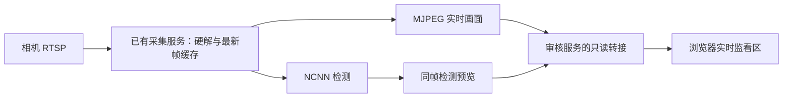

# 审核网页实时监看

审核页顶部的“实时监看”区显示当前镜头画面，在场景审核、仪表清单、路线和历史记录各页均保留。它与历史采集照片分开展示。

- **实时画面**：显示同一路 RTSP 采集的最新 JPEG，以 MJPEG 连续传送，不等待模型推理。
- **检测画面**：显示模型输出图，检测框与图像来自同一帧；有模型计算造成的额外等待。
- 支持折叠、暂停/恢复与全屏查看。网页进入后台或监看区折叠后断开画面连接，恢复查看后重新连接。
- 视频暂时不可用时隐藏旧画面并提示重连，避免将冻结图片当作当前画面。

## 连接方式



审核服务不新建 RTSP 解码器，也不把视频刷新转化成相机高清抓拍请求。预览复用现有采集服务；逐表保存的 2560×1440 高清照片继续独立记录。

默认审核服务不连接预览上游。部署时显式指定本机已有视频服务端口：

```bash
python3 src/inspection_console/server.py \
  --host 0.0.0.0 --allowed-host TX2_IP --port 8775 \
  --preview-port 8774
```

`--preview-port` 仅接受本机 TCP 端口，浏览器不能指定任意上游 URL。相机密码不进入浏览器；此次新增的网页接口不提供云台控制。

上游服务接口约定：

| 上游路径 | 内容 |
| --- | --- |
| `GET /live.mjpg` | `multipart/x-mixed-replace; boundary=jetson-live` 连续 JPEG；可复用 `src/person_tracker/live_preview.py` 的 `LivePreview.serve` |
| `GET /preview.jpg` | 已完成检测、方向已校正的单张 JPEG |
| `GET /api/status` | `source.state`、`source.sequence`、`source.last_frame_age`；可选 `model`、`preview_rotation`、`result_age_ms`、`ipc_ms`、`processed_frames` |

`preview_rotation` 为原始视频在浏览器中需要补偿的 0° 或 180°；检测画面不重复旋转。`source.last_frame_age` 是视频帧到达主机后的年龄，单位为秒，不是相机曝光到屏幕显示的端到端延迟。

审核服务对外提供同源的 `/live.mjpg`、`/live/detection.jpg` 和 `/api/live/status`。转接只输出白名单状态字段，关闭重定向，不转发原始解码错误。最多两个实时连接，慢客户端的单次写入超时为 1 秒；没有为每个客户端堆积视频帧。

## 验证记录

2026-10-22，PC 与 TX2 控制台各 133 项检查通过；新增视频转接检查 7 项，前端连接生命周期检查 8 组，大图审核既有检查 6 组通过。

实际局域网连续观察约 4 秒，收到 36 帧，帧到达速率约 **9.4 FPS**。原始实时图为 **1280×720**，模型标注预览为 **960×540**。该观测不证明端到端显示延迟，也不替代现场运动时的延迟测量。

部署前后完整清单一致，保持版本 50；上轮四表任务、历史照片与人工审核结果保留。网页仍处于审核模式，物理周期任务关闭，本次没有发送云台运动命令。浏览器自动打开请求处于排队状态，未宣称生产页面点击或渲染验收；视频连续帧、检测预览、静态资源和前端生命周期均已分别验证。
