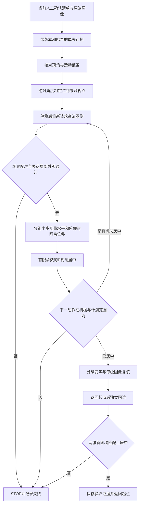

# 真实仪表单表示教与回访试验

此模块将人工确认的表盘参考接入有限运动测试。默认只生成计划；只有操作员检查当前现场、明确确认具体范围后，才执行一次试验。它不是已经验收的周期采集适配器。

## 控制与采集链路



来源视点是扫描原图的拍摄位置，不能直接当作表盘居中的机位。实时监看继续使用 RTSP；这个静态表盘试验采用“运动、停稳、重新请求 2560×1440 高清图、复核”的串行链路，未使用 RTSP 预览截图冒充高清采集。图像时间是主机收到响应的时间，不是已知的相机曝光时间。

参考来自人工确认的 YOLO 候选，但后续每一步定位使用 ORB/RANSAC 场景配准及局部表盘外观检查，不要求 YOLO 在每帧都检出。局部外观或重复纹理不满足条件时拒绝继续。变焦期间仅在成功匹配后延伸参考链，人工主参考保持不变；该方法没有给出通用的仪表身份保证。

## 运动模型

测量两个轴的小步变化，建立当前倍率、局部场景和固定安装条件下的雅可比矩阵：

\[
\Delta \boldsymbol{c} \approx J\Delta\boldsymbol{q},\qquad
\Delta\boldsymbol{q}=-k_pJ^{-1}(\boldsymbol{c}-[0.5,0.5]^T)
\]

其中图像中心坐标按宽、高归一化，角度单位为度。使用比例增益和单步限幅；不含积分或微分项。矩阵不是镜头内参、全局球面标定或运动速度模型。

每轴先同方向预动 3°，再试测 1.5°；若完整测量的图像质量不足，可进行一次 3° 测量。通信、取消或 STOP 失败不会触发第二次非零运动。矩阵过弱、近奇异、图像不匹配或目标下一步越界都会停止。

## TX2 环境与文件

- Python 3.5 标准库负责状态机、ISAPI、SQLite 版本检查、时间预算与 STOP。
- 独立 Python 2.7/OpenCV 3.3 图像子进程负责配准、模板复核、图像旋转与证据裁剪，不修改系统 Python。
- 相关入口为 `scripts/teach_meter.py`，核心为 `src/inspection_console/teaching.py` 和 `teaching_io.py`，图像子进程为 `tools/scene_mapping/revisit_worker.py`。
- `record.json` 保存来源绑定、所有请求图像、动作、局部矩阵、外观检查、误差及结束原因。输出目录必须是新的，失败不会自动再次执行。

先从审核控制台生成当前版本的参考计划，再生成单表动作计划。密码通过标准输入的 JSON 传入，不能放在命令行或公开配置。执行需要准备好的计划、匹配的指纹、Linux TX2 和本轮现场确认。程序持有共享运动锁，并逐步核对清单版本；清单变更、已有控制任务活动或周期任务启用都会阻止继续。

## 2026-10-22 首次真实表盘试验

一次中央 V 字表盘试验运行 **42.433 秒**，留下 8 张高清图，其中 4 张业务观察通过参考匹配。两个轴的局部测量通过，获得归一化图像位移/度：

```text
J = [[ 0.01128418, 0.00024445],
     [-0.00055664, 0.01892704]]
```

| 视觉居中观察 | 水平中心偏差/画面宽 | 竖直中心偏差/画面高 | 俯仰角 |
| --- | ---: | ---: | ---: |
| 第一次修正前 | 27.61% | 22.26% | 5.5° |
| 第一次修正后 | 22.98% | 18.40% | 3.4° |
| 第二次修正后 | 18.64% | 14.67% | 1.4° |

第三个计算目标需要负俯仰角，被相机位置范围检查拒绝。按最后一帧和局部矩阵估算，中心机位约为水平 208.96°、俯仰 −6.83°，超出设备返回的 0°～90° 俯仰范围。这是局部估算，不能当作全局几何可达性证明。实际现象说明当前相机与表盘相对位置需要调整。

该轮 **STOP 已确认，但没有完成居中、变焦或独立回访**。失败按计划停在当前位置，没有自动返回。没有将来源角度写为已验证机位，没有读数，没有启用周期任务。

针对这次失败，控制器新增越界诊断，记录受限轴、实际位置、拟执行步长、局部估算中心机位及允许范围。失败记录可以通过 `scripts/import_teaching_failure.py` 导入审核控制台，显示诊断图。这个入口只接受失败/停止记录，不能授予机位验证状态；它保持人工清单不变。

## 严格模式的后续验收

若继续要求精确居中，需要改善相机与表盘的相对高度或视角，重新固定并核对新图像与可达范围。安装或场景改变后，旧来源位置必须重新定位或采集。之后完成单表的居中、各级变焦、返回起点及独立回访。下文受限模式允许先留图，不以调整高度为当前前提；它仍不能代替重复回访、成像质量、周期执行与读数验收。

## 允许中心残差的采集模式

用户随后明确允许先拍到表盘，不要求完整或精确居中。因此另设 `best_effort.py` 的受限采集流程：保持机械与计划范围，俯仰受限时继续水平 P 调整，再逐级变焦、匹配和保存。这个模式不验证采集机位，也不执行独立回访验收。默认需要目标在当前新画面中已通过参考检查，才开始任何运动；可另行准备包含来源视点粗搜索的明确范围计划。

同日 M0007 受限采集一次运行 **68.839 秒**：完成 2 倍光学变焦、原分辨率留图及约 **320×357** 像素的表盘裁剪。采集角度为水平 **210.4°**、俯仰 **0°**；中心残差为画面宽的 **4.22%**、高的 **21.21%**，明确标为偏离中心。图像匹配通过，清晰度指标仅记录，未使用未经验证的阈值判定可读数。正常返回 **225.3°／1.4°／1 倍**，STOP 确认。网页展示新图和受限状态，四表档案保持不变。

准备时可使用 `teach_meter.py --allow-center-residual`；如需粗定位到已审核来源视点，再加 `--approach-source`。执行仍需保存的计划、精确匹配的指纹及当前现场确认，执行语义由保存的计划决定。可用 `import_teaching_failure.py --partial-capture` 将受限记录导入审核控制台。它不会把 `pose_status` 改成 `verified`，也不会启用周期执行。

受限留图与精确回访分别记录。若要执行后者，仍需解决安装/视角范围并完成返回后的独立匹配及中心误差验收。

## 四表实机留图结果

在用户允许偏离中心、确认新的多表动作范围后，按 M0009 → M0008 → M0006 执行一次有限批次。整批运行 **279.546 秒**。前两块完成受限采集并分别返回起点；M0006 的局部外观检查失败，整批按失败记录并停止，没有自动继续追踪或重试。已完成的照片保留，未把批次改写为全程成功。

| 仪表 | 本轮最终照片的水平角/俯仰角/倍率 | 表盘展示裁剪尺寸 | 处理结果 |
| --- | --- | --- | --- |
| M0006，A 字 0～30 | 267.7° / 1.4° / 2 倍 | 390×385 | 固定角度补拍，用户明确确认保留 |
| M0007，较大 V 字表 | 210.4° / 0° / 2 倍 | 320×357 | 自动外观匹配通过，受限留图 |
| M0008，较小 V 字表 | 187.6° / 0° / 2 倍 | 190×205 | 自动外观匹配通过，受限留图，部分遮挡 |
| M0009，A 字 0～50 | 178.5° / 0° / 2 倍 | 243×298 | 自动外观匹配通过，受限留图 |

M0006 失败时，全盘外观分数约 0.644，低于所用门槛 0.72；内部区域约 0.868，不能据此忽略整体失败。未降低阈值或把这帧标成自动匹配成功。随后另行完成一次 **14.105 秒**的固定水平/俯仰角拍照，在 1、1.5、2 倍分别请求新图，再恢复到 1 倍。此流程不继续目标追踪，也不提供算法身份检查。用户只确认最终 A 字 0～30 图像是所需仪表并同意保留。

该补拍的裁剪框由操作员按画面添加，仅用于展示，不属于模型输出，不改变原检测候选和来源框。原始高清图、采集姿态、原始失败记录和人工复核分别保留。尺寸差异只描述这些图像，不能当成可读数或模型精度验收。

本轮四张 2560×1440 原图已进入网页记录，HTTP 完整长度和 SHA256 核对通过；前端区分“受限留图”“待人工复核”和“人工确认保留”。未宣称已自动验证生产浏览器的点击与视觉渲染。

所有正式清单、历史地图及候选审核选择保持不变，四表的 `pose_status` 仍为 `unverified`、`visit_pose` 仍为空。表中角度是实际 `capture_pose`，不能直接赋予“已验收回访机位”含义。相机最终停在 **267.7° / 1.4° / 1 倍**，无活动运动任务，审核控制台仍为 `review_only`。

接下来应从这些实际拍照位置准备独立回访：离开后返回同一仪表、匹配身份、检查目标入画和图像质量，记录重复成功率。用户尚未选定周期；不能使用默认间隔自动开跑。读数算法仍未接入，所有数值保持空，现场图像和数据库不随源码公开。
