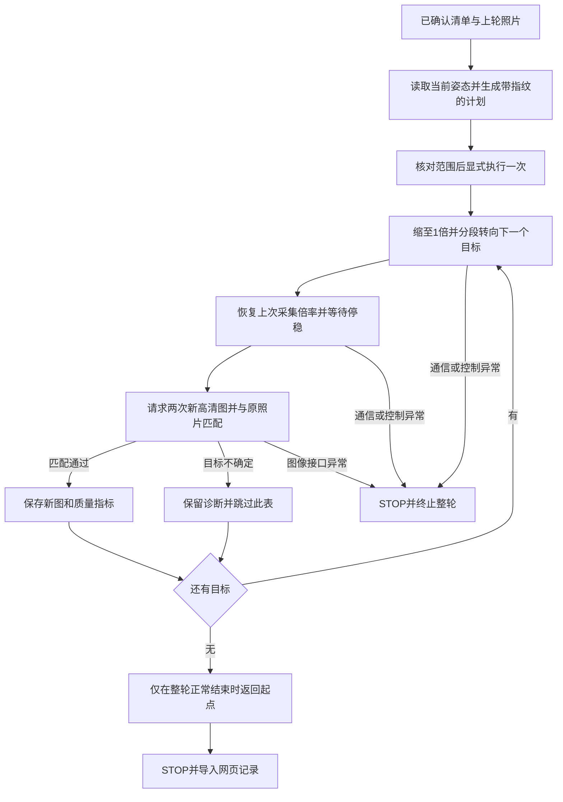

# 自动单轮回访采集

本模块用于“已确认清单，已有一次拍摄记录”的下一轮回访试验。程序复用上轮实际拍照角度和原照片，自动排序、逐表拍新图、匹配身份并汇总；不再为每块表重新做两轴标定，也不在每块拍完后返回同一个起点。正常结束只返回一次。

2026-10-22 已完成 TX2 部署，126 项板端检查通过。只读准备之后，现场确认的一轮四表自动回访用时 **97.773 秒**：共请求 8 张新高清图，8 次参考匹配全部通过；相机正常返回起点并确认 STOP。本结果为固定场景的一次试验，仍允许偏离中心，不能据此宣称长期稳定性或正式采集机位已验收。

## 首次四表实测

路线根据已有拍照位置自动生成。每表恢复 2 倍光学倍率，采两张 2560×1440 新图并核对外观，四表照片均已进入网页新任务记录，原有清单和历史照片保留。

| 目标 | 表盘 | 第二次匹配完成时刻（距本轮开始） | 裁剪尺寸 | 本轮结果 |
| --- | --- | ---: | --- | --- |
| M0006 | A，0～30 | 9.160 秒 | 390×383 | 2 次通过 |
| M0007 | V，0～450 | 35.828 秒 | 319×356 | 2 次通过 |
| M0008 | V，0～500 | 55.630 秒 | 193×206 | 2 次通过 |
| M0009 | A，0～50 | 71.880 秒 | 243×296 | 2 次通过 |

上表为累积完成时刻，不是单表独立耗时。第四表第二次匹配之后，再用约 25.893 秒完成证据保存、回到起点及停止。整个执行包含 19 次分段或变焦位置动作。8 次高清图 HTTP 请求合计 1.461 秒，单次均值 0.183 秒；8 次外观匹配工作进程内部计算均值 1.345 秒，均不等于端到端每帧耗时。

照片复核显示目标分别正确。M0008 下缘有遮挡，M0006 和 M0009 的盘心仍明显偏离全画面中心；本次没有运行居中控制，也没有验证读数质量。外观匹配使用先前确认的参考照片，不是重新运行 YOLO 完成陌生场景发现。周期关闭，所有 `visit_pose` 仍未正式验收，`reading=null`。

## 数据与路线

从当前确认并启用的仪表清单读取目标。每块表选择上一轮通过外观匹配的受限照片，或用户已经确认保留的补拍照片。后者必须另有明确的盘面参考框；图像用于匹配，不据此把拍照角度升级成已验证机位。

路线采用最近邻贪心算法，每一步选择水平、俯仰角差的欧氏距离最小的目标。它不计算变焦时间，不跨机械边界绕行，不保证总耗时最优。原 `planner.route` 仍仅接受已验证机位；单轮试验使用独立的计划类型，明确标记 `pose_basis=unverified_previous_capture`。

没有上轮可用照片的仪表返回 `first_capture_required`，不能假装已经定位。陌生场景的首次自动定位、居中和建档仍需先完成，本模块不代替该流程。

## 有限执行



每次水平/俯仰绝对移动不超过 20°，计划覆盖全部目标和起点，并设定倍率范围。每表最多两张业务新图；外观明确不通过时直接记录，不反复搜索或调整阈值。四表默认预算为 240 秒，这只是截止时间，不是实测用时。

执行端持有共享运动锁，逐步检查清单版本、其他控制任务、相机型号及编码器范围。单独监视线程在预算到期、取消或清单版本改变时请求 STOP，包括图像计算尚在运行的阶段。停止请求失败会保留故障，不能继续采下一块。

新图的时间是主机收到响应的时间，不是曝光时间。两次请求与外观通过不能单独证明周期采集成功率，也不保证读数可用。允许偏离中心的当前要求继续生效，清晰度只记录，不用未经验证的阈值宣称读数正确。

## 入口

默认只生成计划；相机密码交互输入，或使用 `--password-stdin` 传入一个 JSON 对象。不要把密码放入命令行。

```bash
python3 scripts/capture_meter_round.py \
  --console-root /path/to/review-console \
  --camera http://CAMERA_IP --user YOUR_CAMERA_USER --map YOUR_MAP_ID \
  --plan-out var/new-round-plan.json
```

检查保存计划的范围、目标、来源照片、预算和指纹，并确认当前现场可执行后：

```bash
python3 scripts/capture_meter_round.py \
  --console-root /path/to/review-console \
  --camera http://CAMERA_IP --user YOUR_CAMERA_USER --map YOUR_MAP_ID \
  --execute --plan var/new-round-plan.json \
  --acknowledge-plan SAVED_PLAN_FINGERPRINT --output var/capture-round-new
```

执行仅支持具有匹配环境的 Linux TX2，新输出目录必须不存在。完成后按该计划的原始清单版本导入：

```bash
python3 scripts/import_capture_round.py \
  --data /path/to/review-console/var/inspection-console \
  --directory var/capture-round-new --revision PLAN_REVISION
```

网页将通过匹配的新图与不确定目标的诊断图区分展示。来源仪表清单、人工候选和历史照片保留；`visit_pose` 仍未验证，读数为空，周期保持关闭。只读的 `/api/plan/capture-round` 可预览候选计划，不负责发出运动命令。

## 检查与后续

标准库检查覆盖排序、跨目标连续采集、只返回一次、普通不确定结果继续、通信错误停止、取消、清单修改、图像处理期间的监视停止、证据导入和防止伪造机位验收。实机通过后还需记录每表和整轮用时、两次匹配结果、失败原因及重复成功率；再决定网页运动入口与周期适配器的接入。

板端部署还检查了实际安装目录的导入关系：`capture_round.py` 依赖 `teaching.py` 的中心误差计算，二者必须一同部署。首次更新漏装该依赖，服务启动失败后自动恢复旧代码；补齐后，新服务启动和清单原样保留检查通过。测试目录导入成功不能代替实际安装目录的启动验证。
