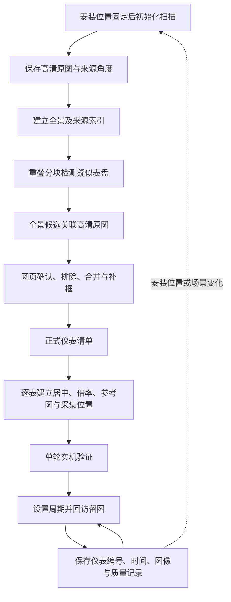

# 全景发现、人工复审与固定机位回访

本阶段复用已保存的 19 视点环视图，在全景上发现候选，再关联高清来源图供人工审核。扫描与建图见[环视记录](RING_SCAN_2026-10-21.md)。当前预览有接缝和局部错位，几何关联仅用于图像审核。

## 目标工作流



固定机位指安装位置固定，云台仍需转动和变焦。周期回访复用经过验证的采集位置，不必每轮重新扫描全景。新仪表或场景变化时更新地图，保留原图和审核历史。

当前实现到网页复审与回访准备检查。逐表采集位置教学、真实仪表居中放大、单轮实机回访和物理周期采集仍待完成。读数算法尚未接入，读数字段为空。周期由用户后续选择，本次没有设置或启用。

## 候选发现与来源关联

PC 工具先对全景整体检测，再以宽 640/960 像素的重叠分块检测，并进行周期边界上的非极大值抑制。跨全景左右接缝的候选保留周期框，网页拆成两段显示。这是图像边界处理，与云台机械边界无关。

候选通过角度辅助柱面投影逆映射到能完整容纳该区域的高清视图。先从最接近的两个视图采样同一投影区域，以 96×96 灰度块的归一化相关性比较外观。当前实验门槛为 0.65，低纹理区域不作一致性通过；这不是识别概率，也未经过仪表数据集标定。选择外观最一致的来源后复检一次，要求检测框与预测区域的交并比至少为 0.35。无可靠外观时仅保留近似几何关联并明确提示人工核对。外观一致或检测匹配都不代表真实仪表。

投影使用估计焦距、假定主点和来源水平角。图像关联不代表相机内参、云台轴线或像素到运动角度已标定。点击只切换图像，不发送运动指令。

导入核对全景/来源哈希、尺寸、方向和拍摄姿态。同一来源图内重叠程度足够的已有候选附加全景观测，保留编号、人工框、确认/排除状态及仪表绑定；其他候选新增为待审核。重复批次被拒绝。人工修框后重新计算显示关联，原全景框作为历史观测保留。显示用全景框仅在网页状态中计算，不写入原始导出。

## 本轮结果

| 项目 | 实际结果 |
| --- | --- |
| 输入 | 4096×600 环视预览、19 张 2560×1440 来源图 |
| 模型 | 本地单类仪表 YOLO；SHA-256 `e6bf75f5aa415b86d62e06497b9adfabefd815a7699df3ff24a22de5fef688f8` |
| PC 前向 | 初次全景 18 次、来源复检 6 次；修正关联后只补测来源 3 次，共 27 次，未重复全景检测 |
| 疑似区域 | 3 个，均关联高清来源 |
| 目视判断 | 帽子/头部、椅子或线缆背景误检；均未自动确认为仪表 |
| 数据保护 | 39 个原来源候选保留，新增 3 个待审核；旧地图的正式两表清单保留 |
| 软件检查 | PC 控制台 74 项、TX2 Python 3.5.2 控制台 74 项、PC 可选场景工具 39 项通过 |
| 服务检查 | 数据库保留、全景及关联原图哈希/长度、显示坐标和暂停状态检查通过 |
| 本次运动 | 无，复用保存图；周期关闭，读数未接入 |

最初核对发现一处来源误关联：检测器在另一幅来源中命中背景挂画，替代了全景中的头部区域。引入外观校验后修正，三处来源相关性约为 0.95、0.94、0.75；仅最后一处通过收紧后的检测框复检。保留原候选编号和修订历史，没有把模型复检当作人工确认。

3 个疑似区域不是 3 块真实仪表。本轮没有验证当前场景真实表盘的召回率或远景发现能力。人工复审可排除误检，漏检仍需补框或改进采集和模型。前向次数与此前来源检测的 260 次使用不同输入和策略，不是等准确率性能比较。生产浏览器点击未独立验收，HTTP 与离线检查不替代实机回访实验。

## 复现与操作

PC 需要 OpenCV、NumPy、Ultralytics，仅加载可信本地权重。图像目录包含按 SHA-256 命名的原图与全景；`projection.json` 来自环视投影工具，`MAP_ID` 为目标地图。输出目录必须尚未存在。

```bash
python tools/scene_mapping/detect_panorama.py \
  --registry var/private/registry.json --map-id MAP_ID \
  --images var/private/images --projection var/private/projection.json \
  --weights var/private/best.pt --output var/private/panorama-discovery

python scripts/import_panorama_candidates.py \
  var/private/panorama-discovery/payload.json \
  --data var/inspection-console --expected-revision 20
```

版本号应使用导入前读取的当前审核版本，不应沿用示例中的 20。有人修改清单时先重新读取并核对差异；源图变化时重新生成结果，不更改哈希绕过校验。

在网页“场景与候选”保留“全景检测与人工候选”筛选，点击全景虚线框查看高清来源。取消筛选可查看之前从来源图发现的全部候选。确认后进入仪表清单，仍须建立并验证采集位置，才具备周期执行条件。
