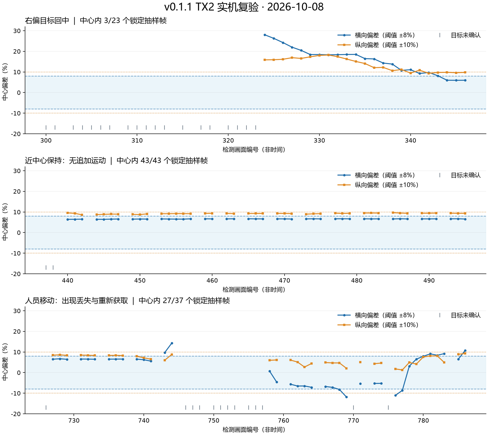

# v0.1.1 工程修订版：TX2 首轮实机复验

复验日期：2026-10-08。对象为 2026-09-26 整理的 v0.1.1 源码。结论：**新工程已在 TX2 独立目录编译运行，基础采集、检测、PTZ 控制和主要异常修复复验通过；单人回中有实测依据，持续动态跟随仍存在短暂丢失，不能判定完整巡检系统已验收。**

没有升级操作系统、CUDA、Python 或重新导出模型。原运行目录保留。本次相机运动均使用速度绝对值 20、500 ms 的有时限指令，随后请求 STOP。

## 1. 设备与部署

| 项目 | 实际环境 |
|---|---|
| 板卡 | Jetson TX2，aarch64 |
| 系统 | Ubuntu 16.04.7，L4T R28.3.1，内核 4.4.159-tegra |
| 工具链 | Python 3.5.2、GCC 5.4、CMake 3.5.1、OpenCV 3.3.1 |
| 模型 | YOLO26n，NCNN CPU FP32，320×320、四线程 |
| 相机 | 海康 DS-2DC2402IW-DE3 S6，现有局域网连接 |
| 新工程目录 | `/home/nvidia/tx2-ptz-reverify-20261008/jetson-ptz-inspection` |
| 页面 | `http://192.168.1.4:8768/`，原端口 8767 未覆盖 |
| 最终状态 | `observe`；`enabled=false`、`calibrating=false`、`calibrated=true`、`error=null` |

当前推理没有使用 TensorRT、CUDA 或 Vulkan。模型只用于通用物体／人体实验，没有验证仪表检测或读数。

## 2. 构建、模型与真实异常验证

| 验收项 | 结果与边界 |
|---|---|
| 上传包完整性 | 原 v0.1.1 ZIP SHA-256 与电脑一致，CRC 通过 |
| C++ 构建 | 复用板上 NCNN 静态库，`detector`、`infer` 均编译成功 |
| 模型配套文件 | param、bin、classes 的 SHA-256 全部通过 |
| 本地及板端测试 | 电脑 33 项通过；TX2 实际 Python 3.5 下 33 项通过 |
| 公共 bus 图片 | 5 次纯推理平均 81.6612 ms；5 个检测结果与旧板端基线的框、置信度差均为 0（按 JSON 输出精度） |
| 真正 Linux 管道阻塞 | 自建 NCNN 子进程正常推理后 SIGSTOP；65536 字节管道写入 137419 字节 JPEG，3.0037 秒报输入超时，进程回收成功 |
| 子进程终止 | 新自建检测进程终止后，再次推理 0.0005 秒内报 BrokenPipe，未返回旧结果 |
| STOP 未确认 | 临时将隔离 App 的 STOP 接入本机拒绝连接端口，实际产生 TCP ECONNREFUSED；控制禁用，告警经过正常采集仍保留，开始／校准被拒绝；恢复真实 STOP 后解除 |
| 校准中推理超时 | 另一隔离 App 暂停自建检测子进程；首帧失败后持有 operation 锁关闭进程，校准退出、无可用矩阵；后续 capture 立即拒绝且不再访问相机 |

校准故障测试结束耗时 5.2261 秒，包括约 3 秒管道期限和约 2 秒进程清理。三秒是写入或读取阶段的期限，不能表述为整个采集请求总期限。故障测试设外层超时，且只操作自己创建的子进程。App 故障测试禁止非零运动，只向真实相机发送抓拍及零速度 STOP。

纯推理时间不包含 JPEG 采集、预处理、网页传输和云台动作，不能换算成完整系统视频帧率。单张公共图片比对也不能代表数据集精度验证。

## 3. 相机与网页接口

相机认证、JPEG 抓拍、水平正反向和俯仰正反向短动作均成功。设备原始位置变化为：

| 动作 | 动作前 → 动作后 | 停止后复查 |
|---|---|---|
| 水平 +20 | azimuth 2554 → 2573 | 两次查询相同 |
| 水平 −20 | azimuth 2573 → 2556 | 两次查询相同 |
| 俯仰 +20 | elevation 144 → 137 | 两次查询相同 |
| 俯仰 −20 | elevation 137 → 144 | 两次查询相同 |

以上为设备接口原始值，不随意解释为角度或画面方向。相等时长的正反脉冲并不保证精确复位。本轮没有重新测试变焦。

新版默认观察模式，连续采集帧数正常增长，预览 JPEG 有效；缺少控制令牌返回 403，未知路由返回 404，未校准开始追踪返回 409。停止接口正常确认。方向校准约 17 秒完成；没有其他控制页面发送心跳时，停止心跳并等待 4.5 秒，`enabled=false`，随后 STOP 确认。

位置查询稳定和接口成功响应提供本轮停止证据，**不能替代拔网线条件下的机械停止试验**。

## 4. 单人回中与移动结果

横向中心死区为画面宽度 ±8%，纵向为高度 ±10%。以 `frames` 去重，只统计 `enabled=true`、`mode=tracking` 且有目标的画面，排除开始瞬间遗留的旧 target。数字为抽样状态帧，不是处理过的全部图像，也不是读数成功率。

| 实验 | 独立抽样帧 | tracking 帧 | 同时进入横／纵死区 | 判断 |
|---|---:|---:|---:|---|
| 40 秒右偏回中 | 42 | 23 | 3 | 目标从明显偏离位置回到中心区域 |
| 30 秒近中心保持 | 45 | 43 | 43 | 所有锁定抽样画面均居中，整轮零追加运动 |
| 40 秒人员移动 | 50 | 37 | 27 | 有校正、丢失及重新获取，尚未稳定持续回中 |

首轮真实 tracking 从 frame324 开始，横偏 +28.036%、纵偏 +15.861%；至 frame346 降为 +5.969%、+9.772%，frame344 首次进入死区。事件日志有 20 次校正动作（水平 −20 共 11 次，俯仰 +20 共 9 次），进入死区后不再追加动作。日志时间把收敛限定在首次确认后约 25–28 秒，未保存逐采样时刻，不能报告更精确的收敛时间。

移动轮出现目标消失、置信度降低与重新锁定；最后一个 tracking 抽样帧仍横偏约 +10.8%，超出横向死区。停止后的观察帧回到中心，需要单独记录，不能纳入 tracking 成功帧。因此本轮支持基础视觉反馈闭环可运行，**不支持快速移动、遮挡或全程稳定追踪已经通过**。

该轮事件日志共 10 次水平校正（−20 六次、+20 四次），每次均对应死区外的已锁定目标框。27 个中心 tracking 抽样帧与 13 个 searching 抽样帧均未对应新增运动；连续丢失及重新确认区间的事件中也没有新增 pulse。这证明本轮未确认目标时不追加运动指令，不能据此代替独立测量的机械停转。



图中横坐标为检测进程的画面编号，不是时间；空缺表示未确认目标。移动后重新锁定不意味着具备人员身份识别。

## 5. 复现入口

发行工程增加 `tools/validation/`，保留本轮检查脚本。密码依然通过交互输入，配置和脚本不保存口令。

```bash
cd /home/nvidia/tx2-ptz-reverify-20261008/jetson-ptz-inspection
python3 scripts/test_local.py
python3 tools/validation/test_real_pipe.py --project-dir . --image /path/to/public/bus.jpg
python3 tools/validation/test_live_app_faults.py --project-dir . --camera http://CAMERA_IP --user CAMERA_USER
```

运行 App 故障测试前停止其他控制服务。它只发送 STOP，暂时禁用 App 的非零运动，并回收测试自建检测进程。公开 bus 图片需自行准备。

在电脑或板端检查已运行的新页面：

```bash
python3 tools/validation/test_api_smoke.py --url http://TX2_IP:8768 --out var/checks/api
python3 tools/validation/test_visual_control.py calibrate --url http://TX2_IP:8768 --out var/checks/calibration
python3 tools/validation/test_visual_control.py track --url http://TX2_IP:8768 --seconds 40 --out var/checks/tracking
python3 tools/validation/test_visual_control.py lease --url http://TX2_IP:8768 --out var/checks/lease
```

API smoke 仅观察并请求 STOP，不启动追踪。visual_control 的校准、track、lease 会真正控制相机，应在固定相机和现场配合条件下运行；lease 检查期间关闭其他发送心跳的页面。脚本保存抽样证据，出现目标并进入中心不等于整轮动态追踪通过，仍需结合事件和现场情况判断。

## 6. 尚待完成

- 多起始位置、多距离和更多人员移动样本，统计稳定回中率、丢失次数与耗时。
- 持续运行一小时的温度、内存和延迟统计；当前只完成短时复验。
- 断网后的机械停止、完整停止／重启服务与重校准流程专项验收。
- 仪表模型接口、面板扫描、仪表去重编号、逐表对准、读数及记录／上传。

原始日志、API 抽样和现场照片存放在项目工作区的私有实验目录 `runs/reverify-20261008`，不随公开工程包分发。工程包只包含复验摘要、去身份图表、源码、模型及复现脚本。
