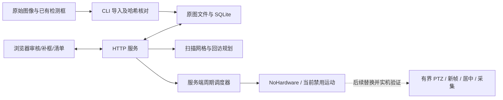

# 场景审核与仪表清单控制台

这是“扫描建图 → 候选审核 → 确认清单 → 周期采集”新流程的第一阶段实现，独立于原人体巡检 Demo。默认仅做图像审核，不连接相机，不加载模型，也不发送云台指令。

2026-10-21 新增[全景检测与复审](PANORAMA_REVIEW_2026-10-21.md)：点击环视候选查看高清来源，保留原有确认、排除与人工框。安装位置固定后，周期回访将复用每块仪表经过验证的采集位置；当前尚未接入物理周期采集，周期由用户稍后设置。

## 已实现的行为

| 功能 | 当前行为 |
| --- | --- |
| 原始图像建档 | 从清单导入 PNG/JPEG，保留原图 SHA-256、尺寸、拍摄时间和历史拍摄角度 |
| 候选审核 | 确认、排除、恢复、人工补框、修正框、合并重复候选；所有框均为原图像素坐标 |
| 仪表清单 | 确认后分配稳定编号 M0001 等；命名、计划采集勾选、刷新及重启保留 |
| 图像追溯 | 候选始终指向来源视图；预览是原图裁剪，不作为新拍摄的近景图 |
| 平台移动处理 | 将当前地图标为失效，禁用该地图仪表并清空回访姿态，保留历史证据 |
| 扫描规划 | 按水平/俯仰边界、视场角、重叠比例生成往返行式网格；只预览不执行 |
| 回访规划 | 确认且启用的仪表才能进入规划；未验证姿态列为阻碍，不用原图拍摄姿态替代仪表定位 |
| 巡检配置 | 保存 60–86400 秒间隔。执行层使用上一轮结束后的固定延迟；当前禁止实机启用 |
| 日志与导出 | 审核日志、原图、SQLite 数据库与 JSON 导出；不产生虚构读数 |

另有独立的有限扫描 CLI、PC 局部全景配准和原图候选发现工具，见下文。它们尚未连成开机自动执行的实机流程。仅有历史视图时页面明确标为“原始视图索引”。人工排除解决审核工作流中的误检，漏检仍需补框或改进发现算法。

2026-10-20 已完成一次实机三视点采集 → PC 局部配准与候选发现 → TX2 审核导入，见[验证记录](SCENE_MAPPING_VALIDATION_2026-10-20.md)。尚未完成实机验收：开机自动扫描、完整场景覆盖、自动跨视图目标身份关联、真实仪表回访标定、逐表新图采集、自动读数及周期巡检。网页确认候选不会自动获得可执行的云台坐标。

## 运行

Python 3.5+ 标准库即可运行，不需要 Flask、Node.js 或前端构建。浏览器需支持现代 JavaScript 与 Pointer Events。所有命令从仓库根目录执行。

```bash
python3 src/inspection_console/server.py --port 8775
```

默认只监听 `127.0.0.1`。导入图像后访问 `http://127.0.0.1:8775/`。在受信任局域网的 TX2 上使用明确的本机地址，例如：

```bash
python3 src/inspection_console/server.py --host 0.0.0.0 --allowed-host 192.0.2.10 --port 8775
```

把文档地址替换成实际 TX2 地址。控制台目前没有用户账号体系；防跨站请求令牌不是登录认证，不应把此服务转发到公网。同一数据目录只允许一个服务进程，避免重启恢复逻辑与正在运行的任务冲突。

默认私有数据目录为 `var/inspection-console/`，被 Git 忽略。停止服务后备份整个目录，可同时保留数据库、原图和来源索引；仅导出 JSON 不包含图像二进制。审核 API 不接受任意文件路径，导入由本地 CLI 完成。

## 导入已有检测结果

在私有目录创建清单，路径相对于清单所在目录解析，也可用绝对路径。`bbox` 为 `[x1,y1,x2,y2]` 原图像素坐标；不应传入归一化坐标。下面的姿态仅为历史来源元数据，不会自动转换成可执行的仪表回访姿态。

```json
{
  "title": "实验室仪表面板",
  "frames": [
    {
      "path": "scene.png",
      "title": "视图 01",
      "captured_at": "2026-10-19T06:00:00+00:00",
      "pose": {"pan": 180.0, "tilt": 5.0, "zoom": 1.0},
      "detections": [
        {"bbox": [100, 120, 250, 280], "confidence": 0.83, "source": "detector"}
      ]
    }
  ]
}
```

可附加 `sha256` 来核对图像。`pose`、`captured_at` 和置信度可省略；候选全部以待审核状态导入。多个视图可以属于同一地图，导入器本身不计算几何变换或自动合并目标。下方 PC 建图工具可生成带来源变换的清单，再由同一入口导入。

```bash
python3 scripts/import_review.py var/private-import/manifest.json
python3 src/inspection_console/server.py --port 8775
```

导入会新建地图，不覆盖旧审核结果。当前原型每张图最多 25 MB、每图最大 8000 万像素，每地图最多 240 个视图/500 个候选，每数据库最多 20 张地图。更大规模需要分块图片服务和数据库分页。

## 网页操作

1. 在“场景与候选”选择原始视图，核对右侧原图裁剪。确认真正需要的仪表，排除挂画等误检。排除可恢复。
2. 点击“手动补框”，在原图拖出完整表盘；补框仍为待审核，需再次确认。
3. 点击“修正选中框”重新拖框。已绑定仪表的框发生变化后，其回访姿态失效。
4. 相同仪表重复出现时，选择保留候选并合并；两块相邻仪表分别保留。合并不删除原图。
5. 在“仪表清单”命名并保存采集选择。排除或合并后的旧编号不复用，以保留追溯关系。
6. 在“巡检计划”保存间隔，并检查未标定目标。未接入实机适配器时，“启用周期巡检”禁用，HTTP 直接请求也会被拒绝。
7. 平台移动后标记地图失效；需重新建图，不直接沿用角度。标记失效不是擦除历史记录。

## 架构与存储



`store.py` 以 SQLite 保存一个小规模版本化聚合：地图、视图、候选、仪表、计划和最近任务。图像按 SHA-256 存为独立文件。`audit` 表追加操作记录，`job_history` 表保留已结束任务；页面展示最近任务，导出包含完整任务历史。一次业务更改与审计写入同一事务，使用 `BEGIN IMMEDIATE`；浏览器提交修订号，过期修改返回 409，避免两个页面静默覆盖。

`scheduler.py` 的周期语义为 **本轮结束时间 + 间隔**，不积压过期动作、不重叠执行。轮次预算用单调时钟，定时起点用 Unix 时间。服务重启时，运行中任务记为 `interrupted`，已有结果保留，计划暂停且不重放旧动作。审核或修改清单会暂停计划，需重新验证后启用。

当前实机适配器为空。离线调度测试使用 `simulation_test_only`，只能证明调度逻辑，不能证明相机停止、定位、对焦或仪表身份匹配。未来适配器需实现 `ready/position/visit/stop`，自行满足：有限动作范围、IO 超时、同一运动执行器互斥、到位确认、新帧屏障、取消、身份不确定处理和新图证据落盘；任务元数据中的 `reading` 仍保持 `null`，直到真实读数模块接入。

## API 与职责

| 路径 | 功能 |
| --- | --- |
| `GET /api/state` | 地图、候选、清单、配置、最近任务及审计 |
| `GET /api/export` | JSON 导出，附已结束任务历史，不含控制令牌 |
| `GET /images/<hash>.<ext>` | 只读取数据库登记的原图 |
| `POST /api/review` | 确认/排除/恢复/合并/修正框 |
| `POST /api/candidates/add` | 原图坐标人工补框 |
| `POST /api/instruments/update` | 命名及采集启用选择 |
| `POST /api/maps/invalidate` | 标记平台移动导致地图失效 |
| `POST /api/plan/scan` | 只计算往返行式扫描网格 |
| `POST /api/plan/route` | 只规划已验证姿态，返回未验证项 |
| `POST /api/plan/references` | 按当前修订号建立已确认仪表的回访参考计划；只读，不创建回访姿态 |
| `POST /api/schedule/configure` | 保存固定延迟间隔，保持暂停 |
| `POST /api/schedule/arm` | 默认拒绝，必须实机适配器与地图/仪表均通过验证 |
| `POST /api/schedule/stop` | 暂停计划并取消当前轮；当前空适配器不发真实 STOP |

所有写请求带 `X-Control-Token`、同源校验及整数 `revision`。请求字段、框坐标、角度、倍率和容量均有限制。页面将名字作为文本插入，不执行其中的 HTML。

## 检查与后续接入

已另备有限扫描验收入口 `scripts/capture_review_views.py`，默认仅查询相机型号、能力和当前位置。它不由当前网页触发，不会随控制台启动自动运行。真正执行时须确认平台停止、相机固定、周围无遮挡，且只在 TX2 Linux 上持有现有 Demo 共用的运动锁；检查旧控制端口是否仍有活动任务。

```bash
# 默认只读：显示当前姿态及当前位置左右各 5° 的三个候选视点
python3 scripts/capture_review_views.py --camera http://192.0.2.20 --user YOUR_CAMERA_USER

# 仅在现场条件已确认后执行；密码交互输入，不写在命令行
python3 scripts/capture_review_views.py --camera http://192.0.2.20 --user YOUR_CAMERA_USER --execute
```

有限扫描保持当前俯仰与倍率，逐点到位并停稳后请求相机原分辨率 JPEG，采图前后核对位置，正常结束返回起点；失败或取消时停止，不继续尝试回程。整体预算 90 秒，底层请求有超时，并有独立看门狗。保存的时间是主机收到图像的时间，不宣称相机曝光时间。来源图保留相机原始方向，后续检测前需核对旋转约定。

每轮目录包含原图和持续更新的 `record.json`；仅正常采集、回程及最终 STOP 都通过才生成 `manifest.json`。结果仍是三个原始视图，不是已经完成全景、去重或候选发现。实机运行结果需另行记录；模拟 IO 检查不能替代实机停止与到位验收。

```bash
python3 -m unittest discover -s src/inspection_console -p 'test_*.py' -v
python3 scripts/test_local.py
```

独立测试覆盖审核持久化、稳定编号、补框边界、合并、旧修订冲突、地图失效、服务重启、原图传输、跨站请求、有限轴规划、固定延迟调度、取消/停止失败及单调时钟看门狗。HTTP 测试仅使用 loopback，模拟调度不会访问相机。

本轮有限扫描已登记每个来源视图的真实姿态，并完成相邻图像的局部配准。扩大覆盖范围前仍需实测视场、按重叠率设计网格并验证拼接缺口。拼接失败应保留视图索引，不能伪称完整全景。审核确认不等于回访标定；下一阶段应先对确认目标建立受控的定位与身份校验，再联调逐表居中、放大、新图留存及周期任务。

现已增加“巡检计划 → 检查回访准备”，展示人工确认目标的参考图与来源视点，并另备 PC 局部外观复核工具。两表的历史跨视点检查和当前场景拒绝结果见[回访参考与图像复核](REVISIT_REFERENCE.md)。这些检查不会使地图或仪表自动变成“已标定”。

## PC 多视图建图与候选发现

2026-10-21 新增独立环视扫描入口及圆柱/球面预览导入，详见[环视验证与操作](RING_SCAN_2026-10-21.md)。环视预览不使用平面 `to_overview`。来源视图选择器可查看高清图；导入全景候选关联后也能点击候选切换高清来源。两种操作均不执行云台动作。

`tools/scene_mapping/` 在普通电脑运行，使用 NumPy/OpenCV；模型发现入口还需要与本地权重兼容的 Ultralytics/PyTorch。它不改变 TX2 的 Python/CUDA 环境。当前开发环境为 Python 3.12、OpenCV 4.12、NumPy 2.2；尚未在新的空白环境复装验证。默认标准库回归不加载这些可选依赖。

```bash
# 输入为从有限扫描目录复制到电脑的 manifest.json 和各原图。
# 若实际原图倒置，才加 --rotate180；会同步变换框并保留未旋转原图及哈希。
python tools/scene_mapping/build_map.py var/input/manifest.json --output var/mapped

# 只接受可信、本地已有的单类 meter/gauge/dial 检测模型，不下载模型。
python tools/scene_mapping/detect_views.py var/mapped/manifest.json --weights /path/to/trusted/best.pt --output var/discovered

# 使用同一导入入口，把来源图、预览、候选写入审核数据库。
python scripts/import_review.py var/discovered/manifest.json
```

在电脑导入只影响电脑的数据目录。要在 TX2 网页审核，应将 `var/discovered/` 整个私有目录传到 TX2，在板端运行导入命令，不能只复制清单 JSON。这些场景图、模型和数据库均不加入公开 Git 仓库。

实现顺序为：原始视图 → ORB 双向特征匹配 → RANSAC 单应矩阵 → 内点数量/比例、分布、重投影误差、投影面积与重叠检查 → 局部总览。保存从每张原图到总览的矩阵；点击总览候选切回对应原图。当前采用局部平面近似和按来源中心优先的接缝选择，适用于有限小扇区预览；广角畸变、近远物体视差、移动对象、重复纹理和累计误差仍可能造成错位。它不是球面 360° 全景，也不是相机内外参标定。

最多处理 24 个视图，预览长边不超过 4096 像素、约 1200 万像素预算。无法通过配准的视图保留在下拉列表中并标为“未配准”，不会消失或冒充已覆盖。原始视图始终保留完整分辨率。

候选发现继续使用已有轮廓提议思路：每张完整原图一次 YOLO640，再对最多 12 个带边界留白的轮廓区域推理，最多补充 4 次裁剪边缘扩展复查，最后还原原图坐标并做同视图 NMS。默认每视图最多 17 次前向，属于离线发现过程，不是实时视频速度。跨视图重叠框暂不自动认定为同一仪表，由网页人工合并；挂画等误报必须经人工排除。模型分数、轮廓分数都不代表真实仪表读数。

`discovery.json` 保存模型哈希、推理环境、每视图调用次数和时间；`registration.json` 保存接受/拒绝的配准边、变换及未配准视图。源码包不附私有表盘模型，现有通用物体权重不能替代此入口要求的仪表模型。

```bash
python -m unittest discover -s tools/scene_mapping -p 'test_*.py' -v
```

13 项可选检查覆盖合成平移配准、投影反变换、空白场景拒绝、预览预算、旋转与原图哈希、未知位置轮廓、裁剪坐标、接缝拒绝及调用预算。3 个合成重叠视图已完成网页跳转和跨来源合并验证；测试视图来自同一张历史照片的裁剪，不能作为实机多视图拼接的精度证据。
