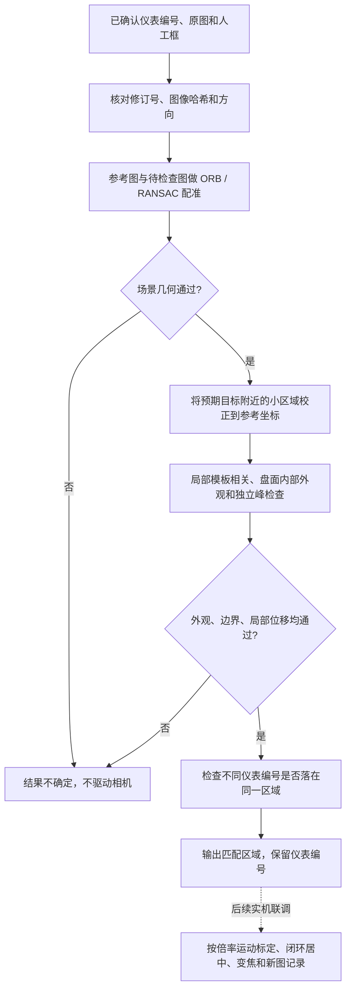

# 已确认仪表的回访参考与图像复核

该模块解决人工审核后的衔接问题：用户确认了某块表盘，后续程序应继续寻找这个已建档目标，不能因为 YOLO 偶尔漏检就丢掉它，也不能只凭背景位置相同就认定它还在。

当前已实现参考计划、PC 图像复核和网页准备检查。它们不执行云台运动，不给仪表写入“已标定”，不启用周期采集。旧人体 Demo 的运动验收与本模块的仪表验证分别记录。

## 从审核结果到参考计划

`src/inspection_console/references.py` 只选取当前地图中已确认且启用的仪表，保留已有仪表编号、人工框、来源图像哈希、方向、分辨率和拍摄姿态。经人工合并的其他视图作为关联观测保留；目前复核以用户保留的主参考为准，不自动用其他观测改写主参考。

计划绑定数据库修订号和内容指纹。过期修订、已失效地图、修改过的框或来源几何不能沿用旧计划。图像加载检查内容地址、尺寸和 SHA-256，不接受任意路径。两块表来自同一张原图时，可共用一次场景配准。

**来源姿态不是仪表居中后的回访姿态。** 它只说明哪一个历史视点看到了目标；参考计划不会将该姿态复制到 `visit_pose`。

网页“巡检计划 → 检查回访准备”展示已绑定的仪表、关联观测数、来源姿态和参考原图。接口是：

```text
POST /api/plan/references
{"map_id": "当前地图编号", "revision": 当前整数修订号}
```

沿用控制台的同源和控制令牌校验。调用不改变数据库修订号，不创建巡检任务；换地图或修改清单后，页面隐藏旧结果，需要重新检查。

## 图像复核流程



`tools/scene_mapping/relocalize.py` 复用已有场景配准，之后仅校正表盘附近的小区域。搜索范围约为表盘尺寸的一半，局部位移超过目标宽或高的 25% 时拒绝沿用固定场景参考。外框和盘面内部都需通过外观检查；第二个相离匹配峰过强、目标跨图像边界、纹理不足或不同编号落入同一区域，均输出 `uncertain`。

默认阈值是整框归一化相关值 0.72、内侧盘面 0.60、独立峰差值 0.08。这些是原型工程阈值，使用本轮场景开发和检查，不能视为独立测试集上确定的最佳阈值。相关值不是检测概率，也不是读数置信度。

它适用于**已审核、位置固定、外观变化有限**的仪表。无约束视角、大倍率变化、强反光、遮挡、读数显示大幅变化和外观相同的相邻仪表仍可能导致失败或歧义；序列号、位置标记或更强的目标描述应作为后续补充。拒绝匹配不等于证明仪表不存在。

## 离线运行

PC 需要 NumPy 和 OpenCV，不需要加载 YOLO 权重。审核数据库和现场图像仍留在私有目录。

```bash
# inspection-registry.json 来自控制台导出；images 中是对应的哈希命名原图。
python tools/scene_mapping/check_revisit.py \
  --registry var/inspection-registry.json \
  --map-id YOUR_MAP_ID \
  --images var/inspection-console/images \
  --output var/revisit-check-001 \
  --negative-controls
```

输出目录必须不存在。脚本保存 `reference-plan.json`、`results.json` 和定位叠加图。与主参考内容相同的图片不计作成功回访；保存图像的重放不计作本轮新采集。`--negative-controls` 在已匹配区域人工遮掉目标并重新配准，用于检查错误路径，不作为真实遮挡样本。

也可以用 `--probe var/probe/probe.json` 检查单张另行获取的图像。该 JSON 至少应提供 `image`、`sha256`、`width`、`height`、`orientation`，图像与 JSON 位于同一目录，文件名为真实 SHA-256 加 `.png` 或 `.jpg`。方向约定必须与原图一致。此工具本身不访问相机，不能证明输入图片的新鲜度；实机适配器还需保证新帧、到位与停止确认。

## 2026-10-20 检查结果

两块已确认仪表以视图 01 为主参考，在保存的视图 02 和 03 上共完成 4 次定位，均通过。左侧倾斜表盘来自人工补框，右侧正面表盘来自保留的检测框。

| 目标 | 待检查视图 | 整框相关值 | 内部相关值 | 结果 |
| --- | --- | ---: | ---: | --- |
| 左侧倾斜表 | 02 | 0.969 | 0.962 | 匹配参考 |
| 右侧正面表 | 02 | 0.927 | 0.851 | 匹配参考 |
| 左侧倾斜表 | 03 | 0.830 | 0.910 | 匹配参考 |
| 右侧正面表 | 03 | 0.805 | 0.662 | 匹配参考 |

4 次合成目标擦除均输出不确定。同日 18:13（Asia/Shanghai）通过只读请求取得的一张当前现场图中，背景配准通过，但两个原表盘区域的整框相关值约为 0.169 和 0.199，均因局部外观不符被拒绝。没有据此删除正式清单或生成虚假的成功采集记录，也没有发送云台运动命令。

上述结果只验证同一局部场景的参考定位与拒绝路径，**不是跨场景准确率，不是新的物理回访，更不是仪表读数验证**。局部单应矩阵未转换成 PTZ 角度。

本次控制台/有限扫描/参考计划共 44 项检查在 PC 和 TX2 Python 3.5.2 通过；可选 PC 图像工具共 24 项通过。可选定位模块尚未在 TX2 的旧 OpenCV 环境运行或测量耗时。PC 复核缓存了同一参考的配准结果，逐目标记录耗时包含不同份额的共享工作，不能直接互比或宣传为板端帧率。

## 接入真实巡检前的剩余工作

1. 获取当前有效场景与仪表参考，保持固定；位置改变后重新建档或明确修正参考。
2. 在 TX2 完成新帧输入与定位执行适配，测量实际处理开销。
3. 将“来源姿态粗定位 → 新帧复核 → 按倍率标定的视觉微调 → 停稳 → 变焦 → 再复核 → 原图记录”接入有界执行器。异常、取消或身份不确定时停止，不继续追旧框。
4. 完成两块仪表的一轮真实回访，记录到位、中心误差、倍率、图像、耗时和最终停止。通过后才写入已验证回访姿态。
5. 再验证服务端固定延迟周期调度。读数模块未接入前继续保持 `reading=null`。
