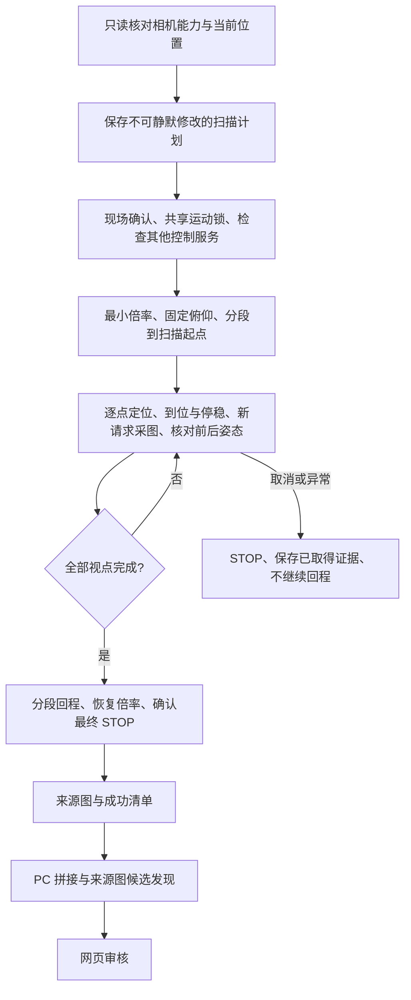

# 单行环视扫描与建图验证：2026-10-21

本轮将原先的小范围三视点验证扩展为本机可达水平范围内的一次扫描：19 个视点、逐点停稳采图、返回起点并确认停止。随后在 PC 生成环视预览、运行来源图候选发现，导入 TX2 审核网页。它是一次大范围扫描 Demo；无缝全景、精确全周覆盖和仪表自动回访仍需继续验证。

## 结果

| 项目 | 实际结果 |
| --- | --- |
| 相机 | DS-2DC2402IW-DE3 S6，本机接口范围水平 0～350°、俯仰 0～90°、倍率 1～2 |
| 扫描范围 | 水平 350°→0°，19 个视点，间隔约 19.4°；不跨机械端点 |
| 固定条件 | 本轮俯仰 5.5°，扫描使用接口最小倍率 1 倍 |
| 来源图 | 19 张相机 JPEG，均为 2560×1440，保留原方向、哈希和回读姿态 |
| 整段执行时间 | 165.591 秒，含进入扫描起点、采图、回程、恢复原倍率和最终 STOP；不含 PC 建图、检测、传输和审核 |
| 返回状态 | 202.9° / 5.5° / 1.4 倍；正常完成，最终 STOP 确认通过 |
| 相邻配准 | 18 对中 15 对通过现有几何检查，另 3 对因内点不足拒绝 |
| 首尾重叠 | 0° 与 350° 图像配准通过，467 个内点；此结果不单独证明完整覆盖 |
| 自动球面拼接 | OpenCV Stitcher 返回状态 3，相机参数优化失败；失败结果已保留 |
| 最终预览 | 19 张来源图的角度辅助圆柱投影，4096×600；存在接缝和局部错位 |
| 候选发现 | 已有本地仪表模型在原图及提议裁剪上共 260 次前向，产生 39 条待审核观测 |
| 网页导入 | 新建独立环视地图，19 张来源图、39 条待审核候选；39 张原图/方向副本/预览文件哈希核对通过 |
| 已有仪表 | M0001、M0002 及其审核框、关联观测、历史地图均保留，没有自动迁移确认 |

39 条候选不代表 39 块仪表。重复观测和背景误检仍需人工确认、合并或排除。该场景不是独立检测测试集，尚未标注完整真值，不能由候选数计算召回率或准确率。

## 扫描与控制



`src/inspection_console/ring_capture.py` 使用独立环视配置，不解除原 `ISAPIScanIO` 的左右 5° 限制。即使首次进入端点或返回起点，也拆为单次不超过计划步长的动作，不直接发送跨零点绕行。固定俯仰，只在扫描结束并回到原水平位置后恢复原倍率。

计划默认最多 19 个拍摄视点，单次位置等待上限 7 秒，整体单调时钟预算上限 360 秒。每一步检查取消和停止状态，独立看门狗负责超时停止。传输异常后也尝试 STOP；停止未确认不能写成功清单。失败时不继续扫描或自动回程，已保存图像保留。

执行器只核对相机回读姿态与有限范围，不宣称回读角度就是经过外部测量的真实光轴角度。拍摄时间记录为主机收到图像的时间，不虚构相机曝光时间。

## 拼接失败后的可用结果

本轮首先尝试 OpenCV `Stitcher_PANORAMA` 自动球面拼接。算法识别出全部来源图，但相机参数优化未成功，耗时约 124.828 秒，没有生成可接受的自动拼接图。尚未通过独立对照确定失败原因。

随后根据通过几何检查的图像对及其编码器角度差，估计用于预览的焦距。14 对观测参与稳健估计，约 1565.591 像素，对应的水平视场估计约为 78.538°。估计假定主点位于图像中央、镜头固定、运动近似为水平旋转；没有替代正式相机内参和云台轴标定。

将各来源图按水平角投影到同一圆柱坐标，并优先选择接近各来源图中心的区域，得到 4096×600 预览。近处物体的视差、安装轴倾斜、角度误差和曝光差异仍会造成接缝、错位或亮度跳变。预览中心行有图像填充不等于现场没有遮挡或盲区。输出继续标记 `full_panorama=false`、`ptz_calibration=false`。

角度在此仅用于离线图片的环形坐标；运动执行始终使用有限 0～350° 轴，不跨机械端点。自动拼接、角度投影和来源图索引分别标记，不能用失败的自动拼接冒充精确全景。

## 来源坐标和网页审核

圆柱/球面投影不是单个 3×3 平面单应变换。新预览使用 `source_picker_only`：可浏览总览，再在来源视图中审核原分辨率检测框。尚未把候选画到这张环视图上，也不从预览像素直接计算可执行云台位置。

导入时原图、相机原始方向文件、哈希、姿态和候选分别保存。自动拼接失败的图像不会丢弃。没有合适投影时，工具退回来源图联系表，明确显示尚未得到环视预览。

本轮网页保持 `review_only`；独立扫描 CLI 不会因审核网页启动而自动运行。网页“暂停巡检”控制的是周期计划，独立 CLI 的本轮执行应在运行终端使用 Ctrl+C 取消。尚未把环视扫描接入网页运动按钮。

## 复现入口

```bash
mkdir -p var

# 只读准备：查询能力和当前位置并保存计划，不发运动。
python3 scripts/capture_ring_views.py \
  --camera http://192.0.2.20 --user YOUR_CAMERA_USER \
  --plan-out var/ring-plan.json

# 现场条件确认后，在 TX2 Linux 执行。密码交互输入。
python3 scripts/capture_ring_views.py \
  --camera http://192.0.2.20 --user YOUR_CAMERA_USER \
  --plan var/ring-plan.json --execute --output var/ring-capture-001

# 复制本轮目录到 PC 后运行；实际原图倒置才使用 --rotate180。
python tools/scene_mapping/build_ring_map.py \
  var/ring-capture-001/manifest.json --output var/ring-mapped-001 --rotate180

# 可选：接入可信、本地已有的单类仪表权重，在来源图发现候选。
python tools/scene_mapping/detect_views.py \
  var/ring-mapped-001/manifest.json --weights /path/to/trusted/best.pt \
  --output var/ring-discovered-001

python scripts/import_review.py var/ring-discovered-001/manifest.json
```

执行入口要求已经保存的计划与当前姿态相符；现场改变相机姿态后需重新准备，不能绕过检查。输出目录必须为新目录。场景图、模型、数据库和凭据置于私有目录，不随源码公开。

PC 建图输入上限 24 张、累计 1 亿像素；自动拼接前先缩图，预览限制约 1200 万像素。图像仍以完整来源分辨率检测与保留。自动拼接失败后可以使用同一批保存图像继续改进，不需要重复物理扫描。

## 检查与剩余工作

- 控制台、扫描与参考计划：最终 60 项在 PC 和 TX2 Python 3.5.2 通过；实机前独立扫描部署版本为 57 项，随后增加 3 项预览导入检查。
- 可选 PC 图像工具：33 项通过，覆盖来源保留、空白拼接失败、角度投影缺口、错误内参估计及原有配准、裁剪、定位检查。
- 本轮真实动作仅上述一次扫描；测试用模拟 IO 结果不计作额外实机成功轮次。
- 生产 LAN HTTP 验证新地图、页面资源及 39 张图片的完整长度与 SHA-256；不将 HTTP 检查写成浏览器点击验收。

后续先改进全局几何、轴姿态和接缝处理，再为审核后的目标接入有界回访、按倍率视觉居中、放大和新图记录。当前没有逐表采集验收，没有自动读数，没有启用周期物理巡检，也没有安装开机自启。
