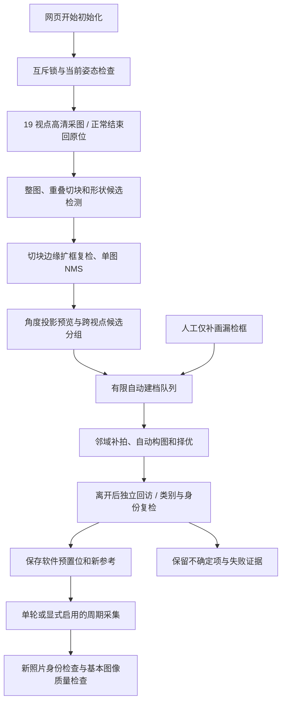

# TX2 本地场景初始化

本入口把分段扫描、高清图候选发现、环视预览生成和自动建档队列接到同一服务中。启用硬件后，用户可在网页点击“新场景初始化”；不再需要在电脑上分别运行建图、检测和导入脚本。启动服务本身不转动云台，也不启用周期任务。

## 数据流与边界



当前实现针对海康 DS-2DC2402IW-DE3 S6 和固定机位，高清图为 2560×1440。本地图像归一化包含该现场所需的 180° 旋转，不能直接当作所有相机的通用方向。更换安装方向、图像分辨率、倍率范围或相机型号后，应重新验证坐标映射和运动方向。

环视图由水平角和相邻视点匹配估计生成，存在接缝与未标定假设，属于可缩放的来源索引。它不是已经证明无缝、完整覆盖的球面全景，更不是三维地图。后续建档仍回到来源高清图和新拍图。估计失败时使用显式标记的相机配置近似值；不能把该近似值当作精确 PTZ 标定。

## 首次启动

板端需具备 Python 3.5 控制程序、Python 2.7 / OpenCV 3.3.1 图像子进程，以及已转换好的单类 YOLO11n NCNN 模型。模型推理采用 CPU FP32，RTSP 解码是否硬件加速是另一项配置。

1. 复制仓库和自己的仪表运行时到 TX2。运行时目录应包含 `build/meter_detector`、`models/meter640/model.ncnn.param` 和 `models/meter640/model.ncnn.bin`。
2. 将 `config/console.example.json` 复制为忽略的 `var/console.local.json`，修改相机地址、模型运行时路径、数据库位置。配置文件中不填写密码。
3. 在板端运行：

```bash
python3 scripts/start_inspection.py --config var/console.local.json --check
python3 scripts/start_inspection.py --config var/console.local.json
```

密码在本地终端交互输入，通过子进程标准输入交给服务，不出现在命令行参数和示例配置中。路径默认相对于仓库根目录。首次配置还需要网络、相机激活和依赖安装；这里提供的是单命令服务启动，没有声称已实现无人输入密码的上电自启。

示例仅监听 `127.0.0.1`。局域网访问时显式修改 `host` 和 `allowed_hosts`，限制在可信网络内；本工程没有公网账户体系。`preview_port` 指向本机已经运行的只读 RTSP 预览服务，启动本控制台不会自动创建视频服务。

`console_root` 的 `var/inspection-console` 必须与 `data` 指向同一套现场数据库和图片，启动脚本会拒绝不一致的配置。迁移旧工程时保留原目录，或一并迁移数据库及全部内容寻址图片。只复制 SQLite 文件会丢失图像证据。

## 初始化操作

相机和仪表固定后，在网页点击开始。扫描水平范围为 0～350°，共 19 个视点，固定当前俯仰、1 倍；正常完成回到起点。范围、姿态和模型哈希随任务记录。若镜头这一高度看不到表盘，单行扫描不能凭空发现它；需要改变扫描设计或安装条件。

处理顺序为整图、重叠切块及形状候选，再将模型结果映射回高清原图。碰到人为切块边界的候选需要扩框复检，不能直接把被切开的框当作完整仪表。跨视点分组只是调度假设，正式身份合并仍需新图和外观证据。

每次初始化最多自动安排 12 个候选组，每组有 180 秒上限；扫描、处理及整次任务也分别有时限。多出的候选显示为待处理，不会被计入已建档仪表，也不会假称“所有仪表均发现”。误检、模糊、遮挡、机械限位或类别复检失败均可留下不确定项。旧场景与历史任务保留，新场景不会覆盖原四表基线。

模型漏检时，可在大图缩放后补画框。该框只提供位置线索，系统仍拍新图并独立回访。建档完成之前，周期入口不能绕过验证。`ready_for_patrol` 只表示当前启用清单具备已验证参考，不代表整个现场发现率已验收。

## 正式采集的图像检查

每个预置位拍摄至少两张新的照片，先验证目标身份，再执行 `relative_picture_checks_v1`。任一图像质量失败时，最多追加一张，需有两次新的通过观测，择清晰度更高的一张保存。三次仍不足时记录诊断照片并将本轮标为有错误，周期自动暂停。

当前工程启发式条件：匹配框最短边至少 64 像素，距图像边缘至少 0.5%，极端亮暗像素占比不超过 35%，清晰度不低于参考的 35%。这些阈值未经跨场景统计标定；不能把它们解释为“指针一定可读”。偏离中心会保留警告，机械限位不会导致无限追中心。遮挡与数值可读性明确记为未评估。

超分不在本链路中。原图、普通放大和超分的历史实验保留，见[超分评估](SUPER_RESOLUTION_ASSESSMENT.md)。数值读取不在本阶段，`reading` 始终为 `null`。

## 中断、恢复与验证

网页 STOP 允许使用因进度更新而稍旧的修订号，避免扫描刷新时无法停止。互斥锁、有限搜索、STOP 确认和数据修订绑定继续生效。服务重启会暂停未完成任务，不自动重放扫描、建档或周期采集；用户应查看中断证据并重新启动所需步骤。

实机检查需区分保存图回放、当前固定现场的新扫描、有限周期验证及长期新环境验收。单元测试或保存图回放不会自动证明后三项成功；当次实测结果见[2026-10-24 复验](INITIALIZATION_VALIDATION_2026-10-24.md)。
