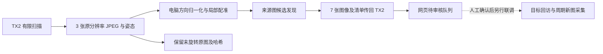

# 三视点实拍、局部建图与人工审核入口验证

日期：2026-10-20。状态：未发布开发版。对象：新场景审核流程；与 v0.5.0-demo 的人体替代仪表实验分别评价。

## 结果与范围

已完成一次“TX2 控制三视点采集 → 电脑局部配准 → 电脑候选发现 → 导入 TX2 审核网页”的真实链路。相机完成回程及最终 STOP，来源图、姿态、时间、哈希及候选均有保存。

这次验证只覆盖起点附近水平 10° 的三个视点。不能据此认定全景完整覆盖、所有仪表已发现、逐表光学放大已完成或周期巡检已验收。拼接及候选发现运行在电脑上，没有迁入 TX2 独立执行；网页当前保持仅审核模式。



## 采集条件

| 项目 | 本轮配置与结果 |
| --- | --- |
| 执行平台 | Jetson TX2，Python 3.5.2 |
| 相机 | Hikvision DS-2DC2402IW-DE3 S6 |
| 现场条件 | 用户明确确认相机固定、转动范围无遮挡、仪表静止 |
| 扫描方向 | 水平 197.9°、202.9°、207.9°；俯仰均为 5.5°，倍率均为 1.4 |
| 起点和回程 | 202.9° / 5.5° / 1.4；返回位置查询与最终 STOP 通过 |
| 原始图像 | 3 张 2560×1440 JPEG |
| 扫描段耗时 | 9.244 秒，包含采集、回程与最终停止，不包含后续处理 |
| 时间含义 | 主机接收图像时间，不宣称相机曝光时刻 |
| 图像方向 | 相机原图倒置；PC 旋转 180° 后配准和检测，未旋转原图另存 |

CLI 显式执行，持有共享运动锁；每点到位连续确认、停止和等待后抓取 JPEG，并核对采集前后位置。默认命令只读，原型尚未安装开机自动扫描服务。调用接口的 STOP 确认不等同于断网情况下机械停止测试。

## 局部配准

ORB 双向匹配与 RANSAC 单应矩阵通过内点分布、误差、面积和重叠检查，三个视图均纳入总览。输出为 **2860×1444** 的局部预览，保留每张来源图到总览的投影矩阵。

接受的配准边内点数为 2172、1980、1557；工作分辨率下的中位重投影残差约为 0.886、1.024、1.211 像素。这些是算法内部诊断，不是独立标注下的定位精度，更不是云台角度误差。

墙面、沙发、灯具等不同深度对象存在视差与接缝。当前平面单应近似只承担浏览导航，不能作为无缝全景、球面 360° 建图或 PTZ 标定。后续实际采集仍应以来源图和相机反馈为准。

## 候选发现

使用本地已有单类表盘权重，SHA-256 为：

```text
e6bf75f5aa415b86d62e06497b9adfabefd815a7699df3ff24a22de5fef688f8
```

本轮运行于电脑 PyTorch CPU / Ultralytics 8.4.0，输入尺寸 640，阈值 0.25。每张来源图执行一次整图检测和 12 次轮廓提议区域检测，共 **39 次前向**；本轮没有触发额外边缘扩展复查。框恢复为 2560×1440 来源图像素坐标后进行同视图 NMS。预览总图不作为被缩小到 640 的唯一检测输入。

| 视图 | 输出候选数 | 正面表盘观测 |
| --- | ---: | --- |
| 01 | 6 | C03，分数约 0.679 |
| 02 | 4 | C07，分数约 0.805 |
| 03 | 3 | C11，分数约 0.802 |
| 合计 | 13 | 3 条来自同一块表盘 |

上表候选编号为本地图页面顺序。逐图目视核对显示，其余 10 条涉及挂画、线缆和背景标识等误检；另一块倾斜表盘未检出。不能把 13 条观测写成 13 块仪表，也不能把单一场景结果作为模型的 mAP、准确率或普遍召回率。

正式审核前所有候选保持 `pending`。推荐人工选择质量更好的同一表盘观测作为主候选，合并另外两次重复，排除背景，并在来源图中补充漏检表盘。补框和确认仍不提供经过实测的回访角度。

## 审核服务与一致性

上传 3 张方向归一化来源图、3 张未旋转 JPEG 和 1 张局部总览，传输后逐一核对 SHA-256。导入新地图及 13 条候选，原有地图、候选、仪表和任务记录保留。

LAN 只读检查覆盖页面、JavaScript、CSS、状态接口、JSON 导出及 7 张图像的完整长度和哈希。新地图为 3 个视图，全部已配准；控制状态为 `review_only`、`control_enabled=false`，正式清单在导入验收时仍为空。

本轮恢复时发现 TX2 已重新开机，原网页进程没有运行。审核服务以已有数据库恢复，未改动相机；代码尚未安装开机自启。旧检测页面服务未随此次恢复自动启动。

浏览器测试和生产数据分开：独立测试数据库已验证候选确认、排除、补框、合并、重启持久化、总览到来源图跳转；本轮生产数据导入检查不替代用户的正式审核。

## 检查及限制

| 检查组 | 结果 |
| --- | --- |
| 控制台与扫描模拟 IO | PC / TX2 Python 3.5.2 各 36 项通过 |
| 项目标准库回归 | 272 项中 271 项通过，1 项 Windows 符号链接权限跳过 |
| 可选 PC 建图/发现 | 13 项通过 |
| Python 3.5 语法、原公开 NCNN 文件 | 检查通过，未变更公开模型 |
| 真实扫描 | 1 次有限三视点运行成功，无多轮可靠性结论 |

测试不证明主动对焦、真实读数或物理断网后的停止能力。源码和私有现场数据分别保管，公开工程不附住宅场景照片、设备凭据、私有训练模型或数据库。

## 下一阶段

1. 人工完成本轮仪表清单，保留主来源图、补框与重复观测关联。
2. 受控测量各倍率的图像位移与 PTZ 角度关系；实际回访采用粗定位、局部视觉居中、身份确认和停稳新帧采集，不能直接把全景坐标当作角度。
3. 验证两个固定仪表依次采集，记录偏差、失败原因、变焦后画面和最终 STOP。
4. 接入服务端固定延迟调度，实测多轮任务、取消、重启和平台移动导致地图失效的处理。
5. 在有限范围验证可靠后，再扩展扫描网格及覆盖缺口检查，评估把 PC 发现流程迁入 TX2 的耗时和依赖。
