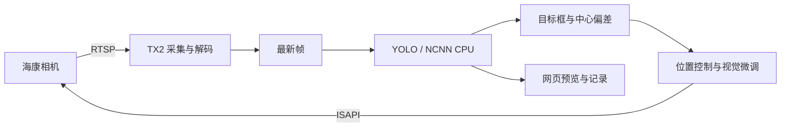

# Jetson TX2 实战：部署 YOLO 并联调海康云台相机

拿到一块已经能启动的 Jetson TX2，接上一台网络云台相机，怎样把“模型能识别”变成“相机会根据识别结果移动”？本文记录一条经过工程验证的路线：保留设备现有系统，在 TX2 上用 NCNN 运行已转换的 YOLO 模型，通过 RTSP 取流，再通过海康 ISAPI 控制云台，最后用固定人体目标验证居中、变焦和留图。

项目仓库：[moonnnei/jetson-ptz-inspection](https://github.com/moonnnei/jetson-ptz-inspection)。文章依据的代码版本是 [343d371](https://github.com/moonnnei/jetson-ptz-inspection/tree/343d371eca50fe66a3a4acc7dbb2c56744920582)。下文命令按这一版本组织；主分支之后的功能变化以对应文档为准。

本文的完成标准是复现部署与设备联调路径。固定人体是仪表采集的代理目标；真实仪表逐表回访、周期采集和读数仍在开发，不能把本文当作已经完成自动抄表的说明。

## 1. 为什么需要单独说明 TX2 的软件环境

Jetson TX2 是 NVIDIA 于 2017 年推出的 Jetson 平台。[NVIDIA 发布介绍](https://developer.nvidia.com/blog/introducing-the-nvidia-jetson-tx2-the-new-gold-standard-for-ai-at-the-edge/)说明了它的硬件代际；这与某块设备是否二手、是否完好无关。

更直接影响部署的是系统版本。本次设备运行 Ubuntu 16.04.7、L4T R28.3.1、CUDA 9.0 和 Python 3.5。NVIDIA 的 [R28.3.1 页面](https://developer.nvidia.com/embedded/linux-tegra-r2831)列出了这一发行分支的 Ubuntu 16.04、CUDA 9.0 和 OpenCV 3.3.1 组合。

因此，“在电脑上安装某个 Python 包成功”不能代替板端兼容性检查。本文选择先在现有环境中打通链路，而不是从系统升级开始。**采用 NCNN CPU 是本项目的实现选择，不表示 TX2 不能使用 GPU。** 本文也没有使用 TensorRT、CUDA 或 Vulkan 执行这个模型。

## 2. 先把链路拆开



三个环节分别验证：

1. **图像链**：相机视频能否持续到达 TX2，画面方向、尺寸和新鲜度是否正确。
2. **推理链**：模型文件能否加载，输入预处理、输出框和类别解释是否一致。
3. **控制链**：相机能否接收命令、回报位置，并确认停止。

浏览器预览还会增加传输和绘制时间。网页看起来卡，并不能直接判断是模型慢；视频解码使用硬件，也不代表模型正在 GPU 上推理。

## 3. 准备硬件与环境记录

| 项目 | 本次验证条件 |
| --- | --- |
| 计算设备 | Jetson TX2，带可工作的载板、电源和散热 |
| 系统 | Ubuntu 16.04.7 / L4T R28.3.1 |
| 板端主服务 | Python 3.5 标准库 |
| 图像辅助 | 设备已有 Python 2.7、OpenCV 3.3.1 和 NumPy |
| 编译环境 | GCC 5.4、CMake 3.5.1、OpenCV 开发库、OpenMP/pthread |
| 相机 | 海康 DS-2DC2402IW-DE3 S6，已激活、有可用账号 |
| 网络 | TX2、相机和开发电脑处于可互通的局域网 |
| 模型 | 已转换的 YOLO26n，COCO 通用类别，320×320、FP32 |

相机单独使用匹配的供电设备，网线负责接入网络；是否支持 PoE 应按设备铭牌和规格核对。

没有显示器也可以通过 SSH 操作：

```bash
ssh YOUR_TX2_USER@YOUR_TX2_IP
```

登录后先记录环境，以下命令不修改系统：

```bash
cat /etc/os-release
head -n 1 /etc/nv_tegra_release
uname -m
python3 --version
cmake --version
g++ --version
pkg-config --modversion opencv
/usr/local/cuda/bin/nvcc --version
```

其中 `uname -m` 应反映板端 ARM64 架构。`nvcc` 输出只说明 CUDA 工具链版本，不证明当前模型调用了 CUDA。

本项目复用了设备已经正常工作的依赖。复现者需要具备 `build-essential`、`cmake`、`pkg-config`、OpenCV 开发库，以及 L4T 对应的 GStreamer/NVIDIA 解码插件。本文不提供刷机、迁移软件源或系统依赖修复的一键脚本。

## 4. 固定代码版本，先运行离线检查

在电脑或 TX2 上获取源码：

```bash
git clone https://github.com/moonnnei/jetson-ptz-inspection.git
cd jetson-ptz-inspection
git checkout 343d371eca50fe66a3a4acc7dbb2c56744920582
```

这样会进入指定提交的分离 HEAD，适合复现实验；若要继续开发自己的修改，应另建分支。

普通电脑建议使用 Python 3.11/3.12；在 TX2 上使用其现有 `python3`：

```bash
python3 scripts/verify_models.py
python3 scripts/test_local.py
python3 scripts/check_release.py --verify-manifest
```

Windows 电脑可把命令中的 `python3` 改为本机对应的 `python`。这些检查不连接相机；它们检查语法兼容、模型哈希、采集/控制逻辑、审核逻辑和公开文件清单，不能代替实机测试。

如果 TX2 自身无法访问代码托管服务，可在电脑获取同一提交，再使用 `git archive` 导出已提交的文件并传到板上；不要把虚拟环境和私有运行目录一起复制。

## 5. 构建 NCNN 和板端推理程序

仓库已经包含配套的转换模型，因此运行时不需要在 TX2 安装现代 Ultralytics 或 PyTorch。

```bash
python3 scripts/fetch_ncnn.py
bash scripts/build_tx2.sh
```

下载脚本固定 NCNN 源码提交 `6c52e59dfb610cbd77946bea19099aaf96f8dcc1`。构建脚本关闭 Vulkan，并对旧版 CMake 不识别的一处条件表达式进行等价替换，随后以 `make -j2` 构建静态库与应用。

预期出现：

```text
build/infer
build/detector
third_party/ncnn-build/src/libncnn.a
```

`infer` 用于单图检查，`detector` 用于服务持续调用。编译产物必须在目标 ARM64 环境构建，不能把电脑上的 x86 可执行文件直接复制过来。

若同一个设备已有本项目使用的 NCNN 头文件和静态库，可复用包含 `ncnn-master`、`ncnn-build` 的根目录：

```bash
bash scripts/build_tx2.sh --ncnn-root /path/to/existing/ncnn-root
```

已有源码目录时下载器会拒绝覆盖。不要因看到“目录已存在”就反复下载或删除依赖，先核对来源版本与已有库。

### 单独验证一张图片

准备一张自己有权使用、包含 COCO 常见类别的图片，保存为 `var/input/test.jpg`。不要用通用模型的检测结果来验收仪表识别。

```bash
mkdir -p var/input var/output
./build/infer \
  models/yolo26n/model.ncnn.param \
  models/yolo26n/model.ncnn.bin \
  models/yolo26n/classes.txt \
  var/input/test.jpg var/output/infer 3 2
```

最后的 `3 2` 表示测量循环数和线程数。输出是 `var/output/infer.json` 与 `var/output/infer.jpg`，JSON 包含检测框、输入图尺寸及各阶段时间。

模型契约是 RGB、除以 255、等比缩放并补边到 320×320；输出框需逆变换回原图。转换模型把特定末端处理移到了主机，不能随意换一份参数文件后继续使用原解释方式。完整契约见[模型卡](https://github.com/moonnnei/jetson-ptz-inspection/blob/343d371eca50fe66a3a4acc7dbb2c56744920582/models/yolo26n/MODEL_CARD.md)。

`mean_inference_ms` 是程序测量的网络推理时间，不是“相机曝光到网页显示”的端到端延迟。

## 6. 独立验证海康 ISAPI

下文的 `192.0.2.20` 是文档示例地址，`YOUR_CAMERA_USER` 是占位用户名，必须替换成实际设备信息。密码由程序在终端交互读取，不写进配置、URL 或命令行。

先进行只读能力探测：

```bash
python3 tools/ptz/probe_camera.py \
  --url http://192.0.2.20 --user YOUR_CAMERA_USER
```

程序查询设备信息、云台通道、能力和位置，不发送运动命令。输出保存在本地 `camera-probe/`，设备标识会按程序规则脱敏。相机接口与权限以实际固件返回为准，不能只凭相近型号名称判断兼容。

海康官方[云台接口文档](https://open.hikvision.com/hardware/v2/08%E5%8D%8F%E8%AE%AE%E9%80%8F%E4%BC%A0/%E4%BA%91%E5%8F%B0%E5%92%8C%E8%B7%9F%E9%9A%8F%E5%AE%9A%E4%BD%8D.html)提供能力查询与定位接口。项目会进一步核对本机范围和单位，能力不匹配时拒绝直接套用。

### 再进行短时运动测试

只有在相机固定、线缆有余量、转动范围无遮挡且能观察设备时，再启动交互控制台：

```bash
python3 tools/ptz/ptz_control.py \
  --url http://192.0.2.20 --user YOUR_CAMERA_USER
```

先输入：

```text
status
stop
```

确认状态可读且停止命令成功后，再单独测试短动作：

```text
pan 5 100
stop
status
quit
```

这会发送实际运动命令。`5` 是接口原始速度值，`100` 是名义持续毫秒数；不能把它解释成“转动 5°”。这个验证客户端将速度限制在 −20～20、时长限制在 50～500 ms，并在动作后与退出时请求 STOP。

观察动作前后位置变化及设备停止，再测试其他轴。401/403 应核实凭据与权限，避免反复自动尝试。接口成功响应和电机物理停稳是不同证据，都应检查。

## 7. 配置并验证 RTSP 连续视频

本文使用 H.264 RTSP 与原 L4T 的 `omxh264dec`、`nvvidconv`。先检查插件和 Python 绑定：

```bash
gst-inspect-1.0 rtspsrc
gst-inspect-1.0 omxh264dec
gst-inspect-1.0 nvvidconv
python3 -c 'import gi; gi.require_version("Gst", "1.0"); from gi.repository import Gst; print("GStreamer Python: OK")'
```

插件不存在时先核对 L4T 和多媒体依赖，不能仅把代码中的插件名称改成另一代 Jetson 使用的名称。相机输出为 H.265 时，也不能直接沿用这一 H.264 路径。

从已有配置复制，保留其余字段：

```bash
cp config/inspection.example.json config/inspection.local.json
```

修改以下字段。这里只展示需要核对的片段，不能用它覆盖整个配置文件：

```json
{
  "camera": "http://192.0.2.20",
  "user": "YOUR_CAMERA_USER",
  "port": 8772,
  "rotation": 0,
  "rtsp_url": "rtsp://192.0.2.20:554/Streaming/channels/101",
  "frame_source": "rtsp",
  "rtsp_decoder": "hardware",
  "frame_policy": "latest"
}
```

相机实际 RTSP 端口必须查询。本次实验设备曾使用 1554，文档片段中的 554 也只是示例，不能省略核对。画面正向时使用 0；原安装需要 180° 旋转时才设置 180。模型路径、二进制路径、CPU 编号、图像尺寸和帧率也需符合自己的设备。

选择 `latest` 的原因是云台控制需要当前误差。若检测始终处理积压旧帧，相机可能已经移动到位，控制器却根据过去的位置继续修正。项目使用持续采集、有限缓存和最新帧策略；这不会消除相机编码、网络和解码自身的延迟。

## 8. 启动服务，先观察再运动

```bash
bash scripts/run_inspection_demo.sh --config config/inspection.local.json
```

交互输入密码后，在同一局域网的电脑浏览器访问 `http://TX2的IP:8772/`。这一服务启动时处于观察状态并请求零速度 STOP；在页面主动开始巡检后才执行运动。

先检查：画面方向正确，帧序号继续更新，人进入画面后检测框位置合理，没有反复重连或鉴权错误。相机与目标保持固定位置，同一相机只运行一个运动控制服务。

初次联调可以选择“仅当前视野”，在确认这一过程后再验证“扫描并巡检”。人体应站定且完整入画，作为位置固定的目标；走动测试属于另一项人员跟随实验。

服务配置默认可能监听局域网。当前控制令牌防止跨站请求，不等于用户登录认证；此实验服务不应直接转发到公网。

## 9. 从检测框到云台动作

已验证的控制思路是：

```text
发现并确认目标 → 规划顺序 → 绝对位置粗定位
→ 局部视觉微调 → 变焦 → 再次居中 → 新帧稳定 → 留图
```

粗定位负责较大的转动；微调根据画面中心误差工作。令目标中心为 `(cx,cy)`，图像宽高为 `(W,H)`，归一化误差为：

```text
e = [(cx - W/2) / W, (cy - H/2) / H]
```

局部图像雅可比 `J(z)` 描述当前倍率下，云台小角度变化造成的归一化图像位移。控制使用：

```text
Δq = -0.65 × J(z)^(-1) × e
```

这是离散 P 视觉微调，**不是 PID**。项目限制单次轴增量并设置中心允许区域，避免每帧都做很小的往返修正。不同倍率分别标定，安装、图像方向或视频源变化后不能直接复用旧矩阵。

相机应读回位置并检查稳定，再观察新图；发送命令成功不等于已经到位。主机收到帧的时间也不等于相机曝光时间，系统仍需实机核对图像延迟。

本篇对应的运动 Demo 只在启动方向附近进行有界扫描，不能用它执行完整环视。真实仪表的来源角度、搜索位置和最终居中采集位置也不能混用，详见[系统架构](https://github.com/moonnnei/jetson-ptz-inspection/blob/main/docs/ARCHITECTURE.md)。

## 10. 检查留下的证据

运动 Demo 的记录目录是：

```text
var/inspection-demo/captures/<run_id>/
```

查看本轮 `run.json`、保存图和目标裁图，核对目标编号、时间、姿态、倍率、图像序号、成功/失败状态及错误原因。网页也提供 JSON/CSV 导出。

当前人体 Demo 保存的是 960×540 检测预览及其裁图。它们与同帧检测结果绑定，不能声称是独立拍摄的原分辨率仪表近景；新的有限扫描模块另有高清原图路径。`reading` 为 `null`，不生成仪表读数。

2026-10-15 的一次实机复验完成首次标定、扫描、居中、1.5 倍放大和留图，整轮 47.724 秒，不包含服务与模型加载。它是单次人体代理结果，不是重复成功率，也不能作为真实仪表多目标验收。报告见[实机复验记录](https://github.com/moonnnei/jetson-ptz-inspection/blob/main/docs/INSPECTION_DEMO_VALIDATION_2026-10-15.md)。

停止时使用页面停止按钮并观察确认，再在服务终端按 Ctrl+C。若已通过后台方式启动，应依据 PID 文件核对实际进程身份后停止，不按进程名批量结束 Python 服务。

## 11. 常见故障按链路排查

| 现象 | 优先检查 |
| --- | --- |
| `import cv2` 失败 | 本设备 Python 2/3 的 OpenCV 分别安装情况；Python3 主服务不要求直接导入 cv2 |
| 包管理脚本出现 Python 语法错误 | 是否曾改动 `/usr/bin/python`；不要通过再次改链接试错 |
| 编译找不到 OpenCV 或 NCNN | 开发头文件、静态库、CMake 查找路径与 ARM64 架构 |
| 模型加载或框位置异常 | param/bin 配套、哈希、输入缩放补边和输出布局 |
| 401/403 | 相机账号、口令、ISAPI 权限；停止重复鉴权尝试 |
| 有视频但不能移动 | 单独查询云台能力/状态，检查通道、限位与控制返回 |
| 有抓图但 RTSP 无画面 | 实际 RTSP 端口、H.264 编码、通道路径、解码插件与网络 |
| 跟随明显滞后 | 分别测采集缓存、推理、控制等待与浏览器显示；先避免处理旧帧 |
| 变焦后偏离或抖动 | 当前倍率的局部标定、方向约定、过大的控制步长与到位判断 |
| 标定失败 | 固定背景纹理、实际转动、位置反馈和质量门限；不要直接关闭门限 |

诊断时先把单个环节复现清楚，再恢复整条链路。不要把未知错误自动处理成恢复出厂、升级整套系统或替换模型。

## 12. 扩展到真实仪表

本项目的后续流程是“扫描建图 → 候选发现 → 网页人工复审 → 正式清单 → 逐表回访采图”。PC 场景工具和审核控制台已经开源，但真实仪表的物理回访、图像质量验收和周期执行仍需联调。

可以先在普通电脑体验审核服务，无需相机：

```bash
python3 src/inspection_console/server.py --port 8775
```

浏览器访问 `http://127.0.0.1:8775/`，按[审核说明](https://github.com/moonnnei/jetson-ptz-inspection/blob/main/docs/REVIEW_CONSOLE.md)导入自己的图像和候选。该入口使用 `NoHardware`，不会因为确认一个框就自动转动相机。

复现部署、验证运动控制和完成实际仪表应用是相衔接的工程阶段。后续应记录真实仪表发现率、回访成功率、中心误差、有效图像比例及单轮耗时，再接入读数算法。

项目代码采用 AGPL-3.0，第三方来源见仓库说明；现场照片、设备凭据、数据库、训练集和私有表盘权重不随本文发布。欢迎基于明确代码版本反馈问题，并注明设备、系统、相机固件和复现步骤。
