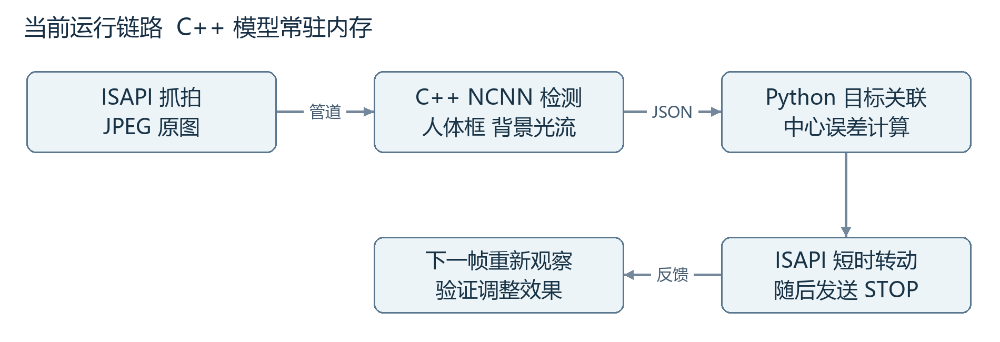
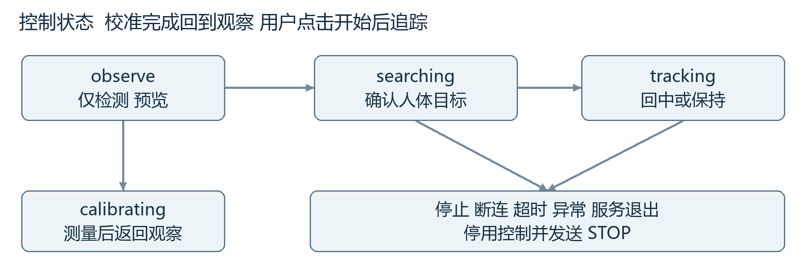
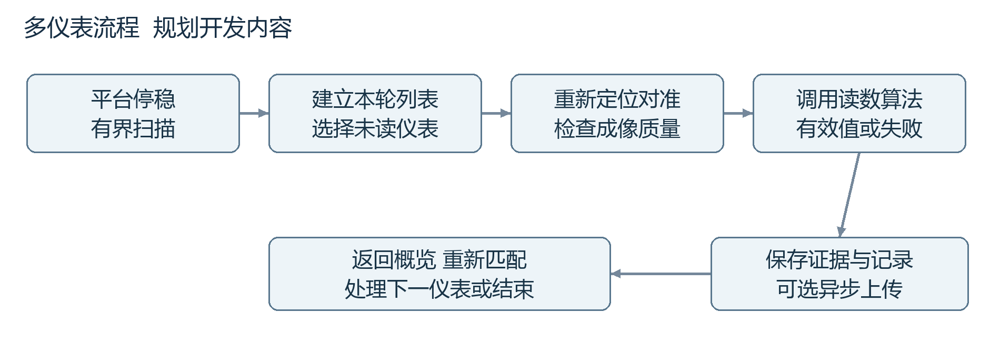

# 基于 Jetson TX2 与海康云台的视觉巡检系统项目方案

版本 v0.1.1 工程复核版　更新日期 2026年9月26日

本项目面向实验室模拟的船港多仪表面板，目标是在平台停稳后自动发现仪表、逐个对准、调用读数算法，并保存或上传结果。系统集成负责人承担采集、部署、控制、调度与数据链路；算法同学提供仪表检测和读数模型。

目前已完成通用目标检测模型在 TX2 上的部署、海康云台网络控制，以及人体检测驱动云台回中的原型验证。本次交付将这些成果整理为可复用工程，并给出从单目标闭环扩展到多仪表巡检的实施方案。仪表识别与读数、自动扫描、任务数据库和服务器上传仍属于后续开发范围。

## 1 项目目标与当前成果

最终演示应体现一条完整链路：移动平台到达位置并暂停，云台扫描规定区域，发现面板与仪表，建立本轮目标列表，逐表对准并读取，输出带时间、仪表标识和证据图的记录。相机与仪表之间的位置或距离改变后，应重新扫描和关联，不能复用旧画面中的像素坐标。

人物跟随是验证视觉控制链路的实验载体。它已经证明检测框能够转化为云台动作，再通过后续图像检查调整效果；它不能替代仪表读数精度、多仪表身份关联和整轮任务验收。

| 能力 | 截至本次整理的状态 | 证据及边界 |
| --- | --- | --- |
| TX2 基础环境与远程访问 | 已验证 | SSH、旧系统依赖修复、图像基础环境 |
| YOLO26n 单图部署 | 已验证 | NCNN CPU FP32 320×320，两张样图数值核对 |
| 海康网络控制与抓拍 | 已验证 | 认证、位置、水平与俯仰、变焦、停止、JPEG |
| 检测驱动云台回中 | 原型已验证 | 小步闭环、中心死区、页面心跳超时停用 |
| 高速或多人持续跟随 | 待专项测试 | 当前没有重识别、运动预测和完整评测 |
| 仪表扫描与逐表读取 | 待开发 | 等待专用模型、面板样本和任务模块 |
| 读数存储与上传 | 已设计待实现 | 规划 SQLite、证据图和幂等上传 |

主线技术路线为“海康网络相机 + TX2 Python 调度 + 常驻 C++ NCNN 推理 + 网页操作”。先保留已运行的旧系统基线，优先完成仪表模型兼容试验；系统刷机和 TensorRT 优化另设里程碑，不与当前工程整理混在一起。

## 2 使用场景与责任边界

首版实验环境为一块集中放置多个仪表的面板。建议从 4 个同类仪表开始，验证后扩展到 6 个；这是实施规模建议，并非已完成数量。平台在扫描、对准和读数期间保持暂停，人工在平台再次移动时中止任务，停稳后重新开始。

相机云台改变的是视线方向，无法改变相机相对于面板的观察位置。严重斜视、反光、遮挡和像素不足，需要调整实验布置或增加算法能力，不能仅靠“把目标放在画面中心”解决。光学变焦上限、最近合焦距离和最小可读表盘像素，应以本机实拍和读数模型要求确定。

| 角色 | 负责工作 | 必须提供的交付物 |
| --- | --- | --- |
| 系统集成负责人 | 设备接入、部署、控制、调度、界面、存储、验证 | 代码、配置、部署说明、测试报告 |
| 算法同学 | 仪表检测和读数模型、参考推理、精度分析 | 权重、导出脚本、输入输出规范、真值样本 |
| 双方共同联调 | 算子适配、预处理对齐、误差定位 | 转换前后对照结果与版本记录 |
| 指导老师 | 最终范围、验收条件和论文评价 | 对场景、指标和阶段成果的确认 |

功能范围依次为设备可控、模型可运行、单目标可对准、多目标可调度、读数可追溯。室内实物演示是首轮交付目标；海上防腐、防振、船舶通信及连续航行补偿需要独立设计和验证。

系统应保留失败原因。读不到的仪表可以记录“不可读”并继续下一项，不应把空值填成零，也不能把模拟输出标成真实识别结果。

## 3 硬件连接与网络拓扑


TX2 和相机通过同一局域网通信，电脑用于 SSH 调试和浏览器查看。海康相机使用自身网络接口，不接 TX2 的 CSI 排线接口；电机控制由相机内部执行，TX2 发送网络命令，不需要再设计电机驱动板。早期板载 CSI 相机实验作为历史基础保留。

| 项目 | 本次实机基线 | 使用说明 |
| --- | --- | --- |
| 边缘设备 | Jetson TX2，Ubuntu 16.04.7，L4T R28.3.1 | 保留既有环境 |
| 云台相机 | DS-2DC2402IW-DE3 S6 | 接口型号不带 S6 后缀 |
| 相机固件 | V5.6.11 build 210526 | 接口能力以此设备实测为准 |
| 相机地址与端口 | 192.168.1.64，HTTP 80，RTSP 1554 | IP 可能随网络配置改变 |
| TX2 与项目网页 | 192.168.1.4，网页端口 8767 | 浏览器只显示和操作 |
| 实际抓拍图像 | 2560×1440 | 模型输入另缩放到 320×320 |

相机和 TX2 分别使用匹配电源，普通路由器 LAN 口不默认提供 PoE。当前已使用配套供电，不因工程整理额外采购设备。后续经确认的新增开销主要是模拟仪表、面板、支架和补光；采购预算应依据实际缺项报价。

IP 与模型路径放入配置或启动参数，口令通过本地终端隐式输入。工程包不保存相机密码。当前网页用于可信实验室局域网，尚无用户登录和 HTTPS。

## 4 软件结构与进程分工



Python 3.5 服务负责 HTTP Digest 认证、抓拍、目标关联、状态管理、云台命令和网页接口。C++ 子进程负责 JPEG 解码、旋转、模型预处理、NCNN 推理、光流估计和预览编码。选择这一分工，是为了保留旧系统可用的 Python 标准库，同时在 C++ 中复用 OpenCV 和 NCNN，避免给板端安装现代 PyTorch 的整套依赖。

模型在 C++ 进程启动时加载一次，后续逐帧复用。Python 通过标准输入输出传递长度前缀的二进制数据：输入为 JPEG，输出先是 JSON 检测结果，再是预览 JPEG。长度字段用于明确消息边界，不能把一段可能被拆分的管道读取当作完整帧。

v0.1.1 对输入写入和协议块读取设置三秒期限。推理通信出错时，在释放采集共用锁前关闭子进程，避免校准和主循环消费旧输出；这类故障需要重启服务。

| 模块 | 输入 | 输出与责任 |
| --- | --- | --- |
| 相机适配层 | URL、账号、交互口令 | 抓拍、状态、短时运动和停止 |
| 常驻检测器 | 原始 JPEG | 归一化人体框、分数、背景位移、预览 |
| 目标选择器 | 本帧候选与上一目标 | 已确认目标或空值 |
| 视觉控制器 | 当前框与校准矩阵 | 一次水平或俯仰短脉冲 |
| 服务与看门狗 | 页面操作、帧时间、控制状态 | 互斥控制、失效停止、JSON 状态 |
| 浏览器 | 预览及状态 JSON | 显示、校准、启停和心跳 |

采集和校准共用操作锁，避免同时向检测进程写入不同帧；云台命令使用单独的锁串行发送。控制代次在停止时递增，使已经排队的旧动作失效。多个线程承担采集、网页请求和超时检测，但并不意味着同时控制多台相机。

## 5 模型部署路线与兼容性

本次主线模型为 Ultralytics YOLO26n COCO 80 类预训练检测模型。它识别通用物体，不具备仪表读数能力。TX2 当前环境较旧，因此将现代模型导出和验证放在电脑，板端只加载转换后的 NCNN 结构与权重。[1][2]

| 环节 | 本次采用的版本或参数 |
| --- | --- |
| 电脑转换 | Python 3.12，Ultralytics 8.4.0，PyTorch 2.7.1+cpu |
| 转换工具 | PNNX 20260526，NCNN 1.0.20260526 |
| TX2 构建 | GCC 5.4，CMake 3.5.1，OpenCV 3.3.1 |
| NCNN 源码 | 提交 6c52e59dfb610cbd77946bea19099aaf96f8dcc1 |
| 模型运行 | CPU 四线程，FP32，batch 1，输入 320×320 |
| 权重文件 | model.ncnn.bin 约 9.66 MB，另有 param 结构文件 |

NCNN 是执行网络计算的运行时，CUDA 是 NVIDIA GPU 编程与计算平台，TensorRT 是另一套推理优化与执行工具。三者不能混为一谈。板上存在 CUDA 9 和 TensorRT 4.1，不代表当前 YOLO26n 使用了 GPU；本次该模型明确采用 NCNN CPU，未启用 CUDA、Vulkan、FP16 或 INT8。

历史 MNIST TensorRT 示例与 YOLOv3-tiny Darknet GPU 实验说明这块板的其他推理链曾运行，但它们与本工程主线分别统计。也不能拿其他 Jetson 平台的 TensorRT engine 直接当作这块 TX2 的可移植模型文件。

若后续考虑升级到 TX2 支持的 JetPack 4 系列，应先备份，再评估算法交付物的算子与运行时兼容性。NVIDIA 的版本归档用于确认具体板卡与版本组合，不能直接为 TX2 安装面向新硬件的最新 JetPack。[3]

## 6 导出适配与图像处理

默认导出的末端 TopK 和 Gather 未被本次 PNNX 转换链完整支持。工程在导出时保留 one-to-one 检测分支与权重，将末端排序交给主机端处理，得到形状为 [1,2100,84] 的网络输出。每行前四项是已经解码的 xyxy 坐标，后 80 项是类别分数，不能按另一类 YOLO 的“中心点、宽高、目标置信度”格式再次解码。

单图通用检测程序对全部类别分数取全局最高的 300 项，再按 0.25 过滤，不加传统 NMS。人物追踪程序直接读取 person 类别分数，先以 0.5 生成候选，再由目标选择器使用更严格的锁定阈值；这两个演示的后处理用途不同。模型是 end-to-end 检测分支，不能随意增加一套旧模型 NMS 后处理。[1]

预处理按顺序执行：解码 BGR 图像、根据安装方向旋转、保持比例缩放、用像素值 114 补成 320×320、BGR 转 RGB、每个通道除以 255。归一化参数、补边方式或旋转位置改变，都可能改变检测结果。

```python
r = min(320 / width, 320 / height)
resized_width = round(width * r)
resized_height = round(height * r)
x_original = (x_model - padding_left) / r
y_original = (y_model - padding_top) / r
x_normalized = x_original / width
y_normalized = y_original / height
```

这些是流程说明，工程实现还包含边界裁剪和非法框检查。坐标还原到旋转后的原始图像；网页预览缩小到不超过 960 像素宽，人体框使用同一份归一化坐标绘制，避免把预览尺寸当成原始控制坐标。

部署验证要比较相同输入像素。此前 dog 样本在不同平台 JPEG 解码后产生像素差，导致约 0.871 像素框差异；使用 TX2 实际预处理像素重新比对后，最大框差缩小到约 0.000343 像素。验证模型转换时，应先排除输入不一致，再判断是不是模型计算错误。

## 7 海康相机接口与命令

ISAPI 是海康设备提供的 HTTP 接口族；RTSP 是视频会话与流接入协议。本工程目前通过 ISAPI 连续获取 JPEG，不等同于 RTSP 实时解码已经完成。RTSP 端口已读到 1554，未来接流时应使用本机配置，不照抄默认 554。[4]

| 已使用的设备路径 | 方法 | 用途 |
| --- | --- | --- |
| /ISAPI/Streaming/channels/101/picture | GET | 抓取主通道 JPEG |
| /ISAPI/PTZCtrl/channels/1/status | GET | 查询云台状态 |
| /ISAPI/PTZCtrl/channels/1/momentary | PUT | 发送限定持续时间的动作 |
| /ISAPI/PTZCtrl/channels/1/continuous | PUT | 所有速度置零以停止 |

认证采用 Python 标准库 HTTPDigestAuthHandler。设备挑战后，客户端根据用户名、口令和挑战计算认证响应；Digest 不等于传输加密，当前 HTTP 画面和控制仍应留在可信网络。脚本关闭系统代理并拒绝重定向，避免设备请求误入电脑的代理链或其他地址。

```xml
<PTZData version="2.0"
 xmlns="http://www.hikvision.com/ver20/XMLSchema">
  <pan>20</pan><tilt>0</tilt><zoom>0</zoom>
  <Momentary><duration>500</duration></Momentary>
</PTZData>
```

接口速度 20 是设备定义的控制值，不是 20 度每秒。正负号遵循设备坐标，不直接表示显示画面的左右上下。HTTP 成功或 XML statusCode=1 说明设备接受了请求，还需结合位置变化与图像变化判断实际动作。

当前每次动作最多 500 ms，随后再次发送 STOP。单次反向同值脉冲不能精确回到原位，因此工程反复从图像测量误差。状态中的 azimuth、elevation、absoluteZoom 作为原始接口值记录，不在没有依据时换算成实际角度或倍率。

## 8 人体目标选择与闭环控制

首个目标从画面中靠近中心的合格人体候选中选择，需要连续两帧分数至少为 0.75。框面积还需位于画面面积的 0.002～0.9 之间。锁定后分数门槛降至 0.55，用来容忍转身、遮挡和姿态变化造成的分数波动。

相邻帧目标关联依据中心距离、面积比例和交并比 IoU。中心距离超过归一化 0.25、面积比例不在 0.3～3 内的候选不参与匹配；在剩余候选中结合 IoU 与距离选择。两秒内找不到匹配时保持停止，超时后才允许重新选人。这是位置关联，没有人脸身份判断、ReID 特征或卡尔曼运动预测。

中心误差定义如下，横纵坐标都除以完整画面尺寸。这里的 0.08 表示画面宽度的 8%，不要与除以半宽的另一种归一化公式混用。

```python
error_x = (x1_normalized + x2_normalized) / 2 - 0.5
error_y = (y1_normalized + y2_normalized) / 2 - 0.5
inside = abs(error_x) <= 0.08 and abs(error_y) <= 0.10
```

误差进入死区后不再发运动指令，减少检测框抖动引起的反复调整。死区之外，程序使用校准矩阵的逆求出抵消误差所需的水平和俯仰方向，选择所需步数绝对值较大的轴，每次只动一轴，速度固定为 ±20，持续 500 ms。

这是一种带方向校准的离散小步视觉反馈控制，没有实现连续 PID、自适应速度或完整比例速度控制。矩阵估计影响方向和优先轴，不承诺每个脉冲都产生完全相同的角位移。下一帧重新检测，是补偿机械差异和估计误差的关键。

检测置信度高不代表一定是人；初版实测出现过杂物误检。提高初次确认门槛能减少部分误动作，但专用场景数据、目标选择交互和更完整评测仍然必要。

## 9 安装方向与运动校准

本机当前安装需要将原始画面旋转 180°。如果把设备坐标方向硬编码为画面左右，很容易出现越追越偏。工程先测量“发一小步命令后，背景在画面中朝哪边移动”，再根据测量结果控制。

在每轴的正方向动作前后，检测器把画面缩为 640×360 灰度图，提取最多 300 个角点，用金字塔 Lucas Kanade 光流匹配角点位置。过滤匹配失败或误差较大的点后，对横向和纵向位移分别取中位数；至少需要 20 个有效点，并用偏差在 2.5 像素内的比例判断背景运动是否一致。

运动后连续取三帧，累计位移以降低编码更新延迟的影响。如果第一小步位移太小，每轴最多补到三次有时限动作；测得位移按动作次数平均。随后发对应数量的反向动作恢复近似视野。反向恢复并非精确定位，整个过程仍需固定场景且人物尽量站定。

校准结果是一个 2×2 矩阵：第一列记录正向水平动作引起的横纵图像位移，第二列记录正向俯仰动作引起的横纵位移。程序检查数值有限、两列位移足够大、行列式不接近零，以及位移不过大；失败则不允许启动追踪。

```text
2026年9月24日最终一次校准
              正向水平一步    正向俯仰一步
横向归一化位移    0.013713        0.000075
纵向归一化位移    0.000109       -0.008664
```

该结果只适用于当次视野、镜头倍率和安装状态。校准只保存在内存中，服务重启后重新做；底座移动、图像旋转或变焦后也应重新做。背景光流只用于方向校准，当前没有用它替代 YOLO 进行连续人体跟踪。

## 10 状态管理与停止机制



当前服务状态包括 observe、calibrating、searching 和 tracking。启动默认只检测；校准完成后也不自动跟随。用户开始后进入目标确认过程，目标存在则按偏差调整，无目标则停止并等待。

| 条件或参数 | 当前值与行为 |
| --- | --- |
| 页面心跳 | 可见页面约每 0.8 秒发送一次 |
| 控制租期 | 3 秒无心跳则停用控制并请求 STOP |
| 看门狗 | 约每 0.1 秒检查超时 |
| 单次采集推理过慢 | 超过 1.5 秒拒绝该帧控制 |
| 最近完成帧过旧 | 跟随期间超过 2 秒则停用 |
| 单次 PTZ 动作 | 500 ms momentary，随后显式 STOP |
| 停止或退出 | 递增控制代次，旧动作失效，发送 STOP |

这些时间戳来自 TX2 收到和处理图像的过程，不是相机曝光时间。连续抓拍降低了应用层排队风险，但不能严格证明相机编码器返回的画面已经反映动作后的最新位置。完整 RTSP 接入阶段应测真实画面延迟、源时间戳和缓冲策略。

网络断开后 STOP 可能无法送达，因此设备端动作时限与控制端看门狗同时使用。现有心跳测试验证了 TX2 停用跟随，不能扩大解释成已经完成拔网线故障下的物理停止验收。

网页令牌用于阻止常见跨站请求，不是账号认证。当前心跳属于整个服务，多个可见页面可能彼此维持租期；演示限定一个控制页面。未来加入多人操作时，要设计唯一控制权、会话租期和只读查看权限。

## 11 实测结果与工程复现

单图部署实验每图预热一次，计时五次，四个 CPU 线程，未锁定 CPU 频率。bus 和 dog 的结果用来核对转换链路，不构成模型在整个数据集上的精度评估。

| 测试 | 实测结果 | 解释范围 |
| --- | --- | --- |
| bus 单图推理 | 平均 84.7332 ms | 不含网络采集和网页显示 |
| dog 单图推理 | 平均 79.0881 ms | 同一车辆有 car 和 truck 候选 |
| 跨平台框误差 | bus 约 0.000481 像素；dog 同输入约 0.000343 像素 | 两图转换一致性检查 |
| 相机采集加处理 | 常见约 0.4～0.6 秒 | 包含预处理等，云台转动另耗时 |
| 十秒回中实验 | 水平偏差约 30.9% 降至 18.2% | 短时原型测试 |
| 最终中心死区实验 | 16 个不同帧中 12 帧位于中心区域 | 死区内停止补偿，出界再调整 |
| 心跳中断测试 | 等待 4.5 秒后 enabled=false | 最终版本已验证 |
| 自动化测试 | 本机和原板端 13 项通过 | 关联、方向、代次和停止故障注入 |

复现顺序为：核对网络和供电，构建固定版本 NCNN 与 C++ 检测器，先运行离线单图，再探测相机与短时运动，最后运行网页追踪。构建日志、模型哈希、系统版本和参数一起记录，避免只保留“运行成功”的截图。

工程整理版修改了目录和启动入口，最初十七项本地测试通过。v0.1.1 修复 Python 3.5 JSON 兼容、推理管道阻塞与旧输出复用、STOP告警和并发控制问题，新增十六项故障测试，共三十三项通过。STOP未确认时禁用控制并保留告警，后续接口确认成功才解除。原始板端十三项测试仍属历史证据；整理版尚未在板上复测。追踪页面的 inference_ms 包含预处理，不应与单图纯推理统计混用。

可复现验收建议由另一位同学按 README 操作完成。当前还需补充长时间运行、不同安装姿态、低照度、多人遮挡、正常行走速度及跨浏览器测试。

## 12 从单目标回中扩展到仪表巡检



首先扫描有界视场。建议在允许转动范围内设置若干概览方向，用较宽视角获取面板图像；每次移动后重新检测，按照面板完整性与仪表分布判断扫描是否结束。扫描范围、次数和总耗时必须有限，未发现也应产生明确结果。预置位或绝对位置接口需要本机专项验证，不能因为能够查询位置就默认能够准确回到某个角度。

然后建立本轮目标列表。目标至少保存本轮编号、面板内位置、检测框、处理状态和证据关联。可以按行排序形成稳定访问顺序，但检测器返回顺序不能直接充当仪表身份。跨轮永久编号可用人工标识、固定面板布局配准或算法同学提供的身份能力；仅用画面“第一个框”容易串号。

逐表处理流程为：回到概览并重新匹配目标，闭环对准，按需要小步变焦并重新定位，等待稳定和合焦，检查表盘完整性和最小像素，调用读数，保存结果，再访问下一项。任何云台动作或变焦后，上一画面的目标像素位置都需要重新确认。

成像质量先于读数。读数模型应明确最小表盘像素、允许斜视和反光条件。如果相机已经达到有效成像能力上限，系统记录“像素不足”或“不合焦”，不使用数字放大伪装细节。是否需要变焦以及变焦量，由试拍与算法要求决定。

每表建议设置有限重试、阶段超时和失败原因；这些参数通过实测确定。平台再次移动时终止本轮，恢复后重新扫描。未来人物跟随模块和仪表任务模块共用采集、检测接口和 PTZ 适配器，任务逻辑分别管理，避免把人物重选规则直接套成仪表身份规则。

## 13 算法接口与结果数据

算法交付至少包含检测和读数两部分。集成负责人不承担训练任务，但需要明确模型输入输出、部署算子和失败语义。先获取少量真实样本与可运行模型，完成兼容试验，再扩展面板与功能。

| 接口 | 输入约定 | 输出约定 |
| --- | --- | --- |
| detect | 原始帧、frame_id、图像尺寸与方向 | xyxy、类别、分数、模型版本 |
| read_meter | 同帧仪表裁剪、meter_id、单位与量程等元数据 | value、unit、valid、reason、可选 confidence |
| move_pulse | 轴、设备速度、有限时长、控制代次 | 请求结果与可用设备状态 |
| save_observation | 任务、目标、帧、读数、原图或裁剪证据 | 唯一 record_id 与保存状态 |

```json
{
  "record_id": "example-task01-meter02-attempt01",
  "frame_id": 120,
  "meter_id": "panelA-meter02",
  "value": null,
  "unit": "MPa",
  "valid": false,
  "reason": "glare",
  "confidence": null,
  "model_version": "reader-version-to-be-provided",
  "simulation": true
}
```

上述 JSON 是未来接口示例，不是实测读数。模型没有输出置信度时保存 null，失败时 value 也为 null。整图、裁剪、检测框、读数必须关联同一个 frame_id，避免异步更新把上一帧的结果写到下一张照片上。

存储建议采用 SQLite 加证据目录：tasks 保存任务，targets 保存目标，observations 保存每次尝试，upload_jobs 保存上传队列。证据图先写临时文件并完成落盘，再改名并提交记录；数据库事务不能跨文件系统提供原子性，因此启动时还需检查缺失或孤立证据。

上传在服务器地址和认证方式确定后接入。使用 record_id 作为幂等键，本地保存成功后入队，网络失败退避重试，收到服务端确认后标记完成。上传失败不阻塞逐表流程，也不删除未确认的数据。

## 14 分期实施与验收方法

以下是后续工作安排建议，时间从拿到兼容的仪表模型和样本后计算。算法交付延迟或成像条件不满足时应调整计划。

| 阶段 | 主要工作 | 进入下一阶段的条件 |
| --- | --- | --- |
| 已有基础 | 部署、云台、人体回中原型 | 固定当前可运行基线 |
| 第 1 周 | 仪表检测和读数最小样本部署 | 同输入参考与 TX2 输出可对照 |
| 第 2 周 | 单表对准、成像与质量检查 | 多个起始位置可对准并判定可读性 |
| 第 3 周 | 有界扫描、概览、4 表顺序调度 | 不串号、失败可继续、无无限循环 |
| 第 4 周 | 真实读数、证据存储和界面 | 每表有有效值或明确失败记录 |
| 第 5 周 | 不同距离光照、故障与长时测试 | 输出统计结果及问题清单 |
| 第 6 周 | 可选上传、文档、演示与开源发布 | 另一人可按文档复现 |

初期实验可选择至少三个停稳位置、累计二十轮、每轮四个仪表。记录应读总数，不能把漏检目标从分母移除。分别报告检测漏检率、对准成功率、正确身份关联率、算法读数误差和系统有效读数率。

系统有效读数率定义为“在误差范围内且身份关联正确的仪表数 / 实际应读仪表总数”。指针表可按满量程误差评价，数字表还应检查小数点、符号和单位。具体阈值由模型能力、仪表类型和老师共同确定，不能把目标值写成已达到的结果。

速度统计应覆盖整轮，包括扫描、运动、等待、读数、重试和落盘；至少报告中位数与较慢分位数。建议增加一小时稳定运行、目标遮挡、相机断流、控制连接丢失、磁盘空间不足和上传失败等测试。

论文与答辩可围绕兼容部署、图像坐标到云台动作的闭环、逐表调度与可追溯结果展开。工程贡献来自系统集成和验证，不把使用预训练模型表述为自主训练或提出新的检测算法。

## 15 工程交付与维护规范

工程包应包含当前可运行源码、固定版本模型与构建信息、配置示例、测试入口、部署手册和实测记录。未来巡检模块以设计接口标注，不用空壳文件制造“已实现完整系统”的印象。原始实验目录保留，整理后的工程单独交付。

每次更换模型时同时记录权重来源、许可证、哈希、输入大小、输出布局、预处理、后处理和基准样本。NCNN param 与 bin 是配套文件；改网络结构却继续使用旧权重会造成加载失败或错误结果。

项目运行口令交互输入，不写入 README、配置、日志或压缩包。现场照片、设备序列号、私钥、虚拟环境、运行日志和重复下载件不进入面向分享的工程包。测试用模型和第三方源码保留来源、版本和许可说明。

Ultralytics、NCNN、OpenCV 及其他依赖有各自许可条款。准备公开仓库时需依据实际分发内容履行对应要求，并确认本项目原创代码的授权方式；本次工程整理没有创建公开仓库，也不擅自为尚未确认归属的代码指定宽松许可证。[5]

服务级控制租期、无登录网页和旧系统依赖是当前原型的维护边界。计划部署到多用户或公网环境时，应重新设计认证、控制权和访问隔离。升级环境、模型或相机固件后重跑基线样本、方向校准和停止测试。

## 16 术语与参考资料

| 术语 | 在本项目中的含义 |
| --- | --- |
| 部署 | 把模型转换并接入目标设备，校验输出、性能和运行方式 |
| 推理 | 对当前图像计算检测或读数结果，不修改模型权重 |
| PTZ | 水平转动 Pan、俯仰 Tilt、变焦 Zoom |
| NCNN | 当前负责在 TX2 CPU 上执行网络的 C++ 推理运行时 |
| Letterbox | 等比例缩放后补边，保留目标几何比例 |
| IoU | 两个框的交集面积除以并集面积，用于位置关联 |
| 闭环 | 动作后重新观察误差，再决定下一步动作 |
| 看门狗 | 独立检查心跳和图像超时，异常时停用控制 |
| 幂等 | 同一 record_id 重试上传不会重复生成业务记录 |

本项目事实依据为 2026年9月23日云台控制记录、2026年9月24日 YOLO26n 部署记录及人物追踪验证记录；技术实现以本次整理的源码为准。历史文档中“尚未接云台”等描述对应当时阶段，不能覆盖本方案的新状态。

[1] [Ultralytics YOLO26 官方说明](https://docs.ultralytics.com/models/yolo26/)；[项目使用的 v8.4.0 源码](https://github.com/ultralytics/ultralytics/tree/v8.4.0)。

[2] [Tencent NCNN 固定版本源码](https://github.com/Tencent/ncnn/tree/6c52e59dfb610cbd77946bea19099aaf96f8dcc1)。完整提交号见工程的构建脚本。

[3] [NVIDIA JetPack 版本归档](https://developer.nvidia.com/embedded/jetpack-archive)。

[4] [海康开放平台：云台能力及跟随定位接口](https://open.hikvision.com/hardware/v2/08%E5%8D%8F%E8%AE%AE%E9%80%8F%E4%BC%A0/%E4%BA%91%E5%8F%B0%E5%92%8C%E8%B7%9F%E9%9A%8F%E5%AE%9A%E4%BD%8D.html)。

[5] [Ultralytics 许可说明](https://www.ultralytics.com/license)；[NCNN 许可文本](https://github.com/Tencent/ncnn/blob/6c52e59dfb610cbd77946bea19099aaf96f8dcc1/LICENSE.txt)。
