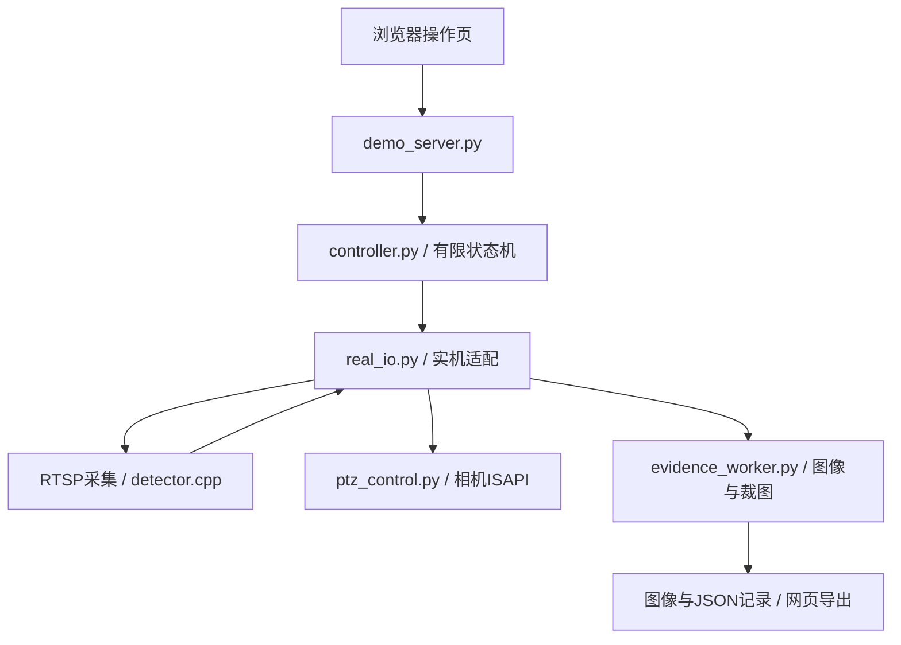

# 源码导航

[项目首页](../README.md) · [部署](../docs/DEPLOYMENT.md) · [巡检接口](../docs/INSPECTION_DEMO_INTERFACES.md)

当前主要入口是固定目标巡检，采用人体检测验证“发现—定位—居中—放大—留图”链路。人员连续跟随是单独的实验入口，两者共享采集和检测基础设施。

## 模块分工

| 目录 | 主要职责 | 入口与关键文件 |
| --- | --- | --- |
| `inspection_demo/` | 网页服务、任务状态机、设备适配与同帧留图 | [demo_server.py](inspection_demo/demo_server.py)、[controller.py](inspection_demo/controller.py)、[real_io.py](inspection_demo/real_io.py)、[evidence_worker.py](inspection_demo/evidence_worker.py) |
| `person_tracker/` | 共享RTSP采集、C++检测器、ISAPI控制，以及独立人员跟随服务 | [server.py](person_tracker/server.py)、[rtsp_capture.py](person_tracker/rtsp_capture.py)、[rtsp_worker.py](person_tracker/rtsp_worker.py)、[detector.cpp](person_tracker/detector.cpp)、[ptz_control.py](person_tracker/ptz_control.py) |
| `image_infer/` | 使用转换模型进行通用物体单图推理 | [infer.cpp](image_infer/infer.cpp) |

## 巡检调用关系



控制器通过注入的IO接口访问设备。实机使用`RealIO`，离线回归使用模拟IO；因此普通电脑可以检查任务逻辑，不需要安装相机SDK或连接设备。接口中的位置单位、局部标定矩阵和观测帧序号见[接口文档](../docs/INSPECTION_DEMO_INTERFACES.md)。

## 推荐阅读路径

1. 从[controller.py](inspection_demo/controller.py)理解扫描、规划、定位、居中、变焦、采集和停止的状态转换。
2. 从[real_io.py](inspection_demo/real_io.py)查看相机位置、局部标定、观测、保存与STOP如何映射到设备。
3. 从[detector.cpp](person_tracker/detector.cpp)和[模型契约](../models/yolo26n/MODEL_CARD.md)理解模型输出如何变成归一化检测框。
4. 从[demo_server.py](inspection_demo/demo_server.py)及[页面](inspection_demo/index.html)查看控制入口与结果展示。
5. 阅读[test_controller.py](inspection_demo/test_controller.py)和[test_real_io.py](inspection_demo/test_real_io.py)，核对失败、取消、旧帧和标定等行为。

## 构建与运行

命令均从仓库根目录执行，具体依赖先按[部署文档](../docs/DEPLOYMENT.md)准备：

```bash
# 普通电脑：不连接相机的检查
python scripts/test_local.py

# TX2：编译和运行固定目标巡检
python3 scripts/fetch_ncnn.py
bash scripts/build_tx2.sh
cp config/inspection.example.json config/inspection.local.json
# 先按本机情况编辑配置
bash scripts/run_inspection_demo.sh --config config/inspection.local.json
```

独立跟随入口是`scripts/run_tracker.sh`，配置示例为`config/tracker.follow.example.json`。同一相机只运行一个运动控制服务。程序启动与主动开始巡检是不同操作，详见[实机操作说明](../docs/INSPECTION_DEMO.md)。

板端主服务保持Python3.5兼容，C++程序由根目录[CMakeLists.txt](../CMakeLists.txt)构建；模型导出工具在仓库的`tools/model_export/`中，使用独立的电脑环境。当前推理后端是NCNN CPU，当前视觉控制是离散P控制，均不要按GPU推理或PID实现理解。
